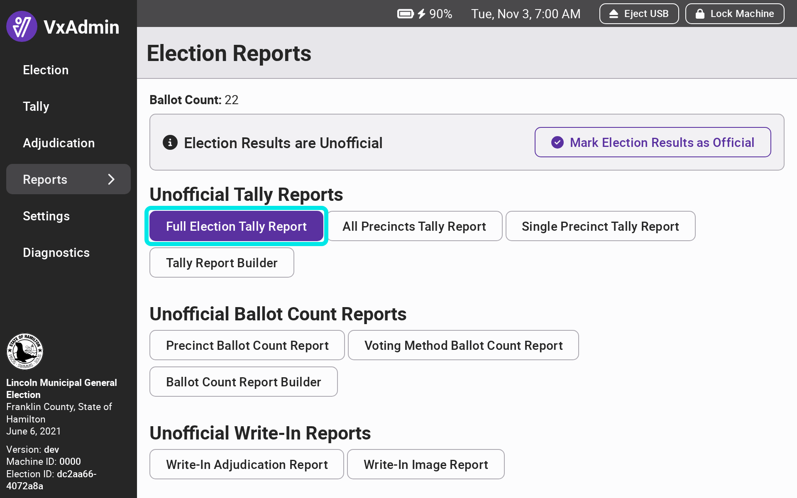
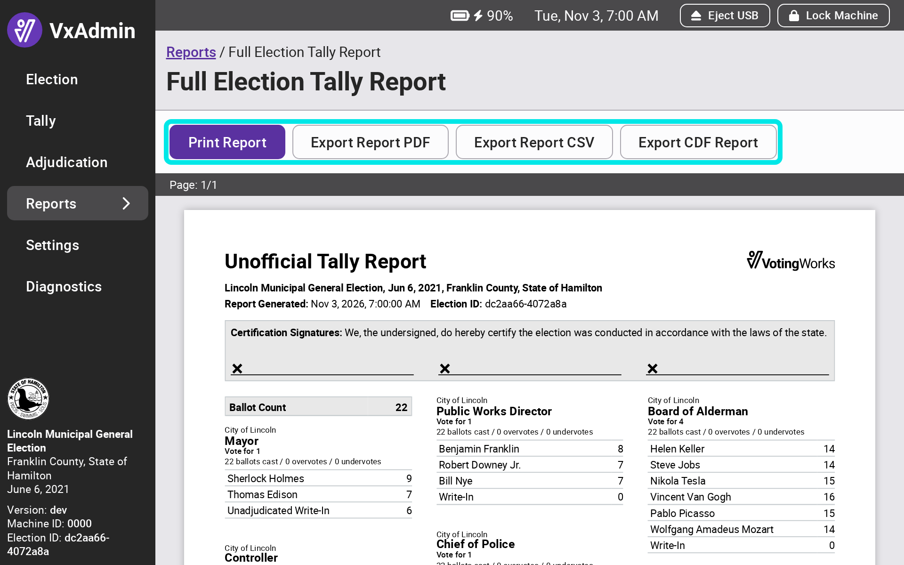
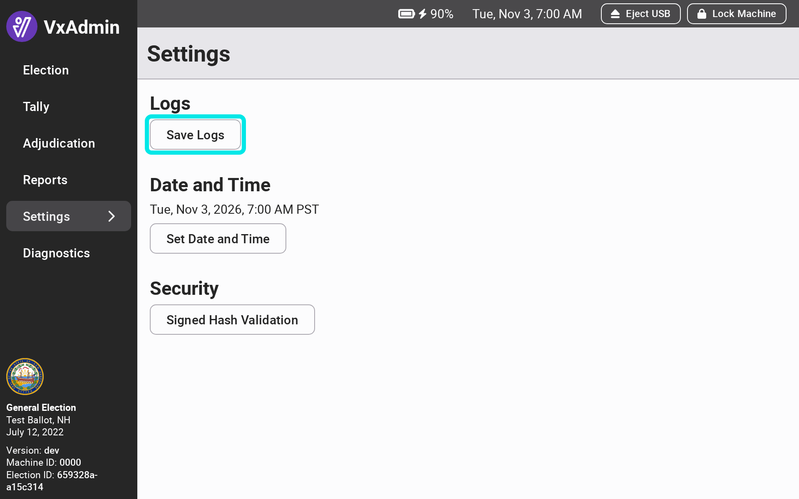
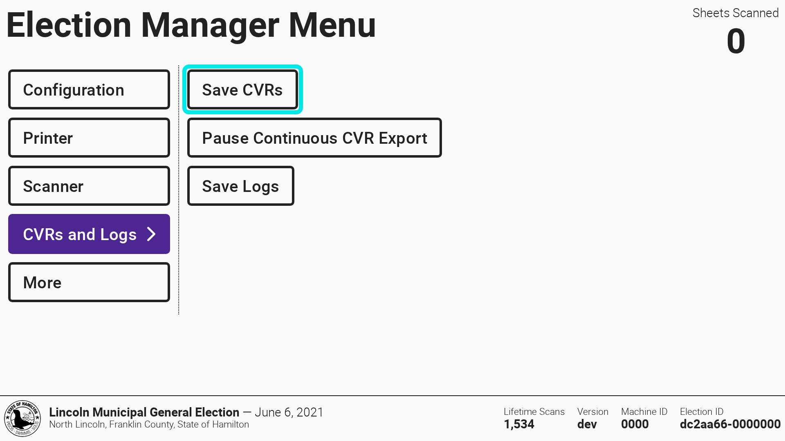
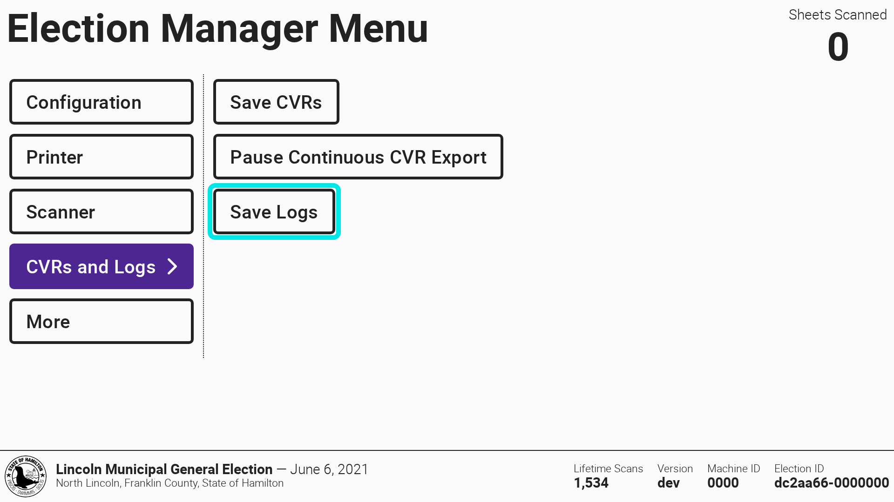
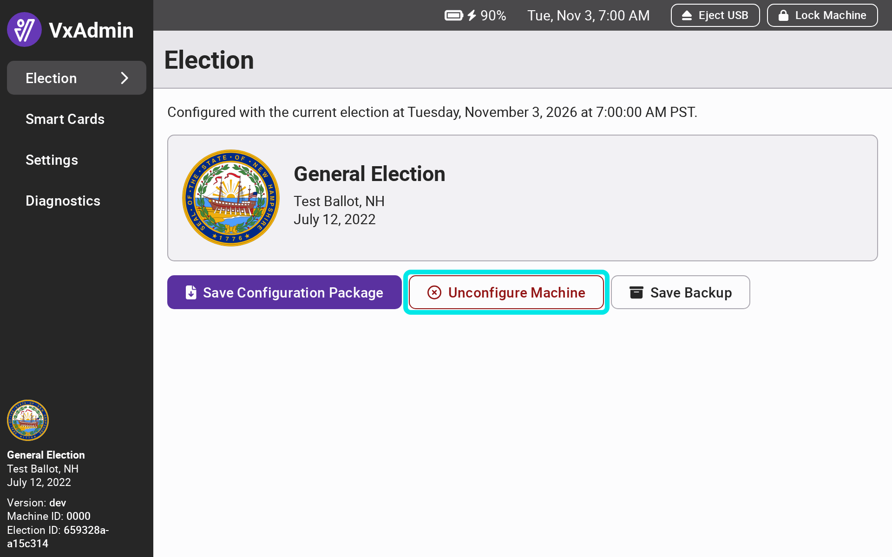
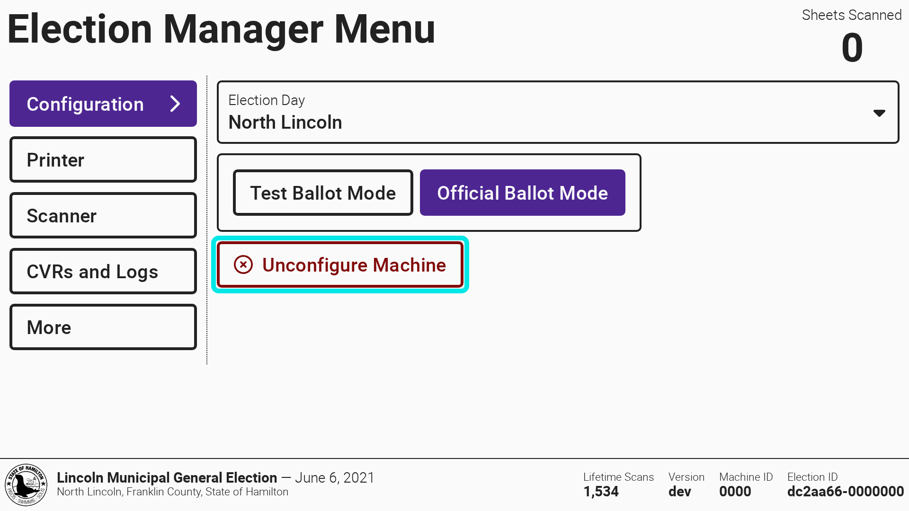

# Retain and Remove Election Files


These steps must be completed by an election manager, except removing election files from VxAdmin, which must be completed by a system administrator.


After certification of an election and before configuring a new election, save all election files and data and remove the previous election's election package.

## Retain Election Files

VotingWorks recommends retaining the following files after each election:

* [ ] VxAdmin results file
* [ ] VxAdmin tally reports
* [ ] VxAdmin log file
* [ ] VxScan cast vote records (CVRs)
* [ ] VxScan log file
* [ ] VxCentralScan CVRs (if applicable—see [Retaining and Removing Files - VxCentralScan](../vxcentralscan/retaining-and-removing-files-vxcentralscan.md "mention"))
* [ ] VxCentralScan log file (if applicable—see [Retaining and Removing Files - VxCentralScan](../vxcentralscan/retaining-and-removing-files-vxcentralscan.md "mention"))
* [ ] VxMarkScan log file (if applicable—see [Retaining and Removing Files - VxMarkScan](../vxmarkscan/retaining-and-removing-files.md "mention"))
* [ ] VxMark log file (if applicable—see [Retaining and Removing Files - VxMark](../vxmark/retaining-and-removing-files.md "mention"))
* [ ] VxPrint log file (if applicable—see [Reporting & Logs](../vxprint/reportingandlogs.md#saving-logs))
* [ ] VxPrint ballots printed report, exported as a PDF (if applicable—see [Reporting & Logs](../vxprint/reportingandlogs.md#reporting))


Ballots should have been secured post-tabulation. Follow state guidelines to ensure proper retention.


Retain all election data for at least 22 months in the following storage conditions:

* Temperature: 5–40 °C (41–104 °F)
* Relative humidity: 5–85%, non-condensing

All VotingWorks paper records and USB drives are specified to last at least 22 months when stored in these conditions.

### VxAdmin

To save the recommended VxAdmin files, follow these steps when logged in as an election manager:

* [ ] Select `Reports` from the side menu
* [ ] Select `Full Election Tally Report`
* [ ] Select `Export Report PDF`
* [ ] Select `Export Report CSV`

<figure><figcaption></figcaption></figure> <figure><figcaption></figcaption></figure>

* [ ] Select `Settings` from the side menu
* [ ] Select `Save Logs`

Machine log files are saved in the `/logs` folder on the USB drive.

<figure><figcaption></figcaption></figure>

### VxScan CVR Files

VxScan CVRs include the VxScan's CVRs and ballot images. The log file contains the logs. To save the VxScan files, set up VxScan without the ballot box (see [Set Up VxScan](../election-day-guides/vxscan-setup.md "mention")) and follow these steps:

* [ ] Insert the election manager card
* [ ] Select `CVRs and Logs` from the side menu
* [ ] Insert a USB drive
* [ ] Select `Save CVRs`
* [ ] Select `Save Logs`

<figure><figcaption></figcaption></figure> <figure><figcaption></figcaption></figure>


Log files contain records of interactions with the machine (e.g., election officials and poll workers unlocking the machine, voters casting ballots, etc.) as well as internal system information (e.g., the status of paper running through the scanner, errors, etc.). [A detailed description for each event in the log can be found in GitHub](https://github.com/votingworks/vxsuite/blob/main/libs/logging/VotingWorksLoggingDocumentation.md).


## Remove Election Files

In VxAdmin:

* [ ] Log in with a system administrator card
* [ ] Select `Election` from the side menu
* [ ] Select `Unconfigure Machine`

<figure><figcaption></figcaption></figure>

In VxScan:

* [ ] Log in with an election manager card
* [ ] Select `Unconfigure Machine`

<figure><figcaption></figcaption></figure>
