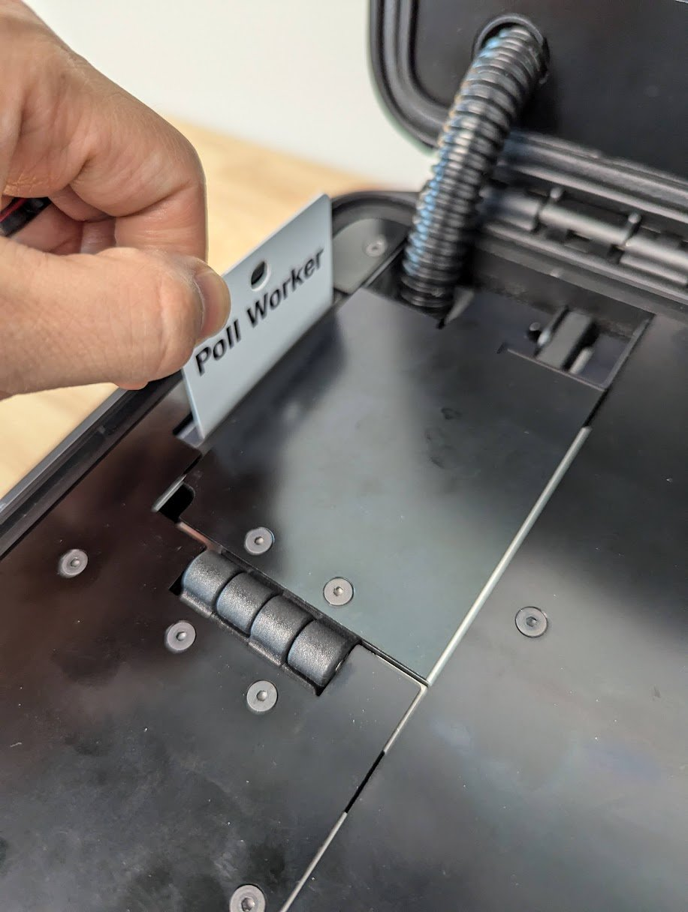
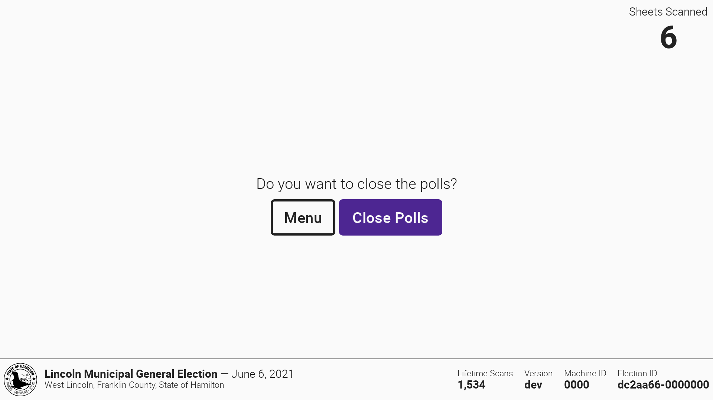
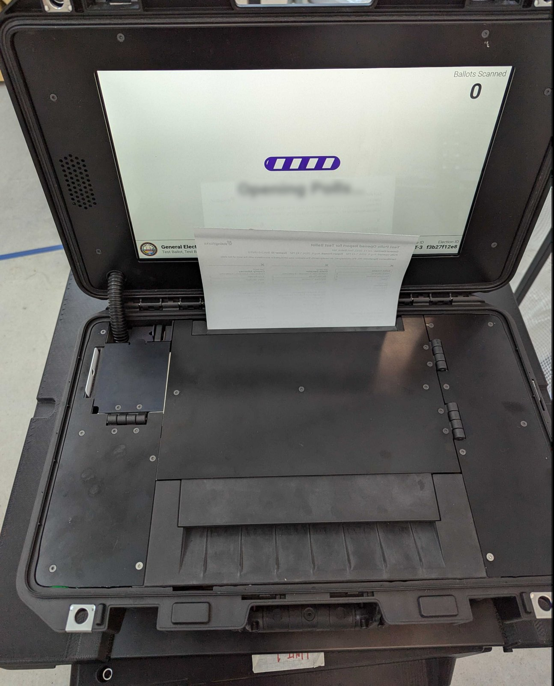
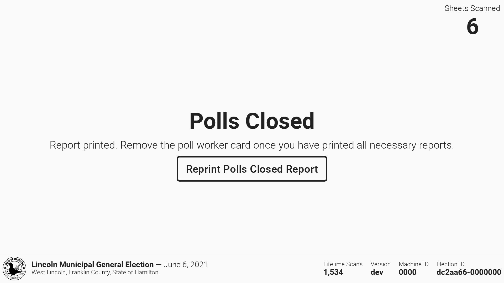
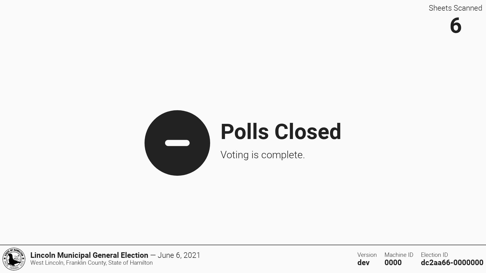
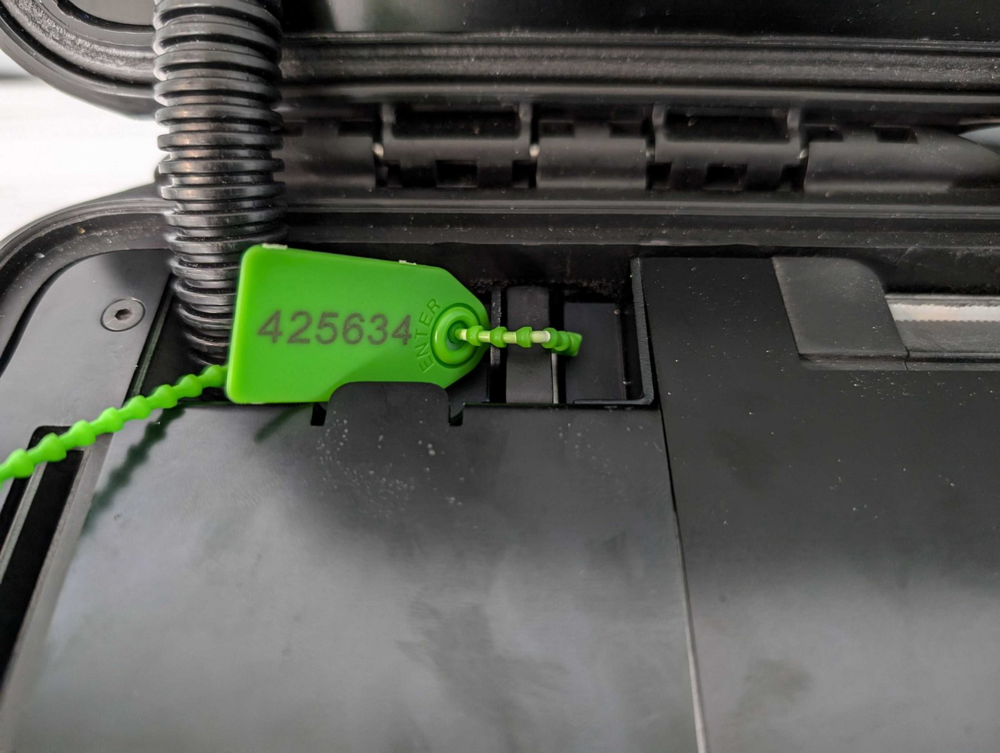
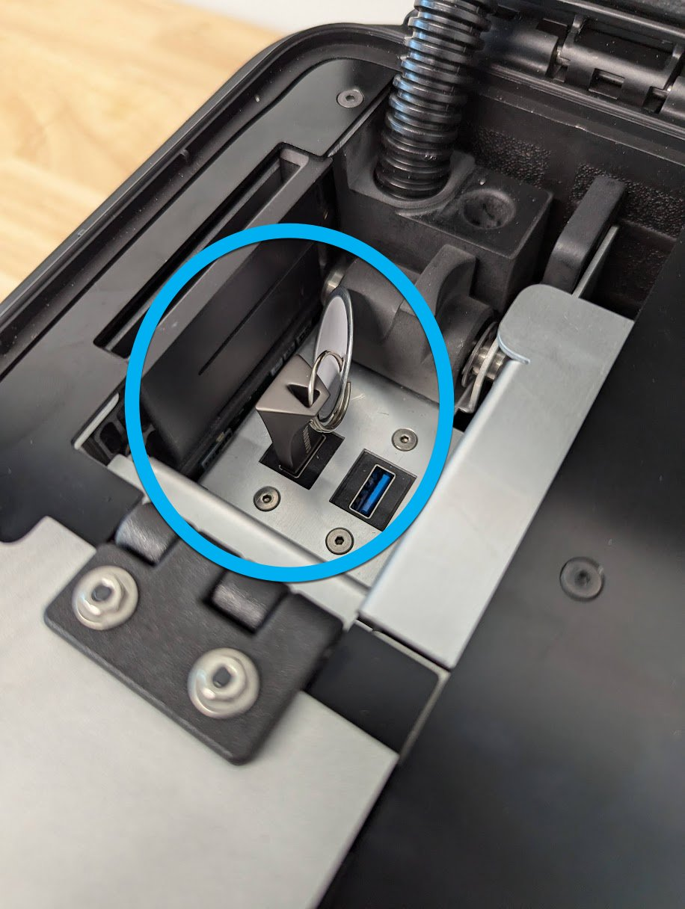
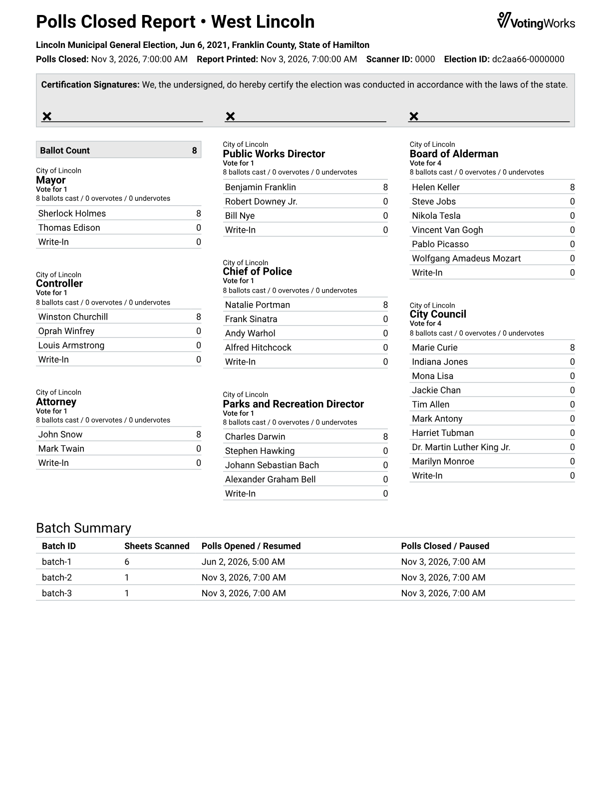

# Close Polls

Close the polls on VxScan at the end of voting to print the polls closed report.

* [ ] Insert the poll worker card into the card reader
* [ ] Select `Close Polls`

The polls closed report prints.

* [ ] Tear to remove the report
* [ ] If you see the `Print Next Copy` button, select it, gently tear off that copy, and repeat until the button no longer appears

<figure><figcaption>
Insert poll worker card
</figcaption></figure> <figure><figcaption></figcaption></figure>

<figure><figcaption></figcaption></figure>

* [ ] Select `Print Another Copy` to print more reports as necessary
* [ ] Remove the poll worker card

<figure><figcaption></figcaption></figure> <figure><figcaption></figcaption></figure>

* [ ] Unseal and document the poll worker door seal as required
* [ ] Open the poll worker door
* [ ] Remove the USB drive from the poll worker door
* [ ] Secure the USB drive as required

<figure><figcaption>
Unseal and document the poll worker door
</figcaption></figure> <figure><figcaption>
Remove the USB drive
</figcaption></figure>

The polls are now closed. Below is an example of the polls closed report.

<figure><figcaption></figcaption></figure>


Jurisdictions may configure VxScan to prevent closing the polls until the official polls close time on election day. If this is the case in your jurisdiction, logging in with a poll worker card before the polls close time takes you directly to the poll worker menu and `Close Polls` is disabled. After the polls close time, you can close polls as shown above.

