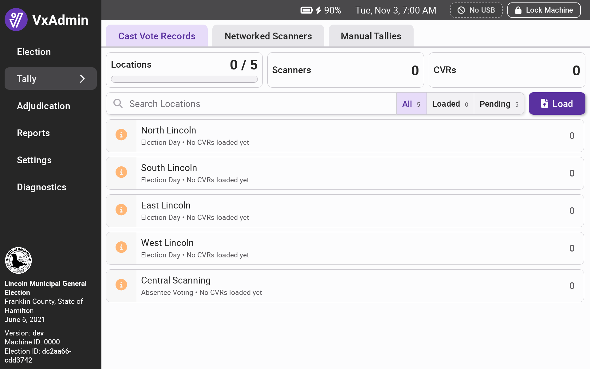
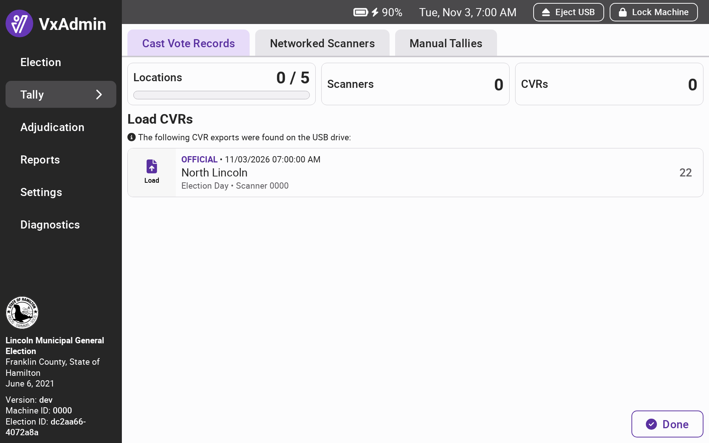
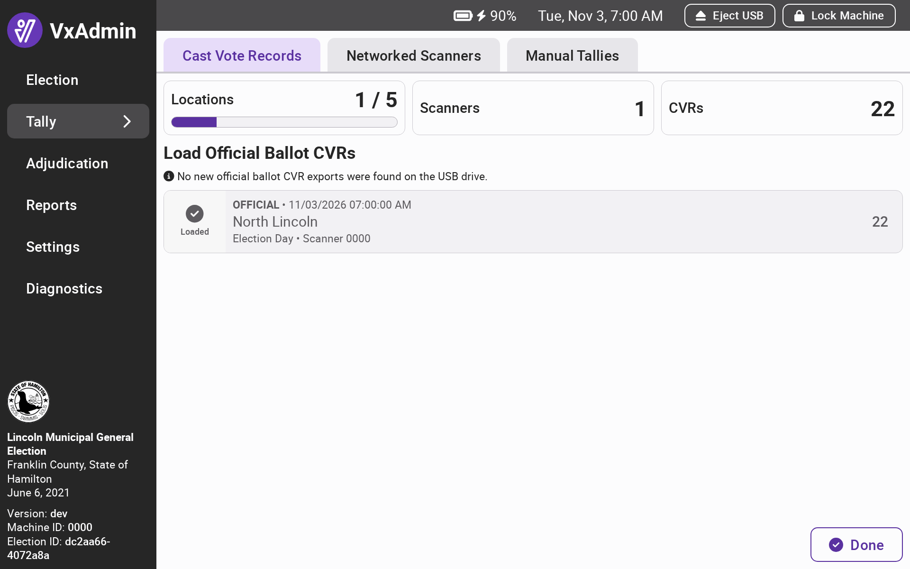
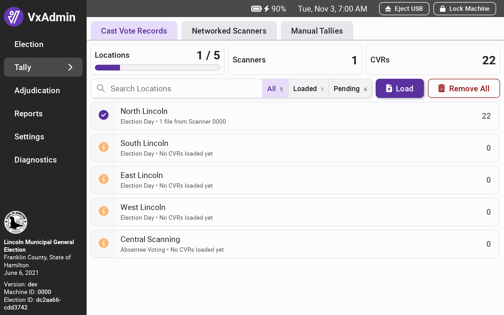
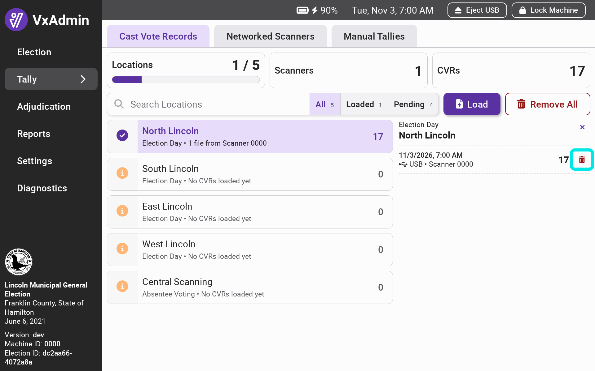

# Tally Results


These steps must be completed by an election manager.


To tally results, load the cast vote records (CVRs) from each VxScan or VxCentralScan USB drive into VxAdmin.

* [ ] Select `Tally` from the side menu

You see the list of polling places in your election. After loading all CVRs, there should typically be results loaded for every single polling place. You may use the progress bar under "Locations" and the summary statistics next to "Scanners" and "CVRs" to monitor your progress.

* [ ] Select `Load` to begin loading cast vote records
* [ ] Insert a USB drive containing CVR exports from VxScan or VxCentralScan

The screen displays the list of all CVR exports on the USB drive. Often there is only one export.

* [ ] If there are multiple exports, identify the correct export(s) by polling place, timestamp, or CVR count
* [ ] Select the CVR export(s) you want to load

<figure><figcaption></figcaption></figure> <figure><figcaption></figcaption></figure>

The selected CVR export should show as "Loaded".

* [ ] If you have more USB drives to load, eject the USB drive and insert the next one
* [ ] When you're done loading CVRs for now, select `Done`
* [ ] Back on the list of polling places, confirm that each polling place shows as loaded with the expected number of CVRs

You may search the list of polling places by typing in the "Search Locations" bar. You may also filter the list of polling places to only those that have already been loaded by selecting `Loaded` or only those that have not been loaded by selecting `Pending`.

<figure><figcaption></figcaption></figure> <figure><figcaption></figcaption></figure>

To review or remove CVR exports:

* [ ] Select a polling place to view all of its associated CVR exports

For each CVR export, the list shows the number of CVRs, the loading time, and the ID of the scanner.

* [ ] To remove an export from VxAdmin, select the trash can icon next to it

<figure><figcaption></figcaption></figure>
