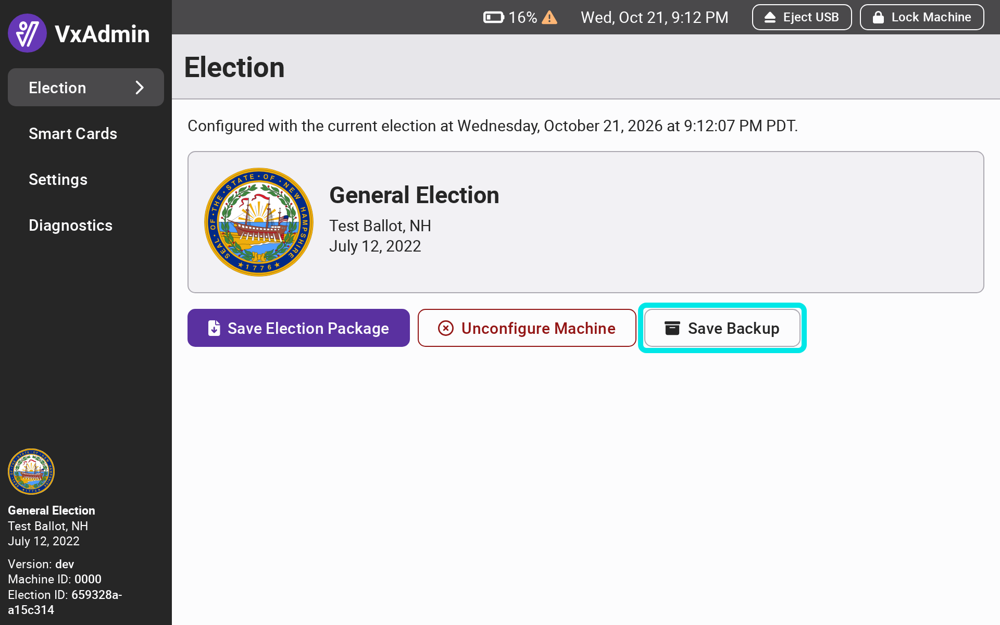
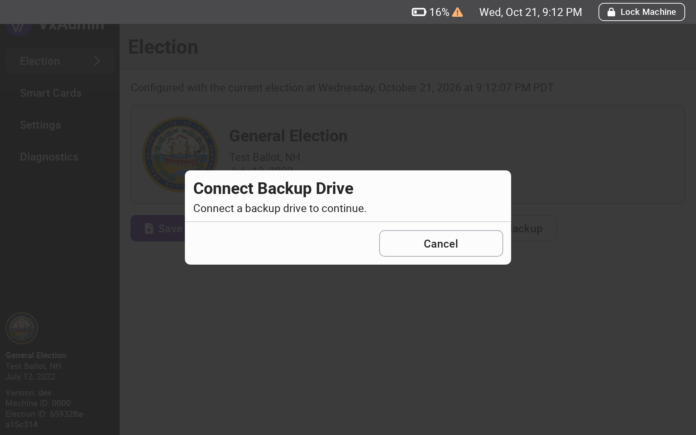
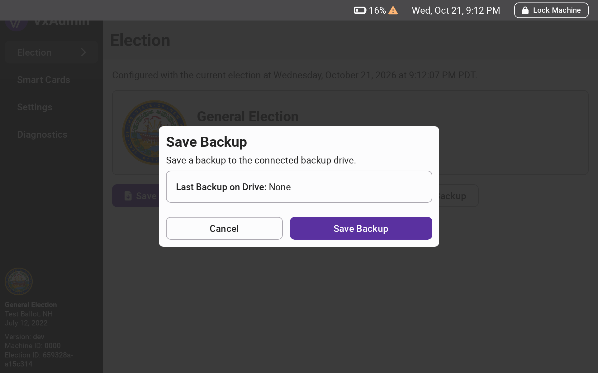
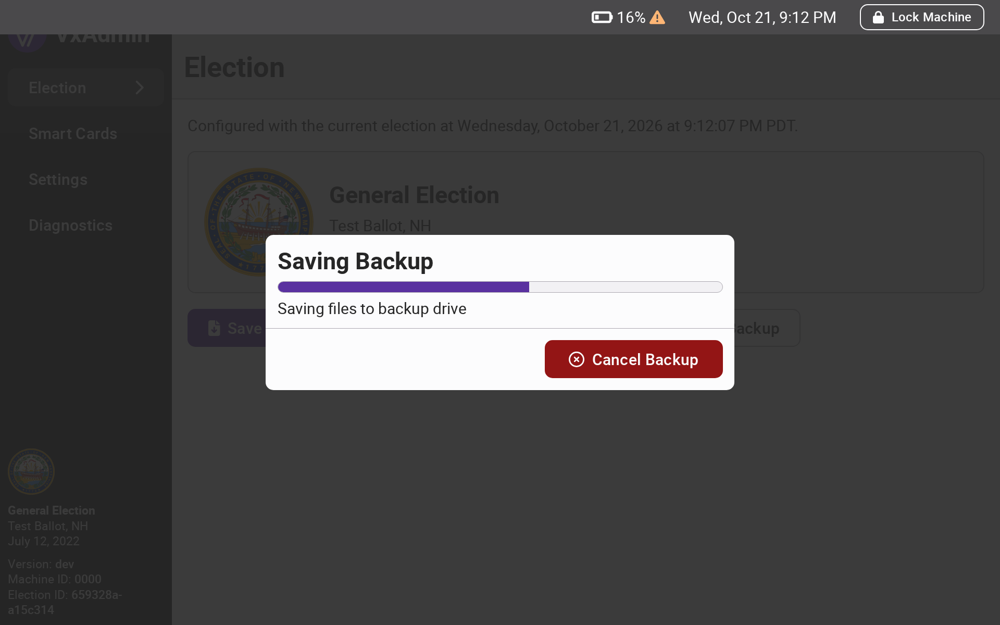
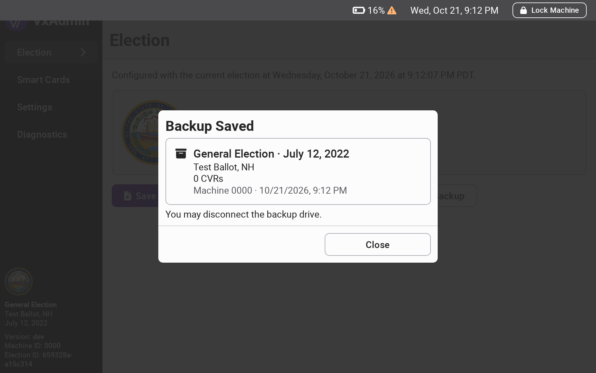
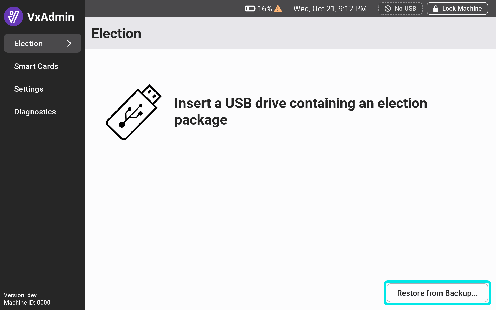
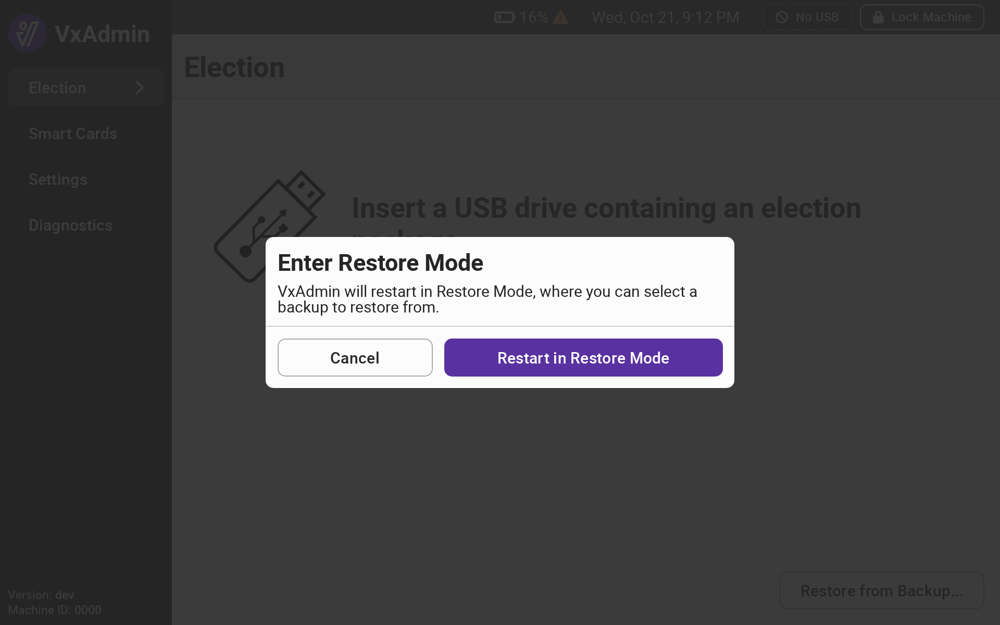

# Backup and Restore


A backup can be saved by a system administrator or an election manager. Restoring from a backup must be done by a system administrator.


VxAdmin can save a backup of its election data to a backup drive. A backup includes the election, all loaded CVRs and ballot images, adjudications, and manual tallies. If a VxAdmin laptop fails or must be replaced, the backup can be restored onto an unconfigured VxAdmin so that work does not need to be repeated.

## Backup Drives

Backups are saved to a dedicated backup drive prepared by VotingWorks. Recommended drives and specifications are listed in the [Supply List](../miscellaneous/supply-list.md#backup-drives). Backup drives are formatted differently from the USB drives used for election packages, CVRs, and reports, and the two cannot be used interchangeably. A backup drive can be connected at the same time as a regular USB drive.

A backup drive holds one backup per election. Saving a new backup of the same election replaces the previous backup on the drive.

## Saving a Backup

Select `Election` from the side menu and select `Save Backup`. If no backup drive is connected, VxAdmin will prompt you to connect one.

<figure><figcaption></figcaption></figure> <figure><figcaption></figcaption></figure>

VxAdmin shows the last backup of the current election saved on the drive, if there is one. Select `Save Backup` to begin.

<figure><figcaption></figcaption></figure>

While the backup is in progress, VxAdmin cannot be used for other tasks. You may lock the machine and the backup will continue; its progress is shown again when the machine is unlocked. Select `Cancel Backup` to stop the backup and keep the previous backup on the drive.

When the backup is complete, VxAdmin shows the details of the saved backup. Select `Close` and disconnect the backup drive.

<figure><figcaption></figcaption></figure> <figure><figcaption></figcaption></figure>


When to save a backup is up to your jurisdiction's policies. One common approach is to save a backup at the end of each day on which CVRs are loaded or ballots are adjudicated, since VxAdmin cannot be used for other work while a backup is running.


## Restoring from a Backup

A backup can only be restored onto an unconfigured VxAdmin, and restoring requires restarting the machine in Restore Mode. A backup can be restored onto a different VxAdmin from the one that saved it, such as a replacement laptop, as long as it belongs to the same jurisdiction.

* [ ] Log in as a system administrator
* [ ] Select `Election` from the side menu and select `Restore from Backup...`
* [ ] Select `Restart in Restore Mode`

<figure><figcaption></figcaption></figure> <figure><figcaption></figcaption></figure>

VxAdmin restarts in Restore Mode, which is marked by a banner at the top of every screen. Restore Mode only allows restoring from a backup. To leave Restore Mode without restoring, select `Exit Restore Mode` and confirm by selecting `Restart`; VxAdmin will restart normally.

* [ ] Log in as a system administrator
* [ ] Connect the backup drive
* [ ] Select the backup you want to restore and confirm by selecting `Restore`
* [ ] When the restore is complete, disconnect the backup drive and select `Restart`

VxAdmin restarts configured with the restored election. If a restore is canceled or fails, VxAdmin is left unconfigured and the restore can be attempted again.
