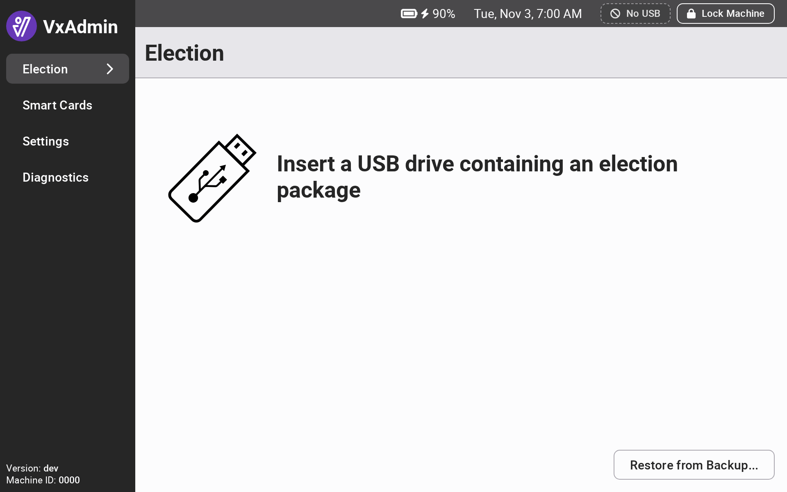
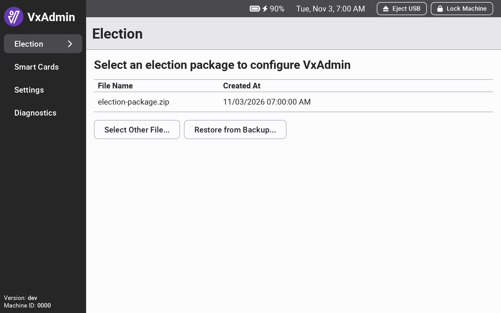
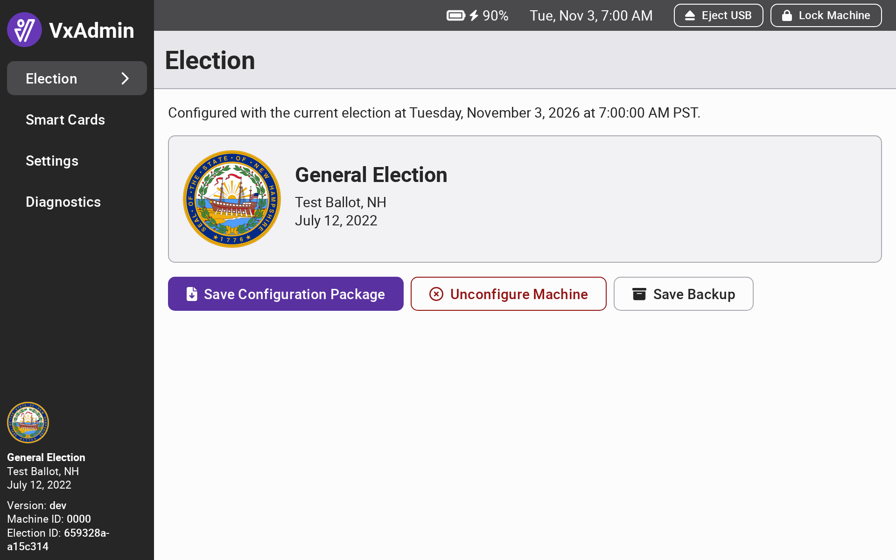
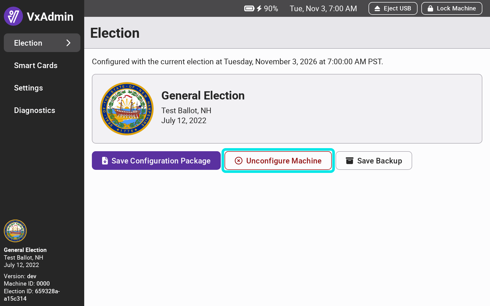
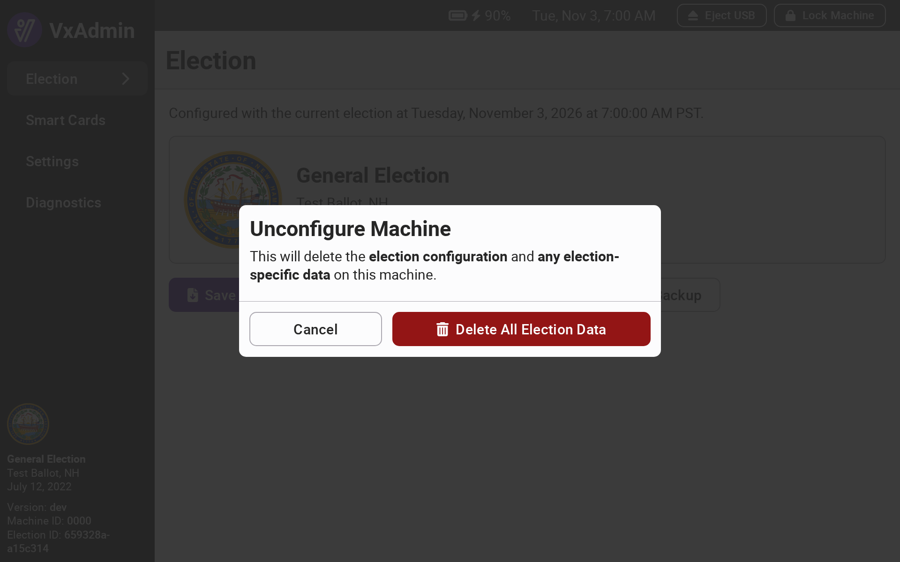

# Configure VxAdmin


These steps must be completed by a system administrator.


For each election, you configure VxAdmin in one of two ways: create the election on VxAdmin (see [Create an Election](create-an-election/README.md)), or load an election package provided by VotingWorks or downloaded from VxHub, as described on this page. The [full election package specifications](https://app.gitbook.com/s/Z4bC0rbmogHEUUuMLAUa/system-overview/election-package) can be found in the technical data package.

## Load the Election Package

When VxAdmin is not configured, the screen prompts you to insert a USB drive containing an election package.

* [ ] Insert a USB drive containing the election package

VxAdmin automatically lists the election package(s) available on the USB drive.

* [ ] Select the file name of the correct election package
* [ ] If the file is not automatically listed, select `Select Other File...`
* [ ] If you selected `Select Other File...`, select the file from the USB drive

Once configured, the election screen displays the title and date of your election as well as the date and time VxAdmin was configured.

<figure><figcaption></figcaption></figure> <figure><figcaption></figcaption></figure>

<figure><figcaption></figcaption></figure>

## Remove the Election

If you need to change an election package or reset VxAdmin for the next election, you must unconfigure the machine.

* [ ] Select `Election` from the side menu
* [ ] Select `Unconfigure Machine`
* [ ] Select `Delete All Election Data` to confirm

<figure><figcaption></figcaption></figure> <figure><figcaption></figcaption></figure>

VxAdmin returns to the initial `Election` screen. VxAdmin can be reconfigured by loading a new election package by repeating the steps above.
