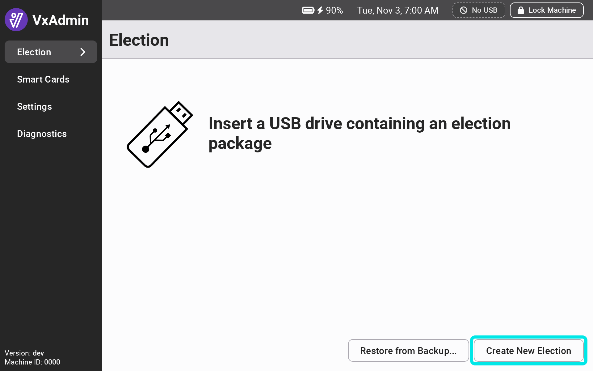
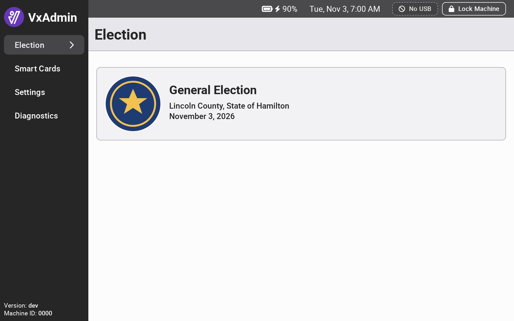
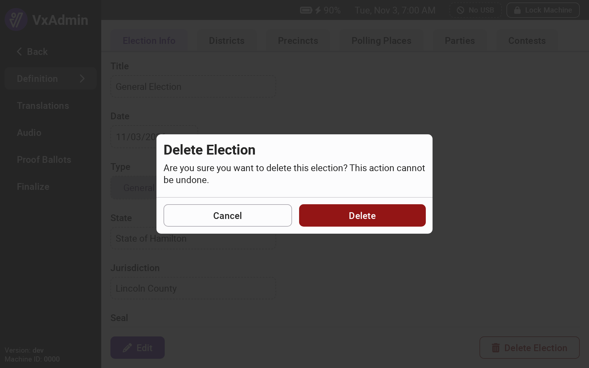

# Create an Election

Instead of loading an election package, a system administrator can create an election on VxAdmin itself: enter the election's information, districts, precincts, polling places, parties, and contests; load translations and audio; proof the ballots; and finalize the election. VxAdmin works offline throughout, so the election is defined on the same air-gapped laptop that tallies it.

VxAdmin holds one election at a time. You can create an election only when VxAdmin is not configured, and while an election is being created, loading an election package is not available. Unconfiguring VxAdmin or deleting the election removes everything entered for it.

## Start a New Election

* [ ] Log in with a system administrator card
* [ ] Select `Election` from the side menu
* [ ] Select `Create New Election`

<figure><figcaption></figcaption></figure>

VxAdmin opens the new election's `Election Info` tab, ready to edit. Continue with [Define the Election](define-the-election.md).

## Work on the Election

While an election is being created, the side menu shows the parts of the election in the order you'll usually complete them:

* `Definition`: the election's information, districts, precincts, polling places, parties, and contests, each on its own tab
* `Translations`: translated text for each ballot language other than English
* `Audio`: audio for every ballot language
* `Proof Ballots`: the ballot styles, ballot layout, and a preview of every ballot
* `Finalize`: lock the election and save its ballots

You can work across several sessions and in any order. Every change is saved when you select `Save` on a tab. Select `Back` to return to the `Election` screen, which shows the election in progress; select the election to continue working on it.

<figure><figcaption></figcaption></figure>

## Delete the Election

Deleting the election removes everything entered for it and returns VxAdmin to its unconfigured state.

* [ ] Select `Definition` from the side menu
* [ ] On the `Election Info` tab, select `Delete Election`
* [ ] Select `Delete` to confirm

<figure><figcaption></figcaption></figure>
