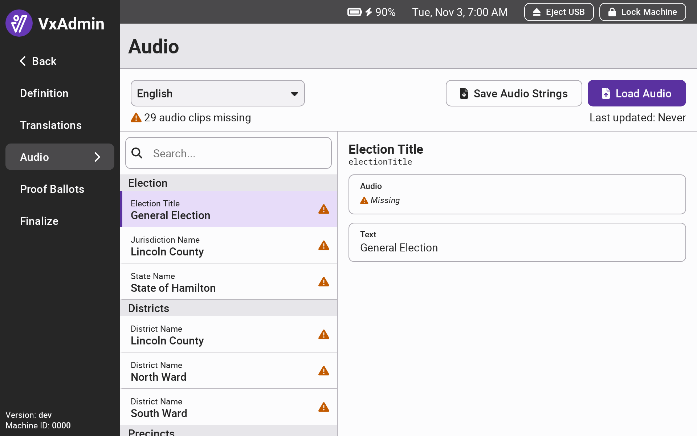
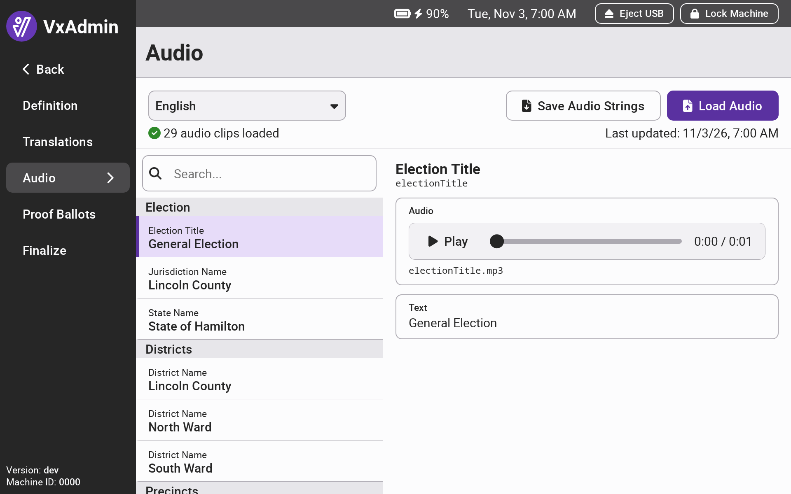
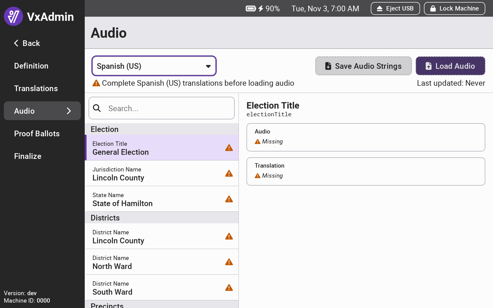
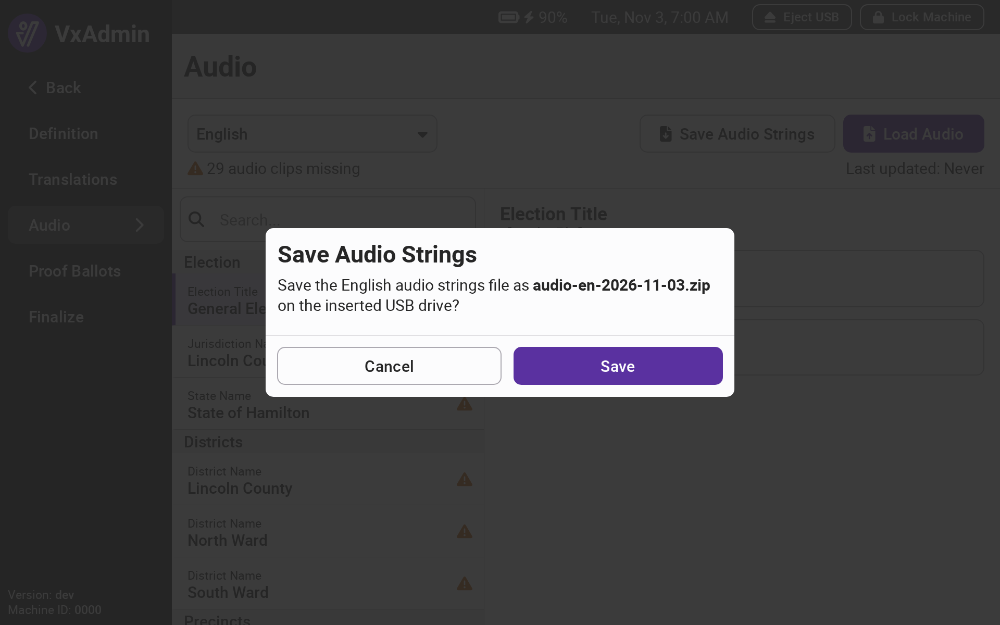
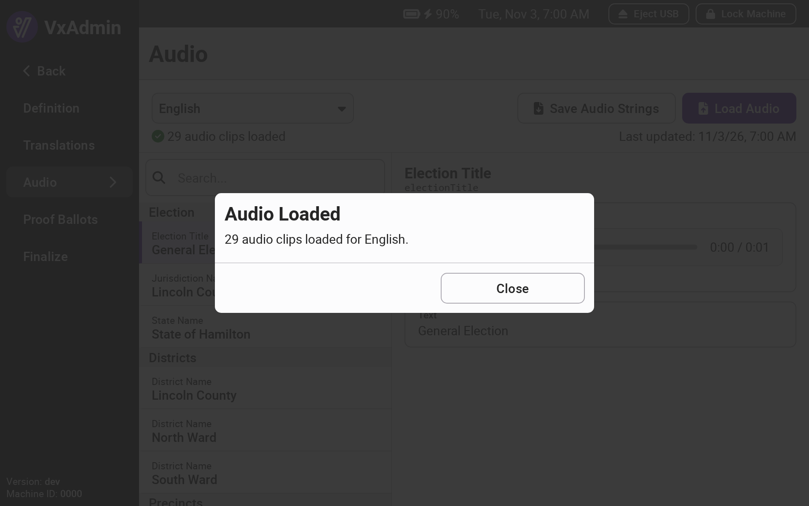

# Load Audio

VxMark and VxMarkScan read the ballot aloud to voters using headphones, so every election needs audio for every piece of election text, in every ballot language. Audio is prepared outside VxAdmin, one language at a time, and loaded into VxAdmin as an audio file.

## Review Audio

* [ ] Select `Audio` from the side menu
* [ ] Choose a language from the language menu

VxAdmin lists every piece of election text and marks each one that is missing audio. The count of missing or loaded audio clips and the time audio was last loaded appear under the language menu.

<figure><figcaption></figcaption></figure>

Select an item to play its audio and read its text. For a language other than English, VxAdmin shows the translation the audio should match.

<figure><figcaption></figcaption></figure>

A language's translations must be complete before you can save or load its audio.

<figure><figcaption></figcaption></figure>

## Save and Load the Audio File

To have audio created, save the audio strings file for the language to a USB drive. The file is a ZIP file containing a spreadsheet (CSV) that lists each item's ID, where it appears, its text, and the name of the MP3 audio file to create for it. Create an MP3 file for each item with the tool or service of your choice, add the files to the ZIP file under the listed names, and keep the spreadsheet in it.

* [ ] Insert a USB drive
* [ ] Choose the language from the language menu
* [ ] Select `Save Audio Strings`
* [ ] Select `Save`

<figure><figcaption></figcaption></figure>

When the audio files are ready, load them into VxAdmin:

* [ ] Insert the USB drive containing the audio file
* [ ] Choose the language from the language menu
* [ ] Select `Load Audio`
* [ ] Select the audio file

VxAdmin reports how many audio clips were loaded.

* [ ] Select `Close`

<figure><figcaption></figcaption></figure>

Every item should show audio, and the count under the language menu should read "audio clips loaded". Listen to the clips to check them. Repeat for each ballot language.

Every language must have complete audio before you can finalize the election.

Continue with [Proof Ballots](proof-ballots.md).
