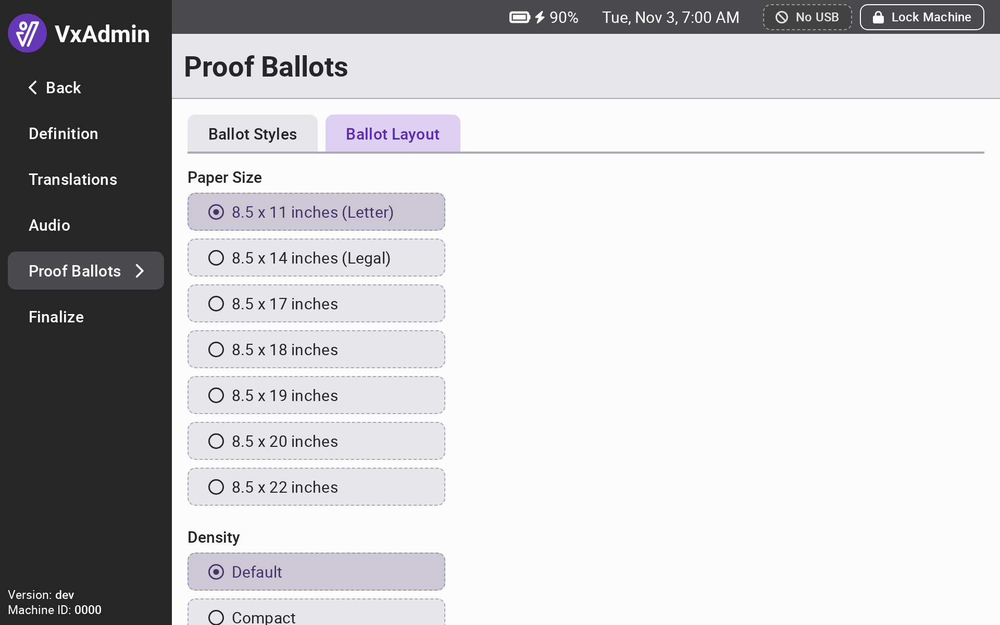
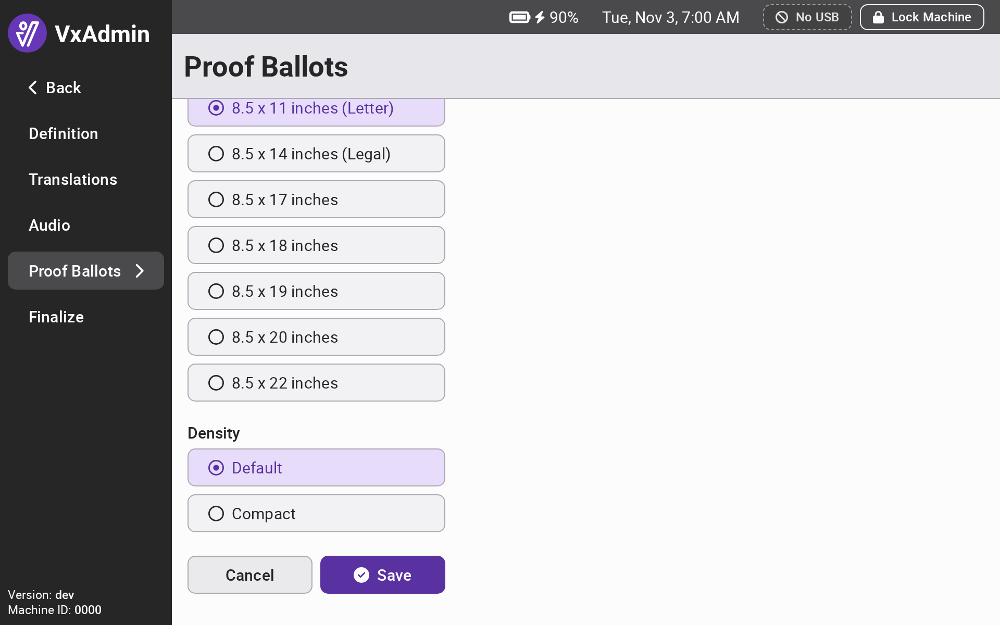

# Set the Ballot Layout

The ballot layout sets the paper size and density of every ballot in the election. Choose them before proofing ballots.

* [ ] Select `Proof Ballots` from the side menu
* [ ] Select the `Ballot Layout` tab
* [ ] Select `Edit`
* [ ] Under "Paper Size", select the paper size of your ballot stock
* [ ] Under "Density", select `Default` or `Compact`
* [ ] Select `Save`

<figure><figcaption></figcaption></figure> <figure><figcaption></figcaption></figure>

The paper sizes are 8.5 x 11 inches (Letter), 8.5 x 14 inches (Legal), and 8.5 x 17, 18, 19, 20, and 22 inches. Paper specifications are in the [Supply List](../../miscellaneous/supply-list.md).

`Compact` fits more on each page. Use it when contests don't fit on the paper size you need.

Continue with [Proof Ballots](proof-ballots.md).
