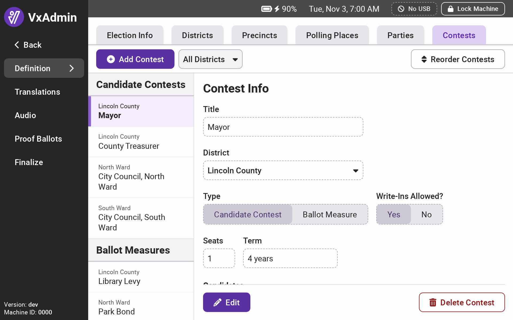
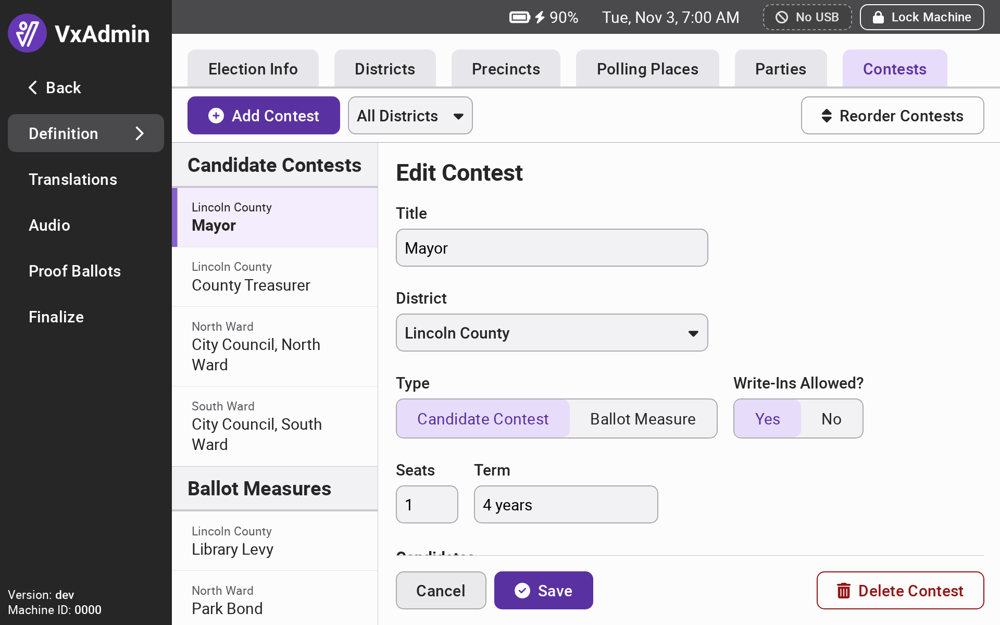
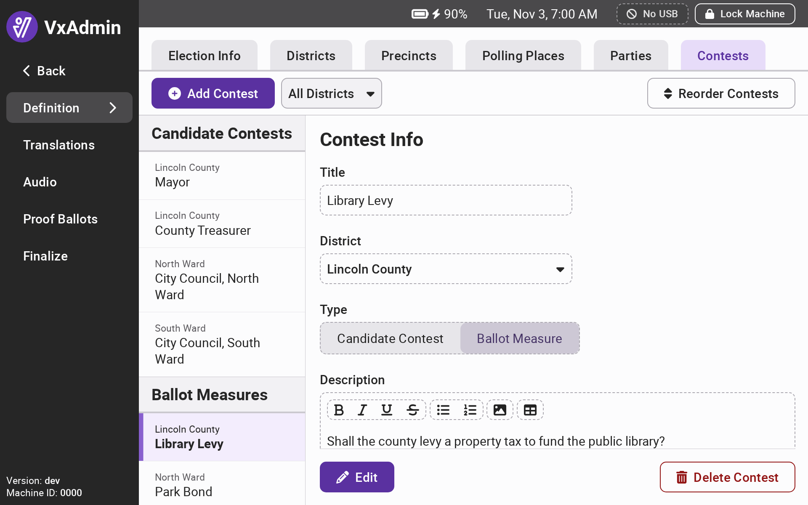
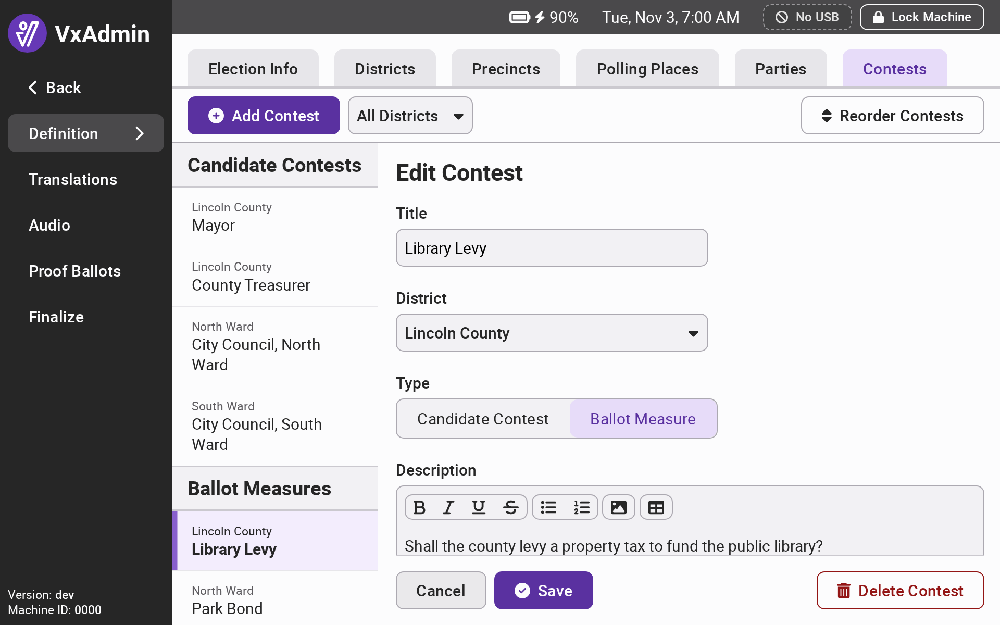
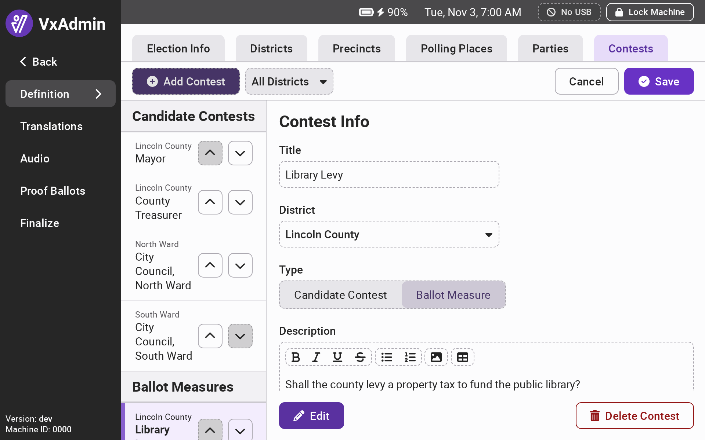

# Add Contests

A contest is either a candidate contest, such as an election for mayor, or a ballot measure that voters answer with options such as "Yes" or "No". Each contest belongs to a district and appears on the ballots of every precinct in that district.

The `Contests` tab lists candidate contests and ballot measures in ballot order. Select a contest to see its details. To show only some contests, choose a district, or in a primary a party, from the filters above the list.

## Add a Candidate Contest

* [ ] Select `Definition` from the side menu
* [ ] Select the `Contests` tab
* [ ] Select `Add Contest`
* [ ] Enter the contest's title in "Title", e.g., "Mayor"
* [ ] Under "District", select the contest's district
* [ ] Under "Type", select `Candidate Contest`
* [ ] Under "Write-Ins Allowed?", select `Yes` or `No`
* [ ] In a primary, under "Party", select the contest's party
* [ ] Enter the number of candidates voters can vote for in "Seats"
* [ ] If the office has a term printed on the ballot, enter it in "Term", e.g., "4 years"
* [ ] Select `Add Candidate` and enter the candidate's first, middle, and last name, party, and any designation
* [ ] Repeat for each candidate
* [ ] Select `Save`

<figure><figcaption></figcaption></figure> <figure><figcaption></figcaption></figure>

Each candidate in a contest must have a different name.

## Add a Ballot Measure

* [ ] Select `Add Contest`
* [ ] Enter the measure's title in "Title", e.g., "Library Levy"
* [ ] Under "District", select the measure's district
* [ ] Under "Type", select `Ballot Measure`
* [ ] Enter the measure's text in "Description"
* [ ] If the options aren't "Yes" and "No", change their labels
* [ ] Select `Save`

The description can include bold, italic, underlined, and struck-through text, bulleted and numbered lists, images, and tables, using the buttons above the text.

<figure><figcaption></figcaption></figure> <figure><figcaption></figcaption></figure>

## Reorder Contests

Contests appear on the ballot in the order listed.

* [ ] Clear any district or party filter
* [ ] Select `Reorder Contests`
* [ ] Use the up and down arrows beside each contest to move it
* [ ] Select `Save`

<figure><figcaption></figcaption></figure>

## Edit or Delete a Contest

Select the contest, then select `Edit`. Make your changes and select `Save`, or select `Delete Contest` and confirm to delete it.

Candidate contests in the same district must differ in title, seats, or term; ballot measures in the same district must have different titles.

Continue with [Load Translations](translations.md), or if all ballots are English only, with [Load Audio](audio.md).
