# Define the Election

Select `Definition` from the side menu to define the election. Its tabs, in the order you'll usually complete them, are `Election Info`, `Districts`, `Precincts`, `Polling Places`, `Parties`, and `Contests`.

## Enter Election Information

The `Election Info` tab holds the details printed at the top of every ballot: the election's title, date, type, state, jurisdiction, and seal. A new election opens on this tab, ready to edit.

<figure>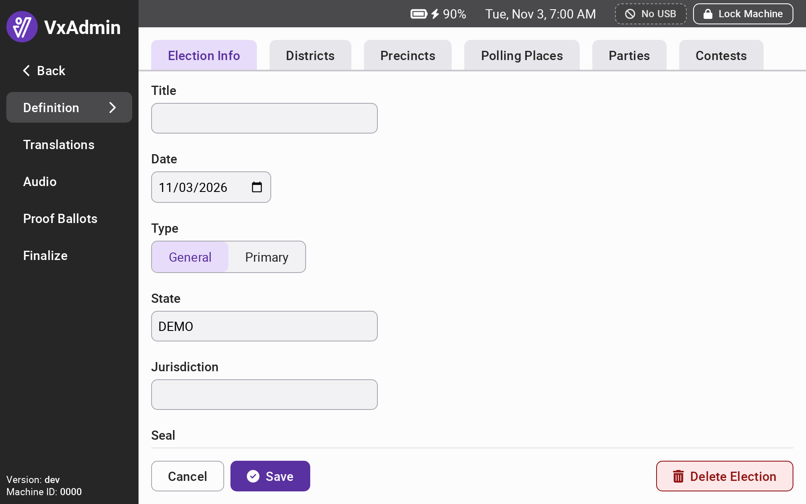<figcaption></figcaption></figure>

* [ ] If the tab isn't already in edit mode, select `Edit`
* [ ] Enter the election's title in "Title", e.g., "General Election"
* [ ] Enter the date of election day in "Date"
* [ ] Under "Type", select `General` or `Primary`
* [ ] Enter the state's name in "State"
* [ ] Enter the jurisdiction's name in "Jurisdiction", e.g., "Lincoln County"
* [ ] Select `Upload Seal Image` and select the seal image file from the USB drive
* [ ] Select `Save`

The seal must be a JPG, PNG, or SVG file, no larger than 5 MB and at least 280 pixels tall and wide. VxAdmin shows the seal once it's uploaded.

<figure>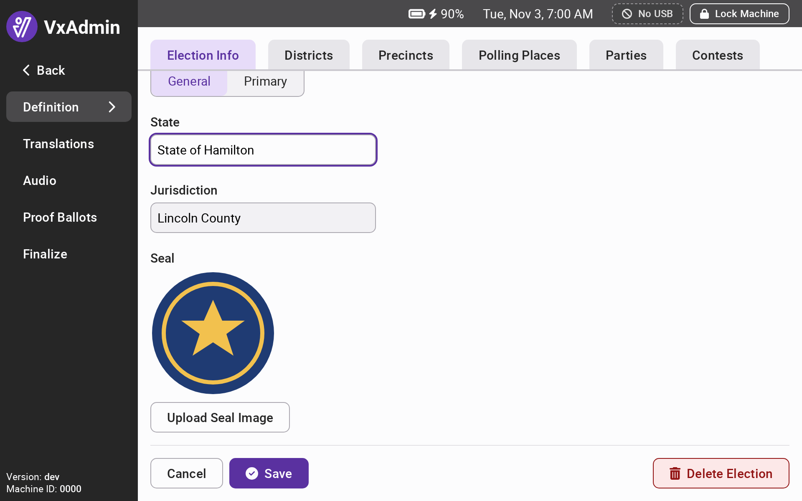<figcaption></figcaption></figure> <figure>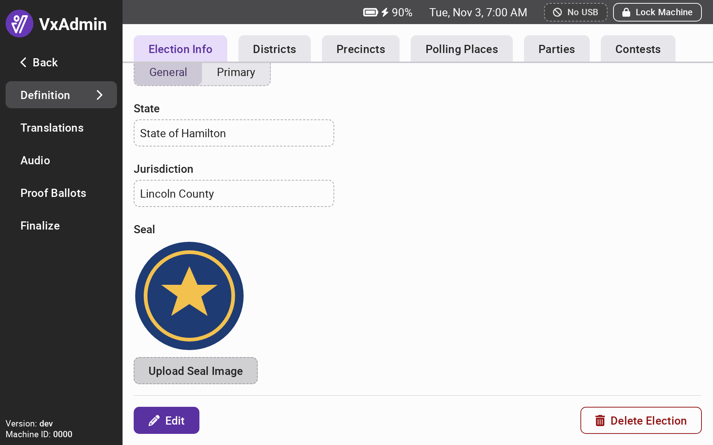<figcaption></figcaption></figure>

To change the information later, select `Edit`, make your changes, and select `Save`. Select `Cancel` to discard changes.

## Add Districts

A district is an area whose voters vote on the same contests, such as a county, a city ward, or a school district. Every contest belongs to one district, and every precinct is made up of one or more districts, so add districts before precincts and contests.

* [ ] Select the `Districts` tab
* [ ] Select `Edit Districts`
* [ ] Select `Add District` and enter the district's name
* [ ] Repeat for each district
* [ ] Select `Save`

<figure>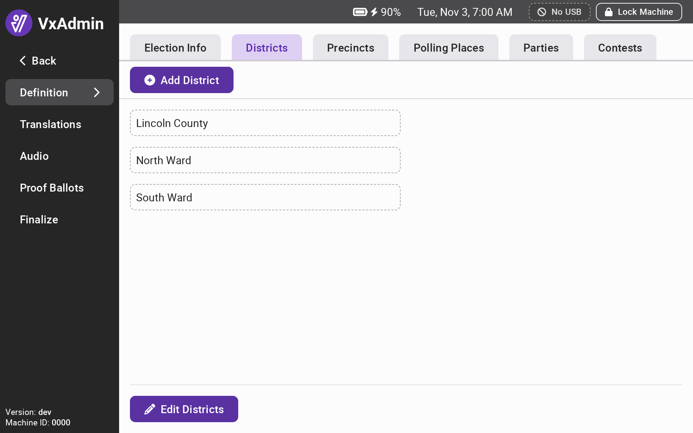<figcaption></figcaption></figure> <figure>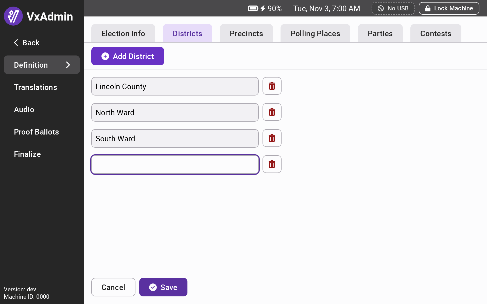<figcaption></figcaption></figure>

Each district must have a different name.

To rename a district, select `Edit Districts`, change the name, and select `Save`. To remove one, select `Edit Districts`, select the delete button beside it, and select `Save`.


Deleting a district also deletes every contest in that district. VxAdmin asks you to confirm before deleting.


## Add Precincts

A precinct is made up of the districts its voters live in, which determines the contests on its ballots. VxAdmin creates a ballot style for each different set of districts.

### Add a Precinct

* [ ] Select the `Precincts` tab
* [ ] Select `Add Precinct`
* [ ] Enter the precinct's name in "Name"
* [ ] If your jurisdiction tracks registered voters, enter the number in "Registered Voters"
* [ ] Under "Districts", select each district the precinct is in
* [ ] Select `Save`

<figure>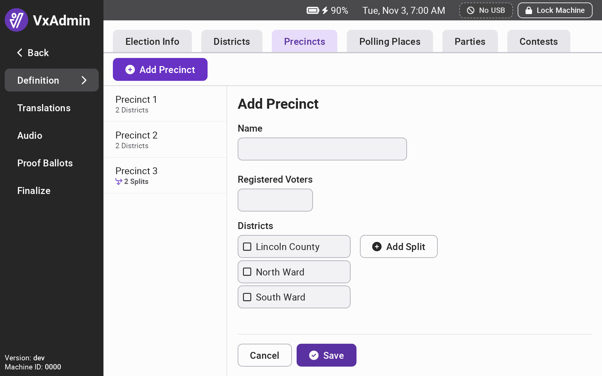<figcaption></figcaption></figure>

The precinct list shows each precinct with the number of districts or splits it has. Select a precinct to see its details.

<figure>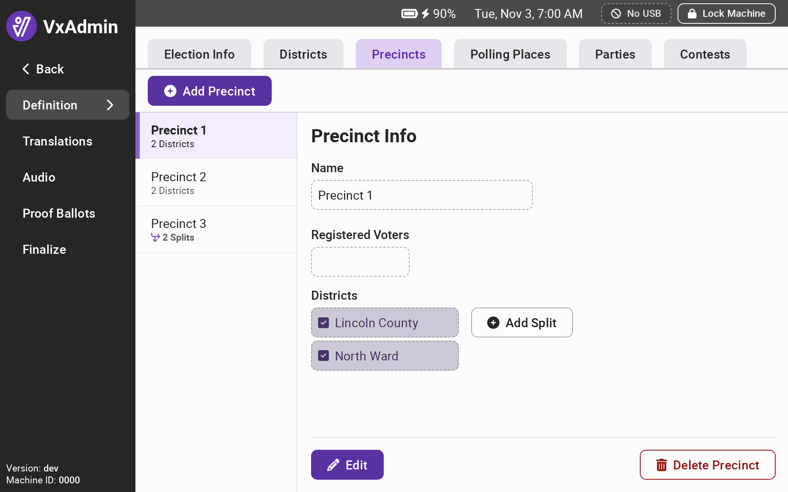<figcaption></figcaption></figure>

Registered voter counts must be entered for every precinct and split, or for none.

### Split a Precinct

When a precinct's voters don't all live in the same districts, split the precinct. Each split gets its own set of districts and its own ballot style.

* [ ] Select the precinct, then select `Edit`
* [ ] Select `Add Split`
* [ ] For each split, enter its name, its registered voters if tracked, and select its districts
* [ ] Select `Save`

<figure>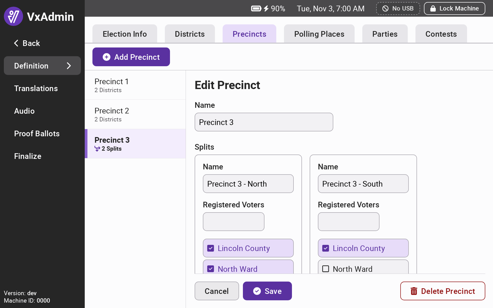<figcaption></figcaption></figure>

To remove a split, select `Remove Split` on it. Splits of the same precinct must have different names and different sets of districts.

### Edit or Delete a Precinct

Select the precinct, then select `Edit`. Make your changes and select `Save`, or select `Delete Precinct` and confirm to delete it.

Each precinct must have a different name.

## Add Polling Places

Polling places are where voters vote, and which precincts each one serves. There are three types:

* Absentee Voting: where absentee ballots are counted, e.g., the county clerk's office
* Early Voting: early voting sites
* Election Day: election day polling places

When you add a precinct, VxAdmin adds an election day polling place for it. Add any absentee and early voting polling places, and change the election day polling places if they serve more than one precinct.

### Add a Polling Place

* [ ] Select the `Polling Places` tab
* [ ] Select `Add Polling Place`
* [ ] Enter the polling place's name in "Name"
* [ ] Under "Type", select `Absentee Voting`, `Early Voting`, or `Election Day`
* [ ] Under "Precincts", select each precinct it serves, or select `Select All`
* [ ] Select `Save`

<figure>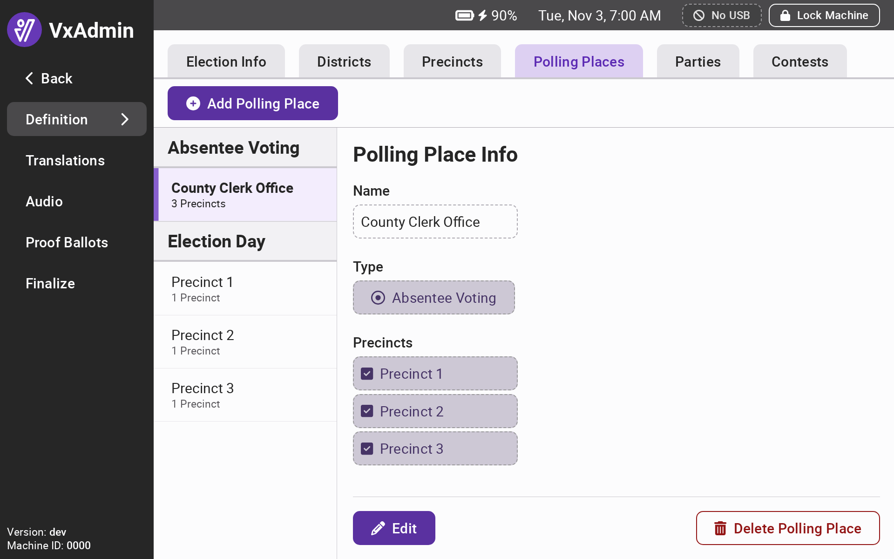<figcaption></figcaption></figure> <figure>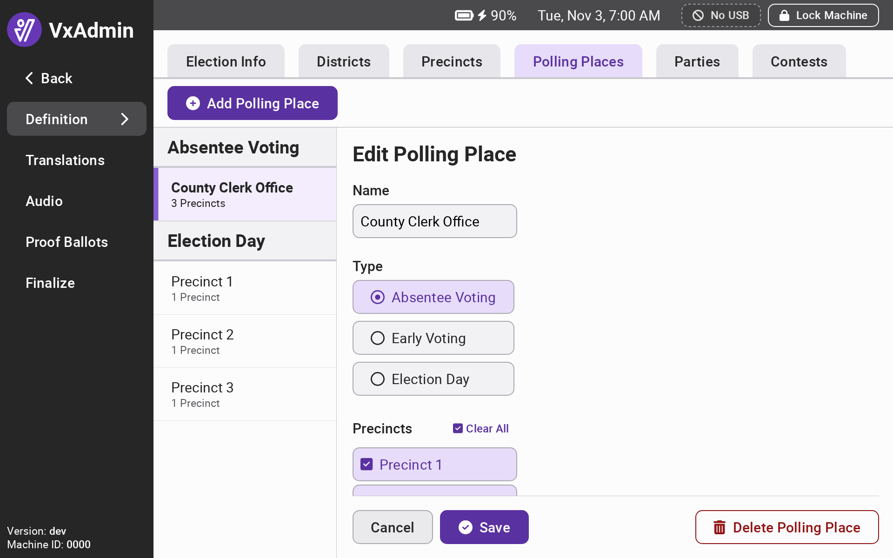<figcaption></figcaption></figure>

Polling places of the same type must have different names.

### Edit or Delete a Polling Place

Select the polling place, then select `Edit`. Make your changes and select `Save`, or select `Delete Polling Place` and confirm to delete it.

## Add Parties

Add the political parties whose candidates appear on the ballot. In a general election, a candidate's party is printed beneath their name. In a primary election, each contest belongs to a party, and VxAdmin creates a separate ballot style for each party.

Each party has three names:

* Full Name: e.g., "Democratic Party"
* Short Name: printed with candidates, e.g., "Democrat"
* Abbreviation: e.g., "D"

* [ ] Select the `Parties` tab
* [ ] Select `Edit Parties`
* [ ] Select `Add Party` and enter its full name, short name, and abbreviation
* [ ] Repeat for each party
* [ ] Select `Save`

<figure>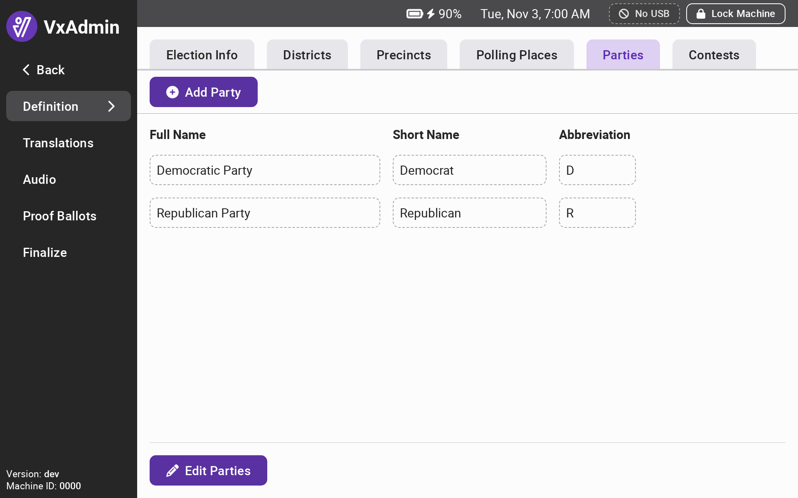<figcaption></figcaption></figure> <figure>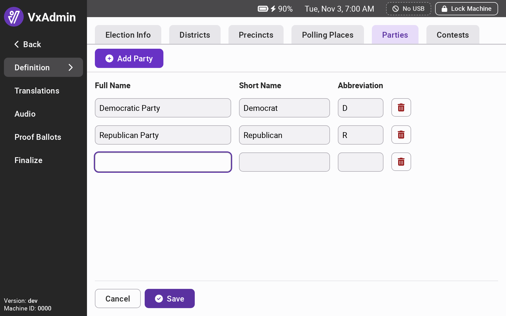<figcaption></figcaption></figure>

Each party's full name, short name, and abbreviation must be different from every other party's. To remove a party, select `Edit Parties`, select the delete button beside it, and select `Save`.

## Add Contests

A contest is either a candidate contest, such as an election for mayor, or a ballot measure that voters answer with options such as "Yes" or "No". Each contest belongs to a district and appears on the ballots of every precinct in that district.

The `Contests` tab lists candidate contests and ballot measures in ballot order. Select a contest to see its details. To show only some contests, choose a district, or in a primary a party, from the filters above the list.

### Add a Candidate Contest

* [ ] Select the `Contests` tab
* [ ] Select `Add Contest`
* [ ] Enter the contest's title in "Title", e.g., "Mayor"
* [ ] Under "District", select the contest's district
* [ ] Under "Type", select `Candidate Contest`
* [ ] Under "Write-Ins Allowed?", select `Yes` or `No`
* [ ] In a primary, under "Party", select the contest's party
* [ ] Enter the number of candidates voters can vote for in "Seats"
* [ ] If the office has a term printed on the ballot, enter it in "Term", e.g., "4 years"
* [ ] Select `Add Candidate` and enter the candidate's first, middle, and last name, party, and any designation
* [ ] Repeat for each candidate
* [ ] Select `Save`

<figure>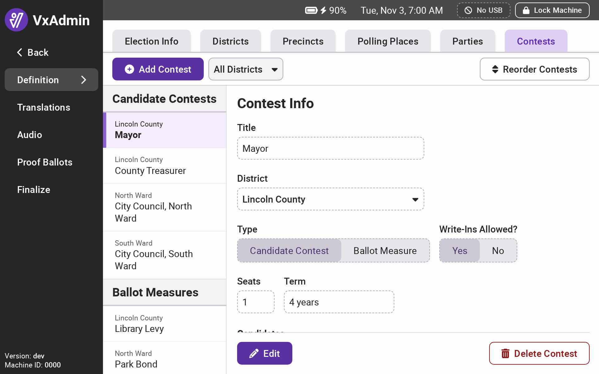<figcaption></figcaption></figure> <figure>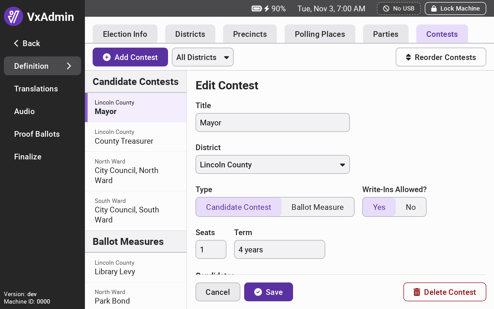<figcaption></figcaption></figure>

Each candidate in a contest must have a different name.

### Add a Ballot Measure

* [ ] Select `Add Contest`
* [ ] Enter the measure's title in "Title", e.g., "Library Levy"
* [ ] Under "District", select the measure's district
* [ ] Under "Type", select `Ballot Measure`
* [ ] Enter the measure's text in "Description"
* [ ] If the options aren't "Yes" and "No", change their labels
* [ ] Select `Save`

The description can include bold, italic, underlined, and struck-through text, bulleted and numbered lists, images, and tables, using the buttons above the text.

<figure>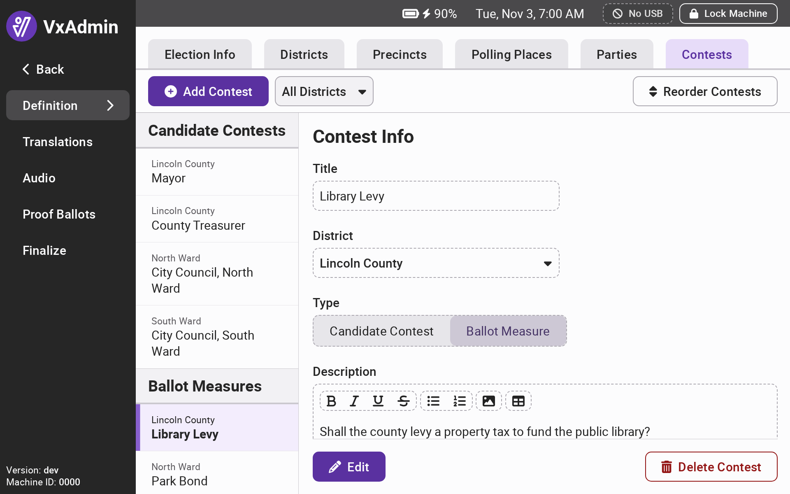<figcaption></figcaption></figure> <figure>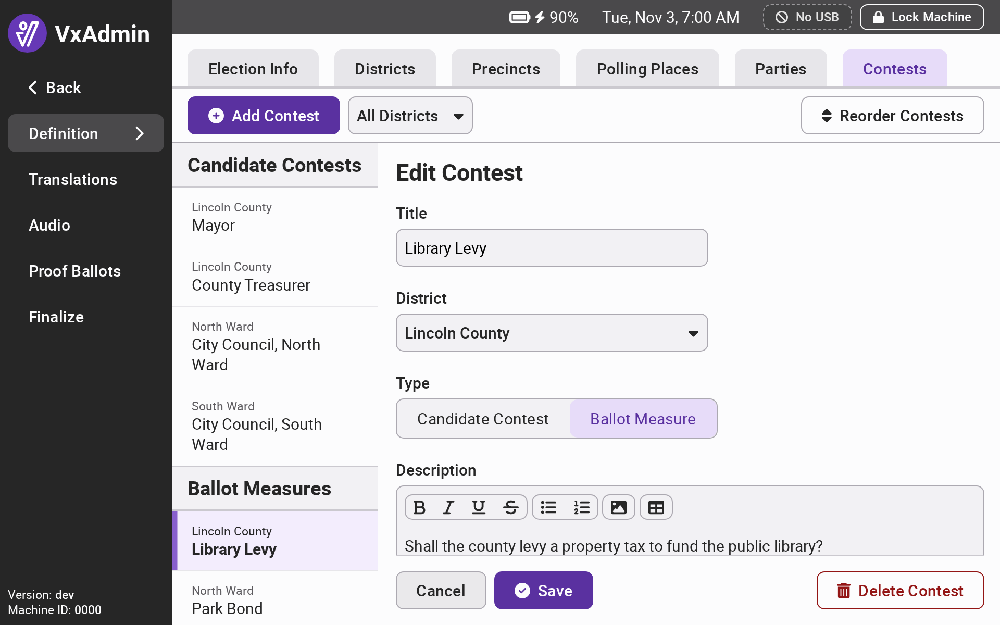<figcaption></figcaption></figure>

### Reorder Contests

Contests appear on the ballot in the order listed.

* [ ] Clear any district or party filter
* [ ] Select `Reorder Contests`
* [ ] Use the up and down arrows beside each contest to move it
* [ ] Select `Save`

<figure>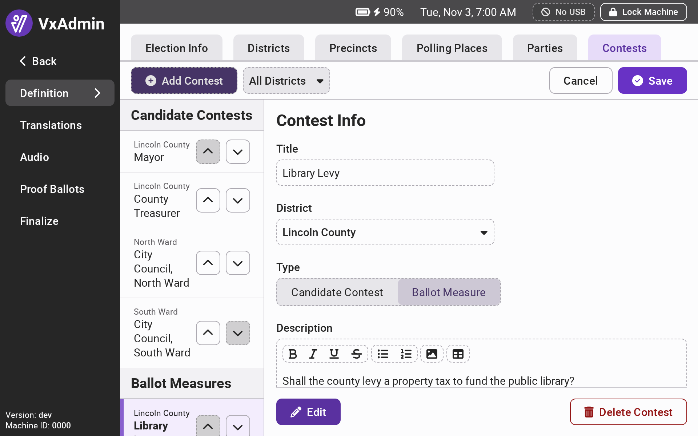<figcaption></figcaption></figure>

### Edit or Delete a Contest

Select the contest, then select `Edit`. Make your changes and select `Save`, or select `Delete Contest` and confirm to delete it.

Candidate contests in the same district must differ in title, seats, or term; ballot measures in the same district must have different titles.

Continue with [Load Translations](translations.md), or if all ballots are English only, with [Load Audio](audio.md).
