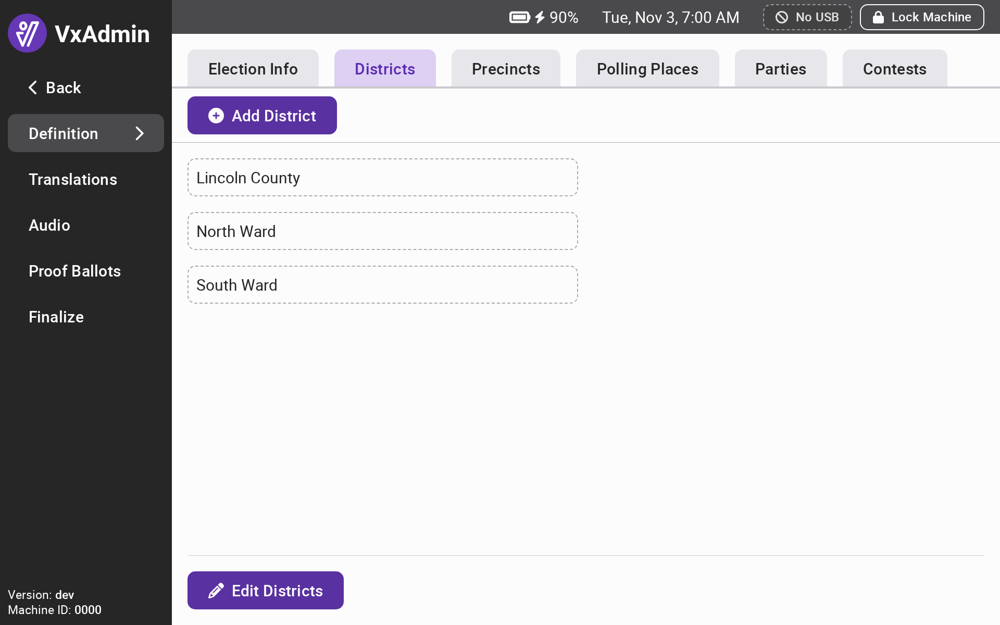
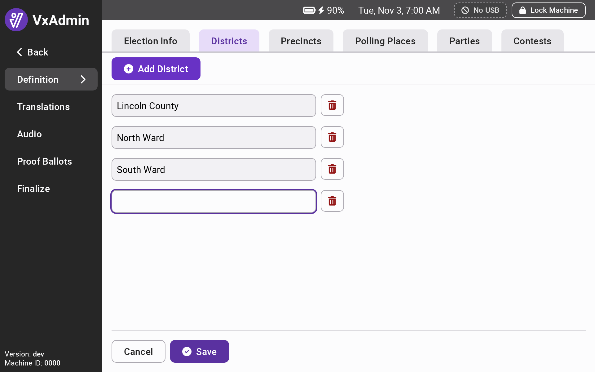

# Add Districts

A district is an area whose voters vote on the same contests, such as a county, a city ward, or a school district. Every contest belongs to one district, and every precinct is made up of one or more districts, so add districts before precincts and contests.

* [ ] Select `Definition` from the side menu
* [ ] Select the `Districts` tab
* [ ] Select `Edit Districts`
* [ ] Select `Add District` and enter the district's name
* [ ] Repeat for each district
* [ ] Select `Save`

<figure><figcaption></figcaption></figure> <figure><figcaption></figcaption></figure>

Each district must have a different name.

To rename a district, select `Edit Districts`, change the name, and select `Save`. To remove one, select `Edit Districts`, select the delete button beside it, and select `Save`.


Deleting a district also deletes every contest in that district. VxAdmin asks you to confirm before deleting.


Continue with [Add Precincts](precincts.md).
