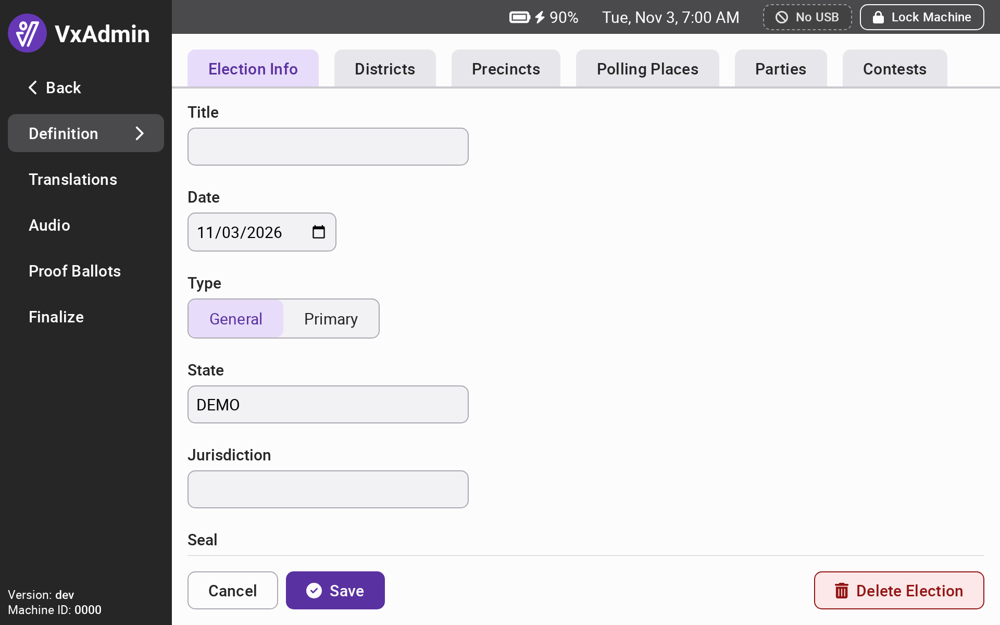
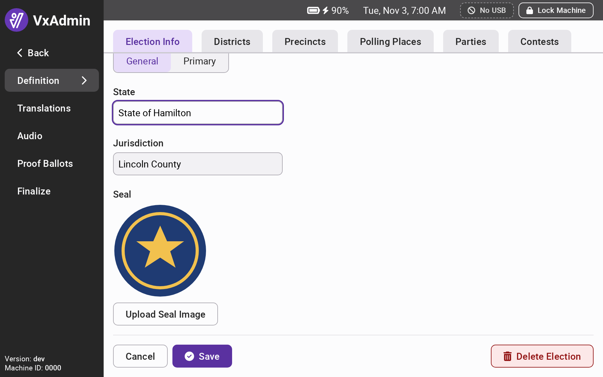
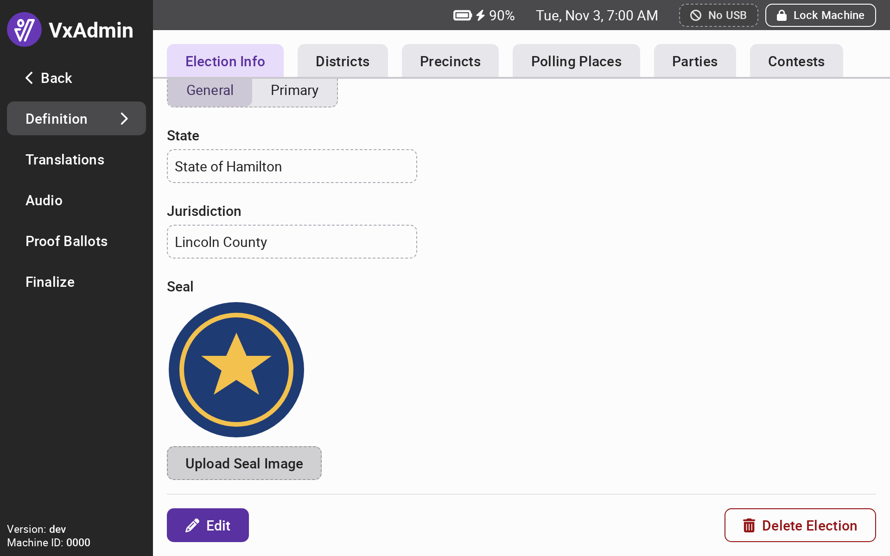

# Enter Election Information

The `Election Info` tab holds the details printed at the top of every ballot: the election's title, date, type, state, jurisdiction, and seal. A new election opens on this tab, ready to edit.

<figure><figcaption></figcaption></figure>

* [ ] If the tab isn't already in edit mode, select `Edit`
* [ ] Enter the election's title in "Title", e.g., "General Election"
* [ ] Enter the date of election day in "Date"
* [ ] Under "Type", select `General` or `Primary`
* [ ] Enter the state's name in "State"
* [ ] Enter the jurisdiction's name in "Jurisdiction", e.g., "Lincoln County"
* [ ] Select `Upload Seal Image` and select the seal image file from the USB drive
* [ ] Select `Save`

The seal must be a JPG, PNG, or SVG file, no larger than 5 MB and at least 280 pixels tall and wide. VxAdmin shows the seal once it's uploaded.

<figure><figcaption></figcaption></figure> <figure><figcaption></figcaption></figure>

To change the information later, select `Edit`, make your changes, and select `Save`. Select `Cancel` to discard changes.

Continue with [Add Districts](districts.md).
