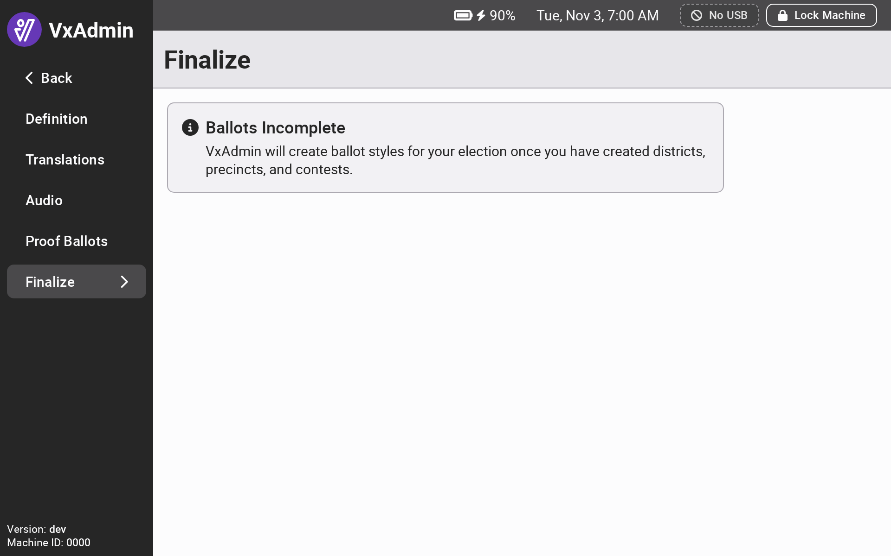
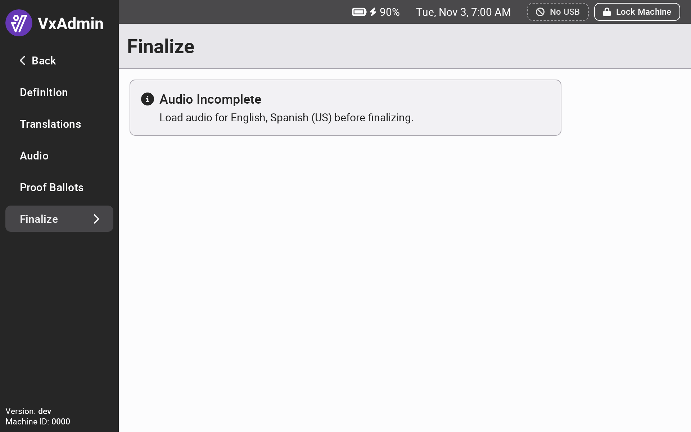
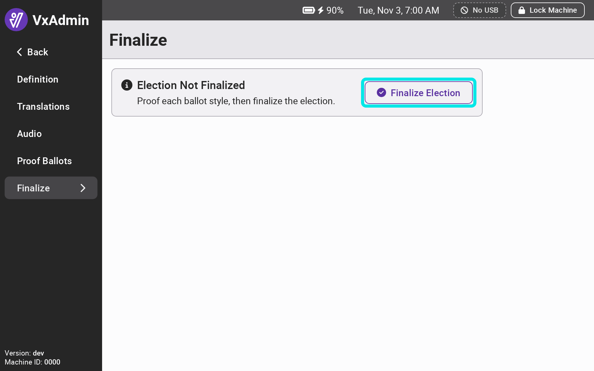
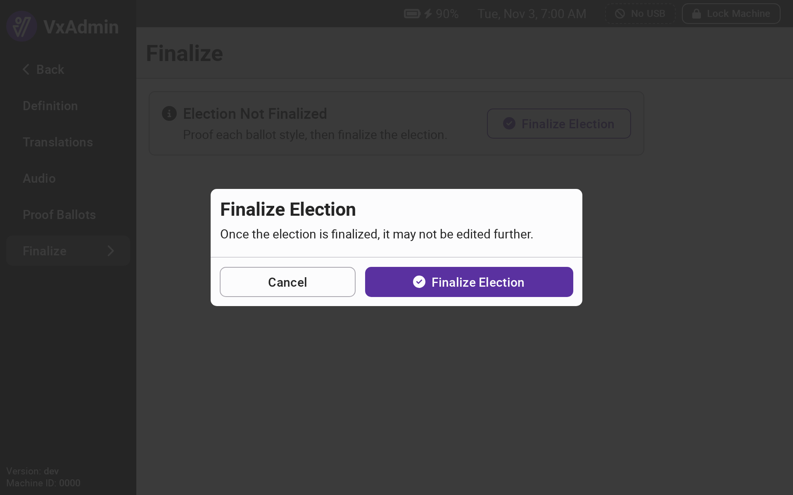
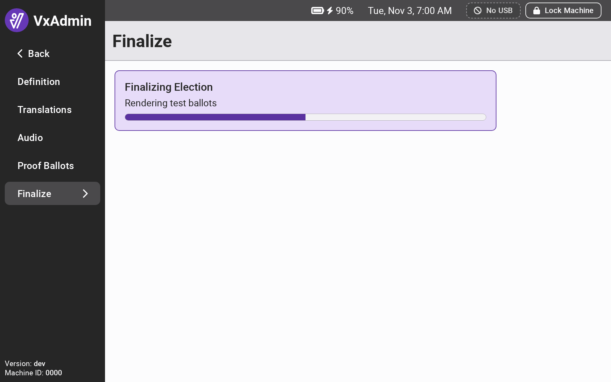
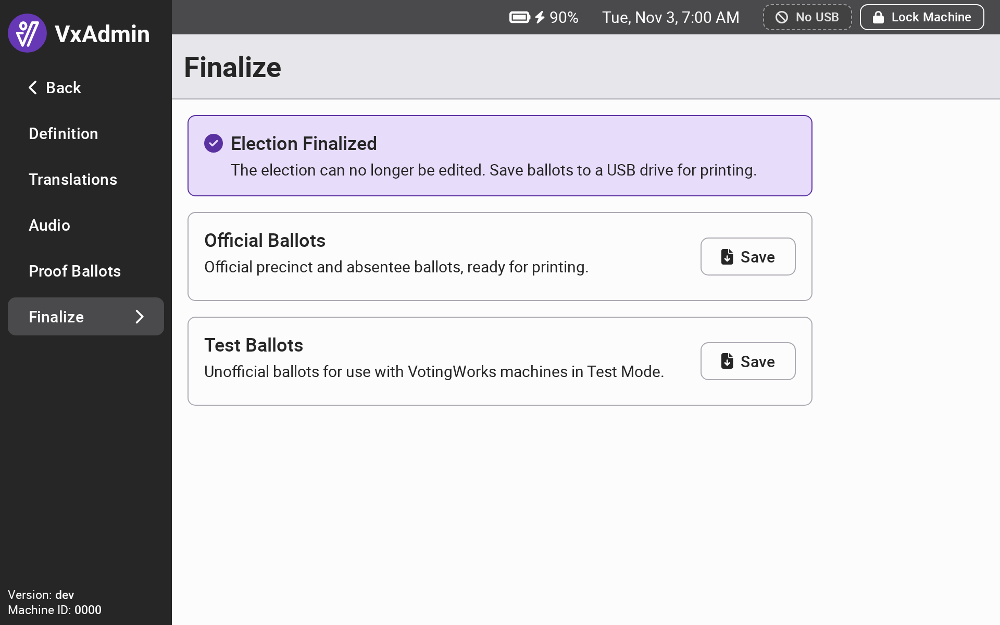
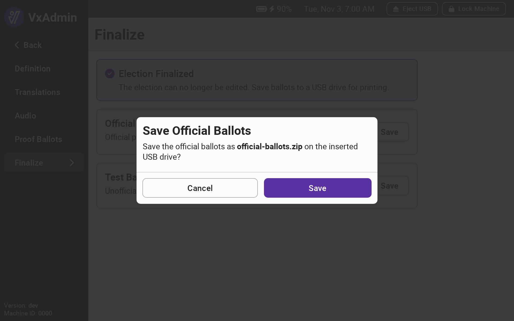

# Finalize the Election

Finalizing the election locks it and generates its ballots. Finalize only after every ballot style has been proofed and approved: once the election is finalized, it can't be edited.

## Check That the Election Is Ready

* [ ] Select `Finalize` from the side menu

VxAdmin shows what remains before the election can be finalized:

* "Ballots Incomplete": no ballot styles exist yet. Add districts, precincts, and contests.
* Registered voter counts are entered for some precincts but not all. See [Add Precincts](precincts.md).
* Some precincts aren't served by an absentee polling place. See [Add Polling Places](polling-places.md).
* "Translations Incomplete": a ballot language is missing translations. See [Load Translations](translations.md).
* "Audio Incomplete": a ballot language is missing audio. See [Load Audio](audio.md).

<figure><figcaption></figcaption></figure> <figure><figcaption></figcaption></figure>

When nothing remains, VxAdmin shows "Election Not Finalized".

## Finalize

* [ ] Select `Finalize Election`
* [ ] Select `Finalize Election` to confirm

<figure><figcaption></figcaption></figure> <figure><figcaption></figcaption></figure>


A finalized election can't be edited. Proof every ballot style before finalizing.


VxAdmin generates the official and test ballots for every ballot style and shows its progress.

<figure><figcaption></figcaption></figure>

When it's done, VxAdmin shows "Election Finalized".

<figure><figcaption></figcaption></figure>

## Save the Ballots

Save the official ballots for your ballot printer and the test ballots for logic and accuracy (L&A) testing.

* [ ] Insert a USB drive
* [ ] Next to "Official Ballots", select `Save`
* [ ] Select `Save`

<figure><figcaption></figcaption></figure>

* [ ] Next to "Test Ballots", select `Save`
* [ ] Select `Save`
* [ ] Select `Eject USB`

Official ballots include precinct and absentee ballots for every ballot style. Test ballots can only be used with VotingWorks machines in test ballot mode. All ballot PDF files must be printed at 100% scale.

Next, [save the election package](../save-election-package.md) to configure the other machines.
