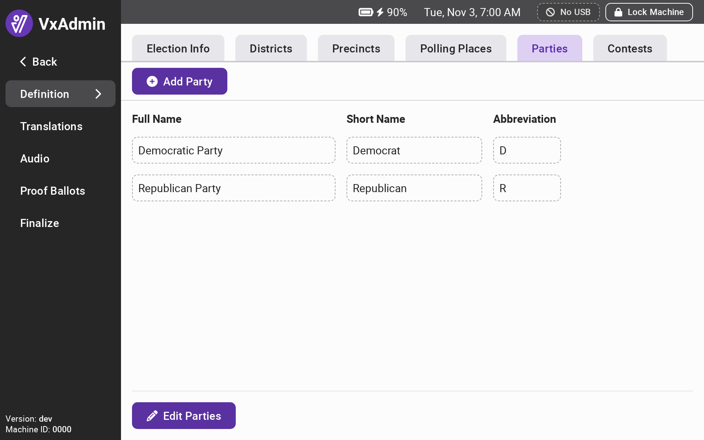
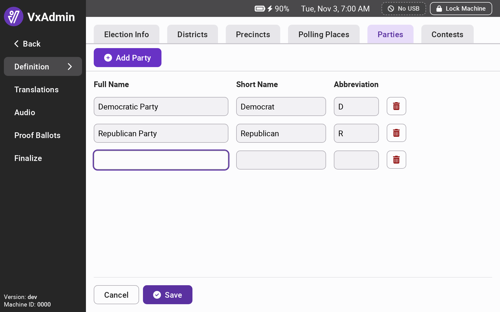

# Add Parties

Add the political parties whose candidates appear on the ballot. In a general election, a candidate's party is printed beneath their name. In a primary election, each contest belongs to a party, and VxAdmin creates a separate ballot style for each party.

Each party has three names:

* Full Name: e.g., "Democratic Party"
* Short Name: printed with candidates, e.g., "Democrat"
* Abbreviation: e.g., "D"

* [ ] Select `Definition` from the side menu
* [ ] Select the `Parties` tab
* [ ] Select `Edit Parties`
* [ ] Select `Add Party` and enter its full name, short name, and abbreviation
* [ ] Repeat for each party
* [ ] Select `Save`

<figure><figcaption></figcaption></figure> <figure><figcaption></figcaption></figure>

Each party's full name, short name, and abbreviation must be different from every other party's. To remove a party, select `Edit Parties`, select the delete button beside it, and select `Save`.

Continue with [Add Contests](contests.md).
