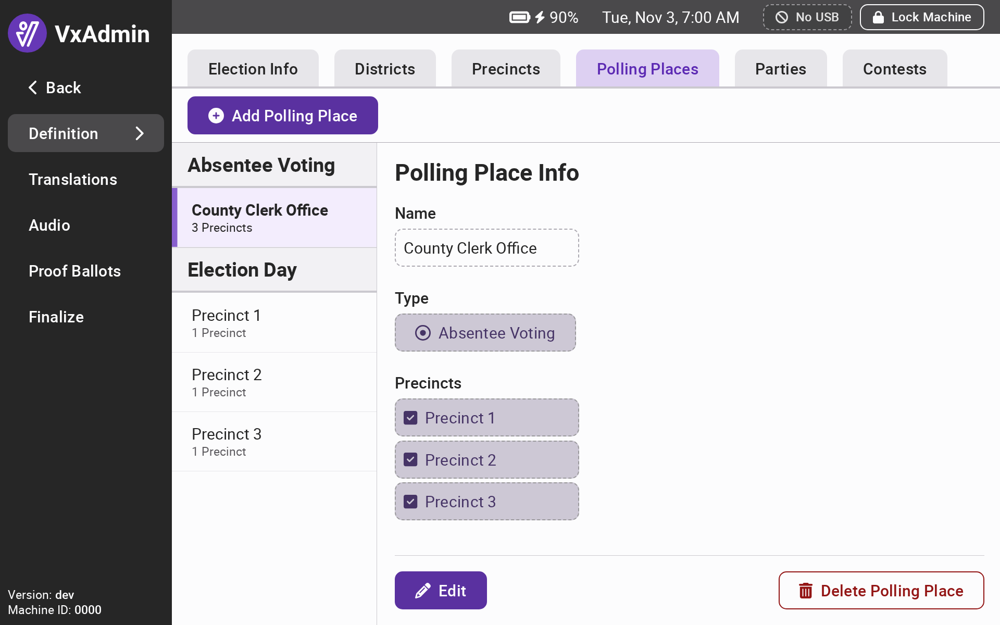
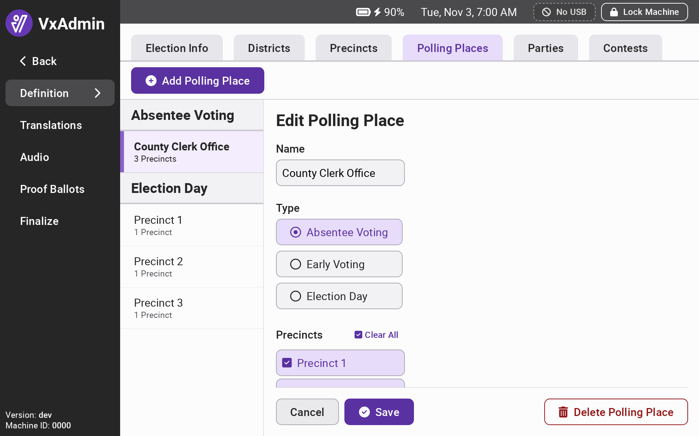

# Add Polling Places

Polling places are where voters vote, and which precincts each one serves. There are three types:

* Absentee Voting: where absentee ballots are counted, e.g., the county clerk's office
* Early Voting: early voting sites
* Election Day: election day polling places

When you add a precinct, VxAdmin adds an election day polling place for it. Add any absentee and early voting polling places, and change the election day polling places if they serve more than one precinct.

## Add a Polling Place

* [ ] Select `Definition` from the side menu
* [ ] Select the `Polling Places` tab
* [ ] Select `Add Polling Place`
* [ ] Enter the polling place's name in "Name"
* [ ] Under "Type", select `Absentee Voting`, `Early Voting`, or `Election Day`
* [ ] Under "Precincts", select each precinct it serves, or select `Select All`
* [ ] Select `Save`

<figure><figcaption></figcaption></figure> <figure><figcaption></figcaption></figure>

Polling places of the same type must have different names.

## Edit or Delete a Polling Place

Select the polling place, then select `Edit`. Make your changes and select `Save`, or select `Delete Polling Place` and confirm to delete it.

Continue with [Add Parties](parties.md).
