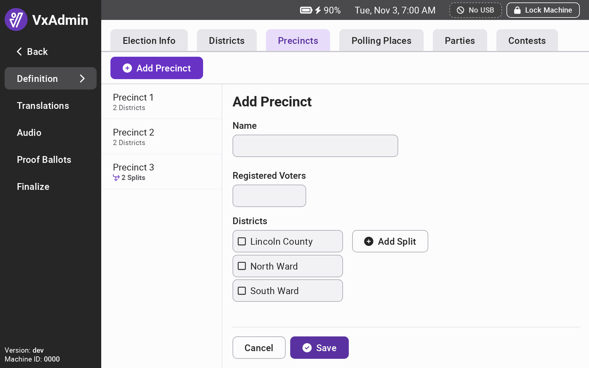
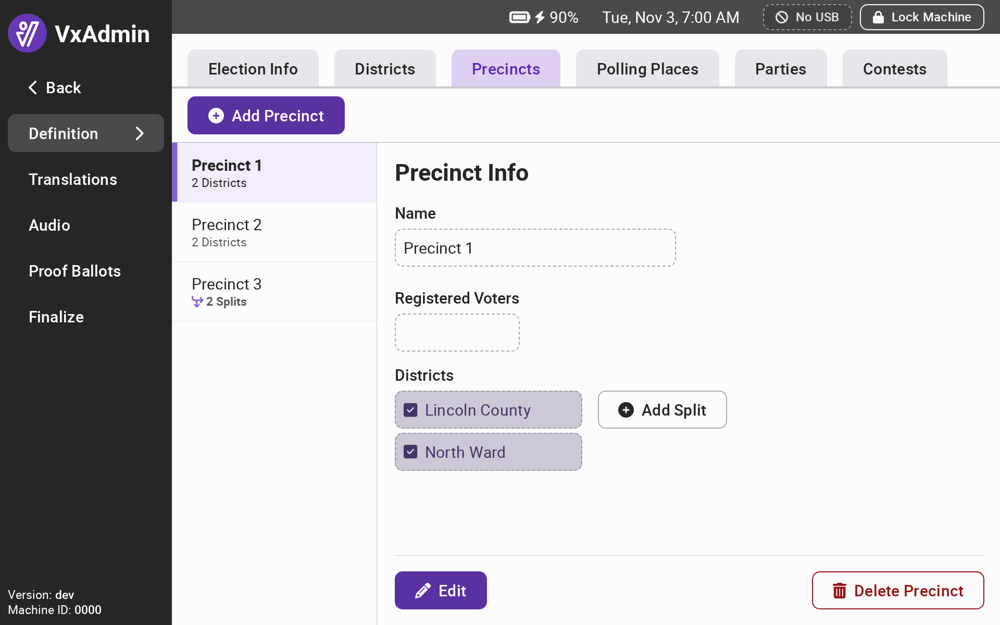
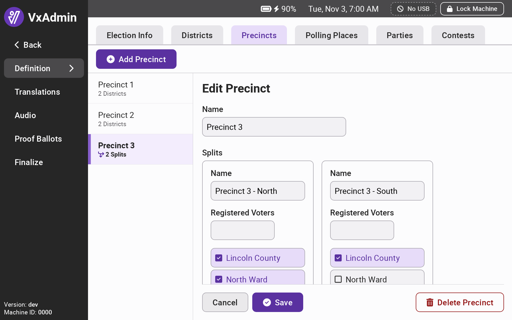

# Add Precincts

A precinct is made up of the districts its voters live in, which determines the contests on its ballots. VxAdmin creates a ballot style for each different set of districts.

## Add a Precinct

* [ ] Select `Definition` from the side menu
* [ ] Select the `Precincts` tab
* [ ] Select `Add Precinct`
* [ ] Enter the precinct's name in "Name"
* [ ] If your jurisdiction tracks registered voters, enter the number in "Registered Voters"
* [ ] Under "Districts", select each district the precinct is in
* [ ] Select `Save`

<figure><figcaption></figcaption></figure>

The precinct list shows each precinct with the number of districts or splits it has. Select a precinct to see its details.

<figure><figcaption></figcaption></figure>

Registered voter counts must be entered for every precinct and split, or for none.

## Split a Precinct

When a precinct's voters don't all live in the same districts, split the precinct. Each split gets its own set of districts and its own ballot style.

* [ ] Select the precinct, then select `Edit`
* [ ] Select `Add Split`
* [ ] For each split, enter its name, its registered voters if tracked, and select its districts
* [ ] Select `Save`

<figure><figcaption></figcaption></figure>

To remove a split, select `Remove Split` on it. Splits of the same precinct must have different names and different sets of districts.

## Edit or Delete a Precinct

Select the precinct, then select `Edit`. Make your changes and select `Save`, or select `Delete Precinct` and confirm to delete it.

Each precinct must have a different name.

Continue with [Add Polling Places](polling-places.md).
