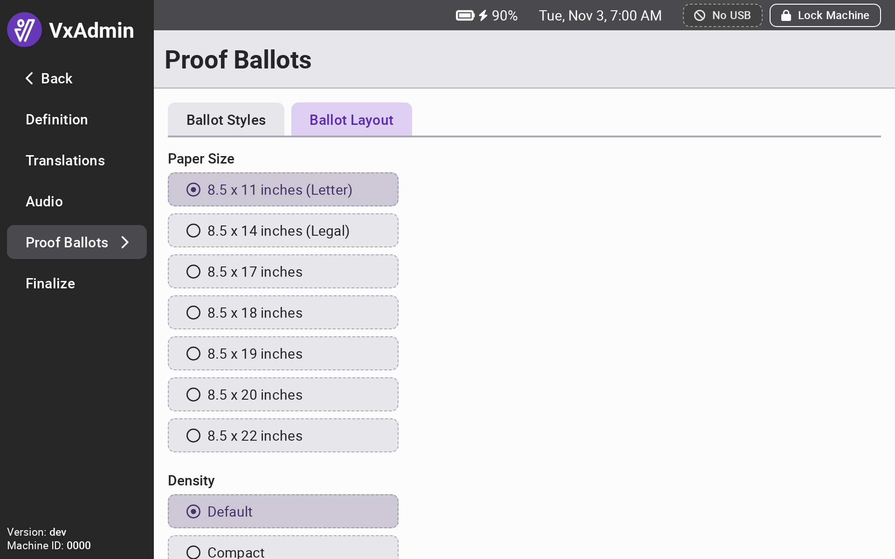
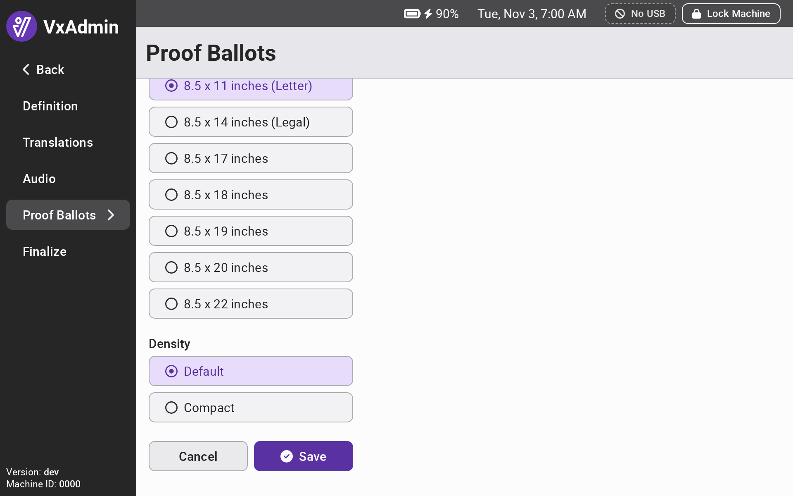
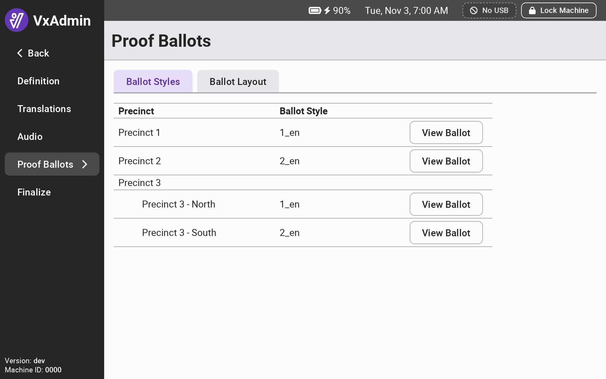
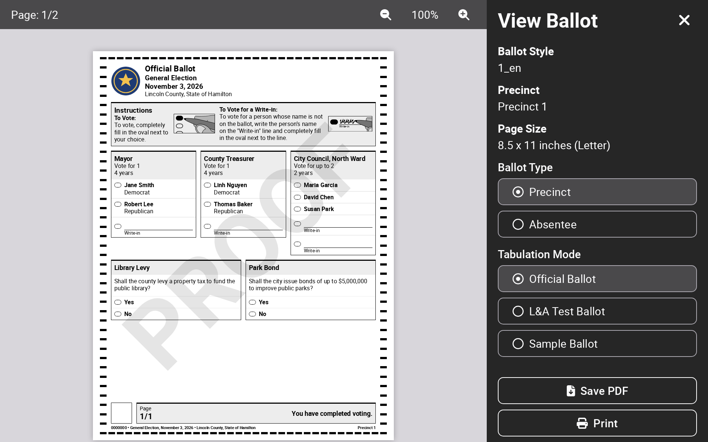
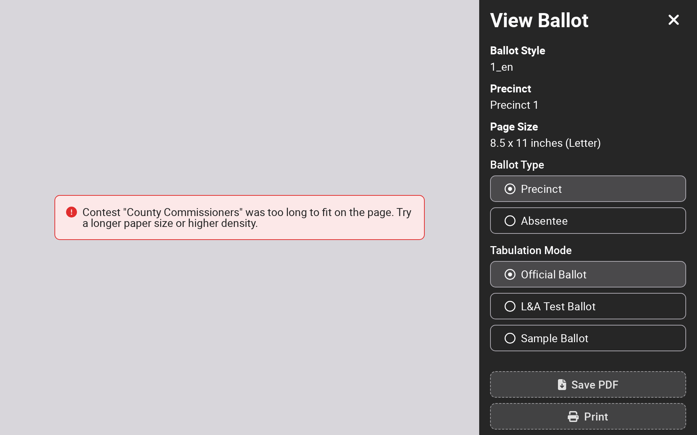
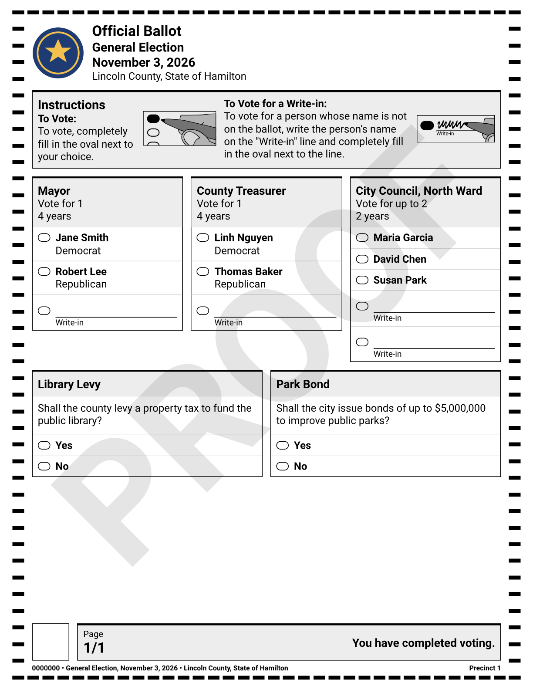
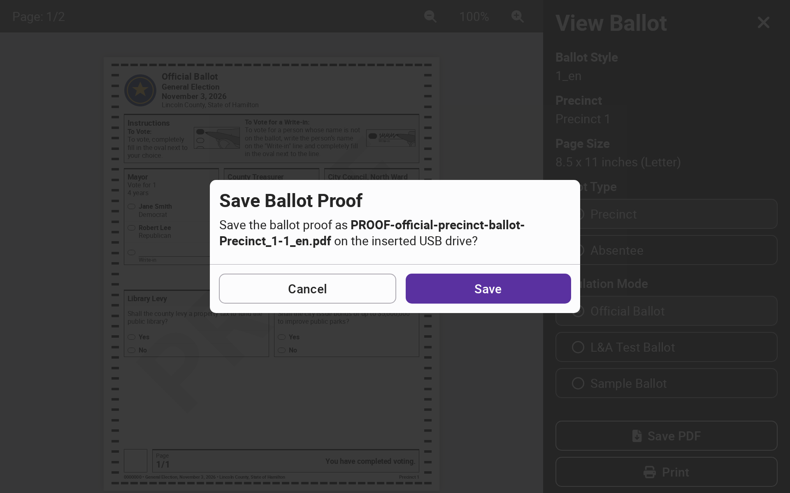

# Proof Ballots

Before finalizing the election, proof every ballot style: check each contest, candidate, and ballot measure against your official sources. You can view proofs on VxAdmin, print them, or save them as PDF files to share for review.

Select `Proof Ballots` from the side menu. Its tabs are `Ballot Styles` and `Ballot Layout`. Set the ballot layout first, since it affects every ballot.

## Set the Ballot Layout

The ballot layout sets the paper size and density of every ballot in the election.

* [ ] Select the `Ballot Layout` tab
* [ ] Select `Edit`
* [ ] Under "Paper Size", select the paper size of your ballot stock
* [ ] Under "Density", select `Default` or `Compact`
* [ ] Select `Save`

<figure><figcaption></figcaption></figure> <figure><figcaption></figcaption></figure>

The paper sizes are 8.5 x 11 inches (Letter), 8.5 x 14 inches (Legal), and 8.5 x 17, 18, 19, 20, and 22 inches. Paper specifications are in the [Supply List](../../miscellaneous/supply-list.md).

`Compact` fits more on each page. Use it when contests don't fit on the paper size you need.

## Review Ballot Styles

VxAdmin creates a ballot style for each different set of contests, from the precincts' districts and, in a primary, the parties. The `Ballot Styles` tab lists each precinct and split with its ballot style.

* [ ] Select the `Ballot Styles` tab

<figure><figcaption></figcaption></figure>

A precinct or split with no contests shows "No contests assigned". Check its districts and the contests' districts.

## View a Ballot

* [ ] Select `View Ballot` next to the precinct or split
* [ ] Under "Ballot Type", select `Precinct` or `Absentee`
* [ ] Under "Tabulation Mode", select `Official Ballot`, `L&A Test Ballot`, or `Sample Ballot`

<figure><figcaption></figcaption></figure>

Use the zoom buttons above the ballot to look closely. Select the close button to return to the ballot styles.

If a contest doesn't fit on the page, VxAdmin shows an error instead of the ballot. Choose a longer paper size or `Compact` density, as described in [Set the Ballot Layout](#set-the-ballot-layout).

<figure><figcaption></figcaption></figure>

## Print or Save a Proof

Proofs are marked "PROOF" and can't be used as ballots.

To print the proof shown:

* [ ] Select `Print`

VxAdmin prints the proof double-sided on the election's paper size. Load the printer with paper of that size first.

<figure><figcaption></figcaption></figure>

To save the proof shown as a PDF file:

* [ ] Insert a USB drive
* [ ] Select `Save PDF`
* [ ] Select `Save`

<figure><figcaption></figcaption></figure>

If you change the election after proofing, proof the affected ballots again.

Continue with [Finalize the Election](finalize.md).
