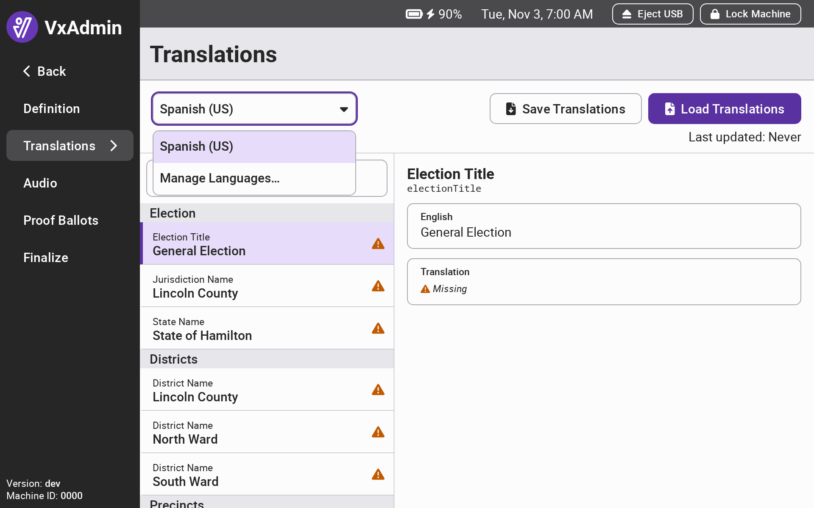
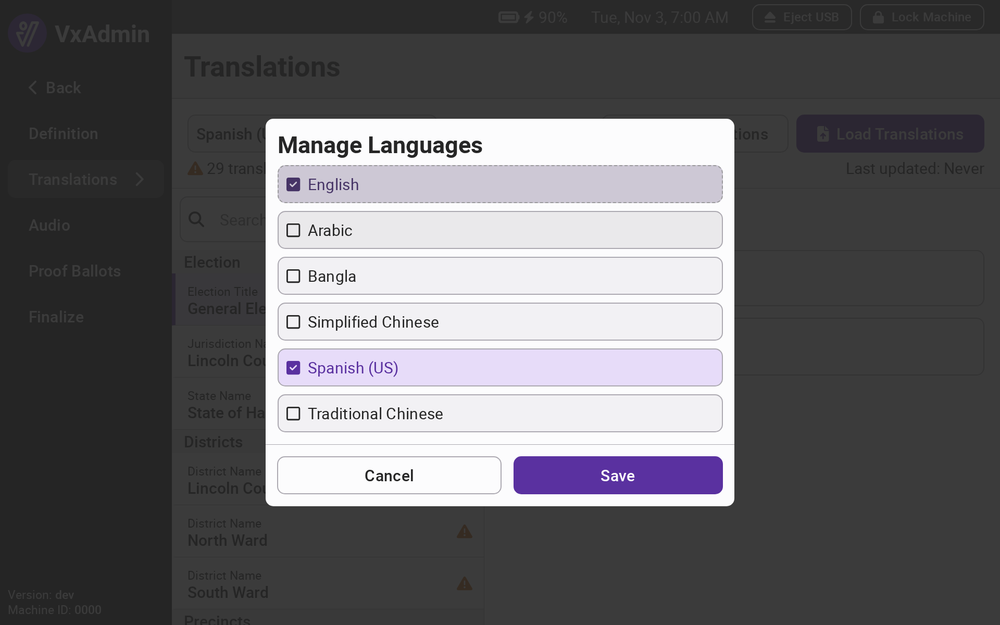
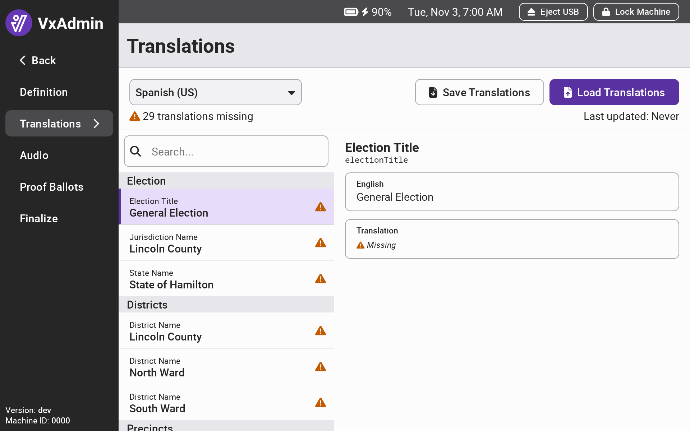
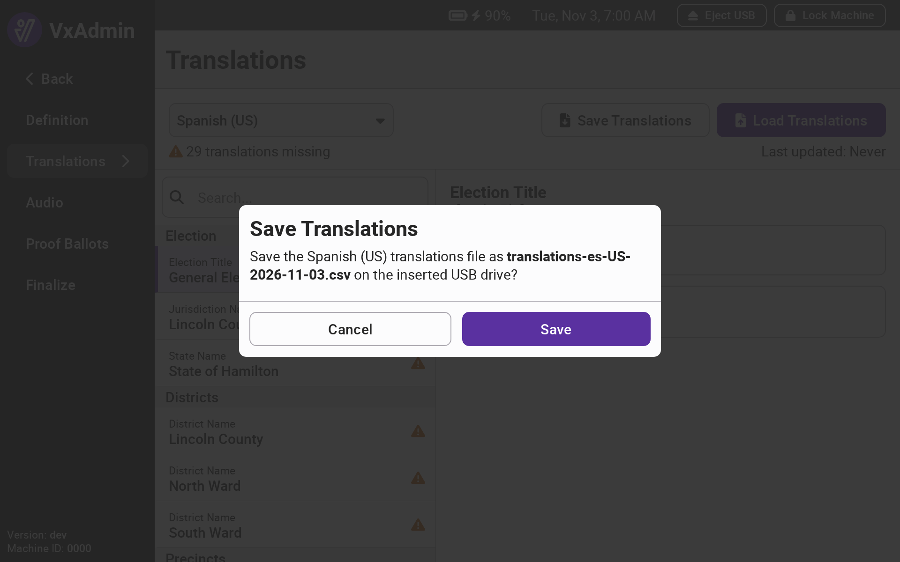
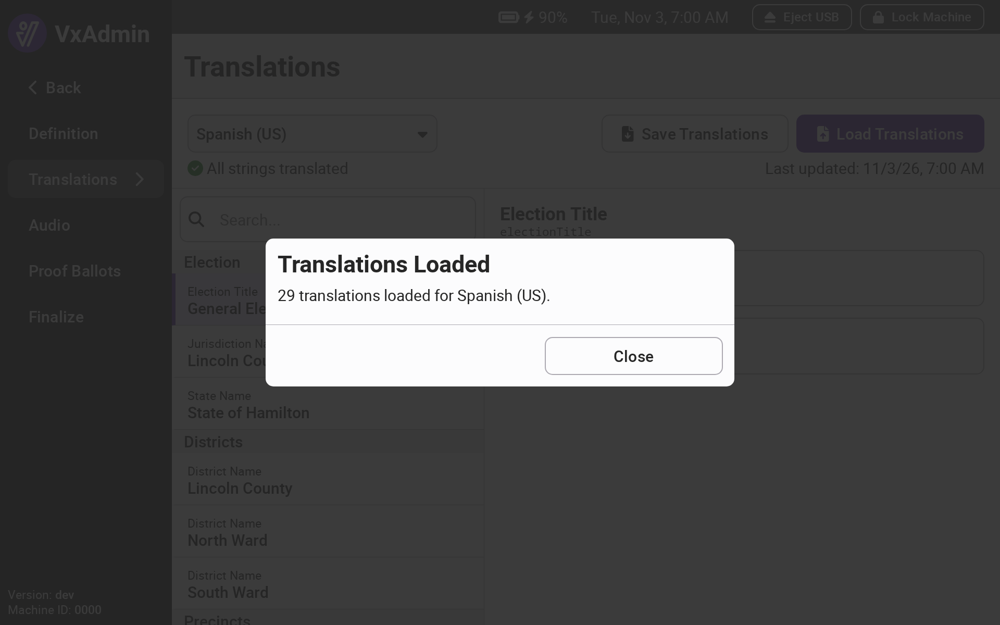
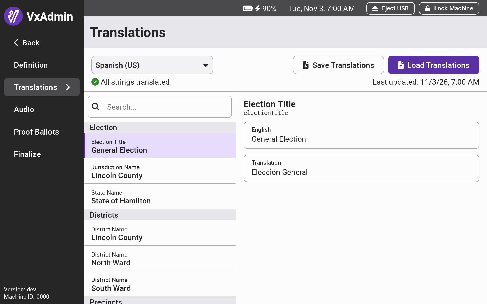
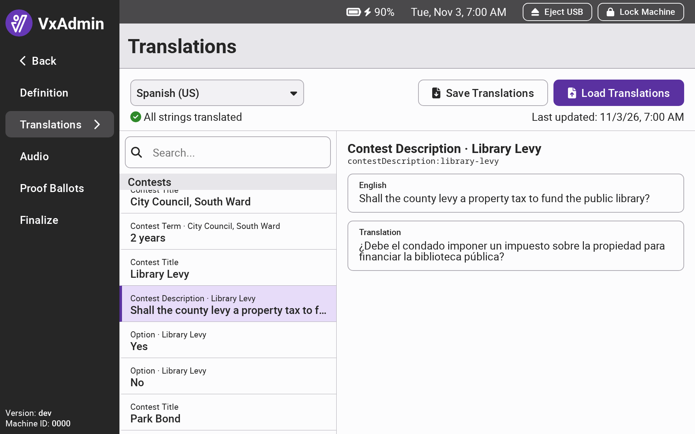

# Load Translations

If your ballots must be available in languages other than English, add those languages and load a translation for every piece of election text: the election title, district and precinct names, contest titles, ballot measure text, and so on. Translations are prepared outside VxAdmin, one language at a time, in a translations file that VxAdmin saves and loads. Skip this page if all ballots are English only.

## Add Languages

* [ ] Select `Translations` from the side menu
* [ ] Open the language menu and select `Manage Languages…`
* [ ] Select each language your ballots need
* [ ] Select `Save`

<figure><figcaption></figcaption></figure> <figure><figcaption></figcaption></figure>

English is always included.

## Review Translations

Choose a language from the language menu. VxAdmin lists every piece of election text, grouped by where it appears, and marks each one that is missing a translation. The count of missing translations and the time translations were last loaded appear under the language menu.

Select an item in the list to see its English text, its translation, and its ID, which identifies it in the translations file. Use `Search…` to find an item.

<figure><figcaption></figcaption></figure>

## Save and Load the Translations File

To have text translated, save the translations file for the language to a USB drive. The file is a spreadsheet (CSV) listing each item's ID, where it appears, its English text, and its current translation, if any. Fill in the translations using the tool or service of your choice, without changing the IDs or English text.

* [ ] Insert a USB drive
* [ ] Choose the language from the language menu
* [ ] Select `Save Translations`
* [ ] Select `Save`

<figure><figcaption></figcaption></figure>

When the translations are filled in, load the file back into VxAdmin:

* [ ] Insert the USB drive containing the filled-in translations file
* [ ] Choose the language from the language menu
* [ ] Select `Load Translations`
* [ ] Select the translations file

VxAdmin reports how many translations were loaded.

* [ ] Select `Close`

<figure><figcaption></figcaption></figure> <figure><figcaption></figcaption></figure>

"All strings translated" should appear under the language menu. If translations are still missing, add them to the file and load it again. Loading a file replaces the language's translations with the ones in the file, so you can save, correct, and reload the file as many times as you need.

Ballot measure text keeps its formatting in translation.

<figure><figcaption></figcaption></figure>

Every language must have a complete set of translations before you can load its audio or finalize the election.

Continue with [Load Audio](audio.md).
