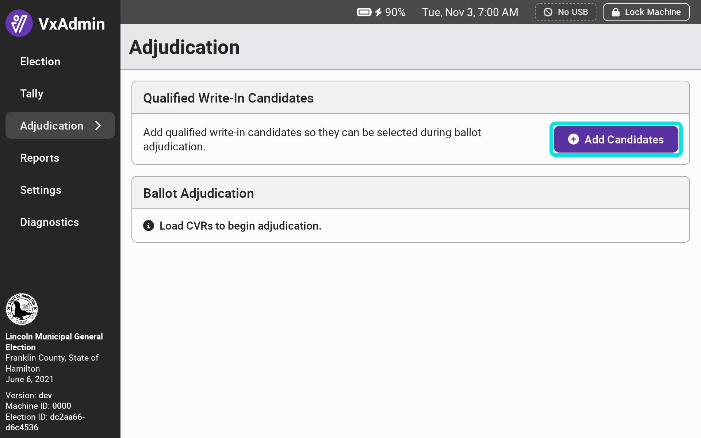
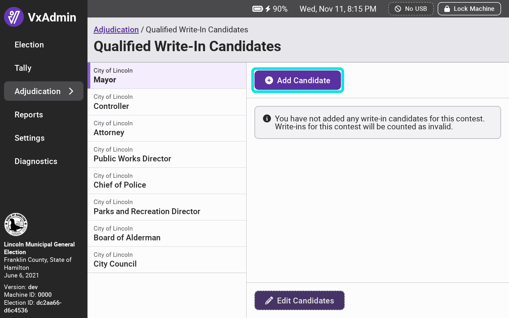
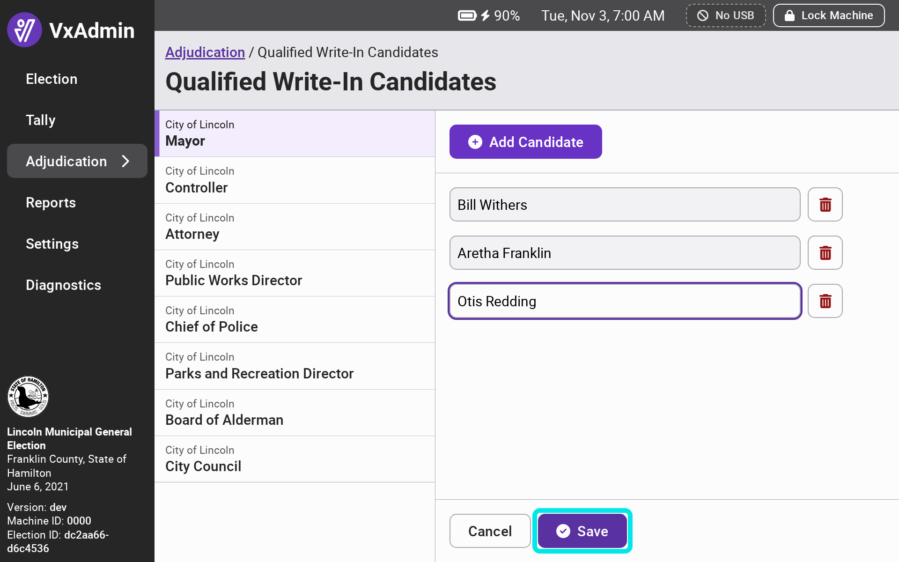
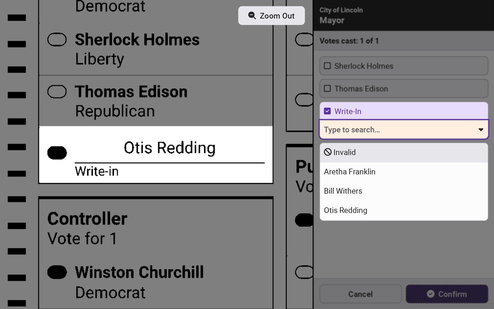
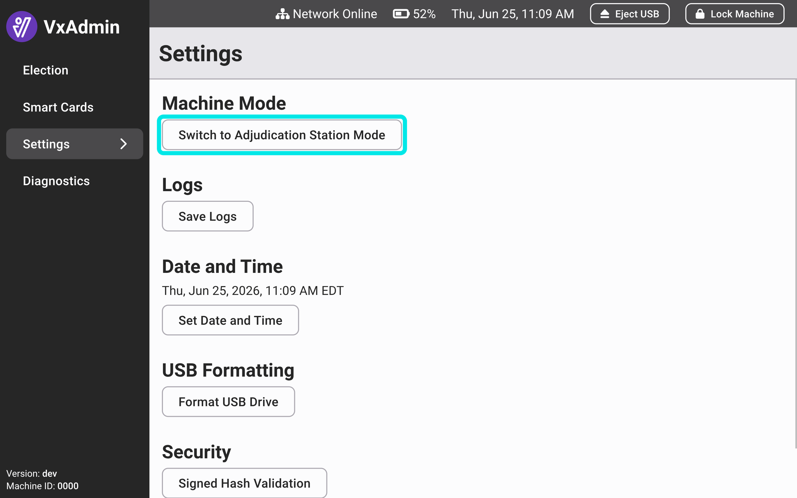
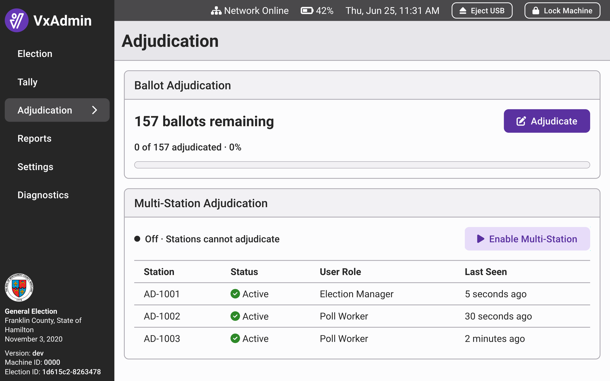
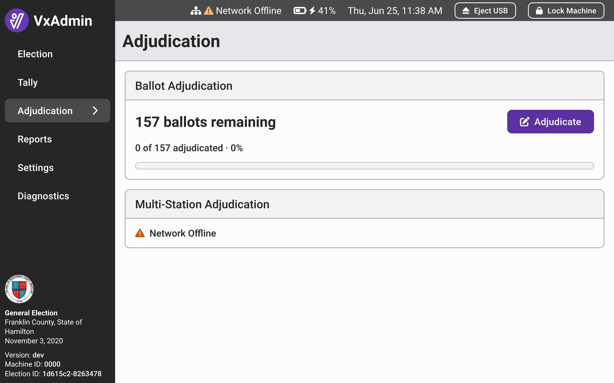
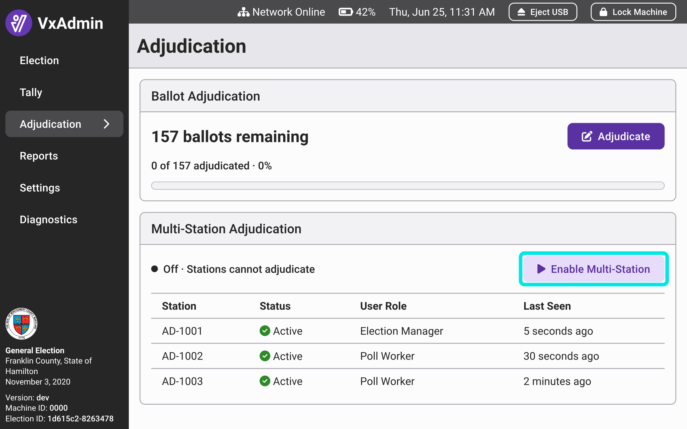
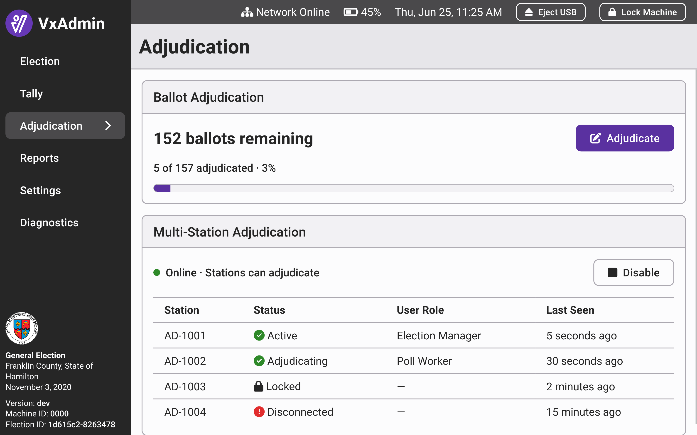
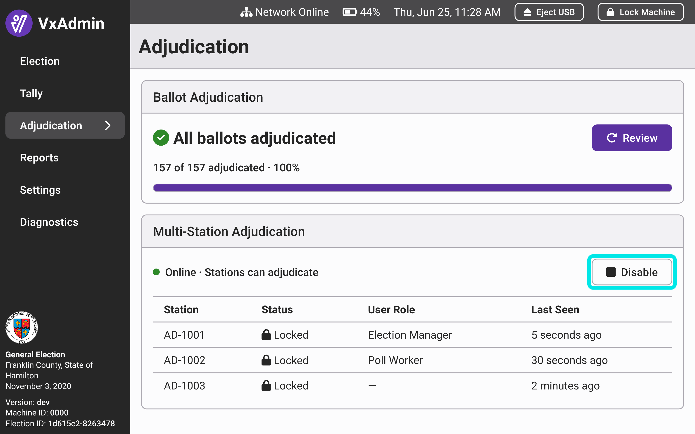

# Pre-Election Adjudication Setup

## System Settings

The system settings in the election package determine which ballots are flagged for adjudication in VxAdmin. Ballots with write-ins or crossover voting are always flagged. Ballots with the following adjudication reasons will only be adjudicated if they are turned on in the system settings: overvotes, undervotes, blank ballots, unmarked write-ins, and marginal marks. Ensure that your system settings match your adjudication needs in VxHub or whatever system you use to create election packages.

The system settings may also be configured to count VxCentralScan ballots only after adjudication. If so, ballots scanned on VxCentralScan that need adjudication will not be included in tally reports until they have been adjudicated. Ballot count reports still include these ballots and can be filtered by reporting status to show which ballots are counted and which are not yet counted.

## Qualified Write-Ins

If only qualified (a.k.a. "certified") write-ins are allowed in your jurisdiction, then you must input the names of those qualified write-in candidates prior to starting adjudication. Navigate to the `Adjudication` page in VxAdmin and select `Add Candidates`.

<figure><figcaption></figcaption></figure>

For each contest with qualified write-in candidates, for each candidate, select `Add Candidate` and type in the candidate name. When you're done adding candidates in a contest, select `Save`.

<figure><figcaption></figcaption></figure>

<figure><figcaption></figcaption></figure>

The added candidates will be the only options for write-in adjudication. If no candidates are added for a contest, write-ins for that contest can only be adjudicated as invalid.

<figure><figcaption></figcaption></figure>

## Multi-Station Adjudication

Multiple VxAdmins can be networked together to perform adjudication at multiple stations. Large jurisdictions with a high volume of ballots to adjudicate typically need multiple stations.

### Network Setup

The pieces of equipment needed for multi-station adjudication:

* Ethernet network switch
* Ethernet cables
* Ethernet to USB-C adapter

All networking equipment should have been sold to you by VotingWorks. If you need new or additional networking equipment, please reach out to VotingWorks.

To physically set up the network, start by connecting the network switch to power. Then connect each VxAdmin to one of the ethernet switch ports via the USB-C to Ethernet adapter and the Ethernet cable. No network configuration is required.

You must choose one VxAdmin to act as the "host VxAdmin." The host VxAdmin is where all data will be stored and where all VxAdmin features will be available. All other VxAdmins must be configured as adjudication stations. Adjudication stations are only for adjudication. To switch a VxAdmin to adjudication station mode, log in as a system administrator, go to `Settings`, and select `Switch to Adjudication Station Mode`. You will be prompted to reboot the computer. If you don't see the option to `Switch to Adjudication Station Mode`, your VxAdmin may not have networking enabled and you should contact VotingWorks.

<figure><figcaption></figcaption></figure>

If your network is properly set up, you should see the list of the connected adjudication stations on the host's `Adjudication` screen.

<figure><figcaption></figcaption></figure>

If there is a problem with your network, you will see a status indicator on the hosts `Adjudication` page or on the adjudication station.

<figure><figcaption></figcaption></figure>

### Adjudication

The adjudication stations can only adjudicate if the host has turned on multi-station adjudication. To do so, log in as an election manager at the host VxAdmin and select `Enable Multi-Station`.

<figure><figcaption></figcaption></figure>

The adjudication stations will now be able to adjudicate ballots. Adjudicators can log in with either an election manager card or a poll worker card. The adjudication process is exactly the same at adjudication stations as it is at the host except that adjudicators are not able to view previous ballots or skip ballots. Refer to the [adjudication.md](../election-night-guides/adjudication.md "mention") guide for a walkthrough of the adjudication process.

You can monitor the progress of adjudication from the `Adjudication` screen at the host. You can also see the status of each station e.g. "Locked" or "Adjudicating".

<figure><figcaption></figcaption></figure>

When adjudication is done for the day, turn off multi-station adjudication by selecting `Disable`.

<figure><figcaption></figcaption></figure>

#### Escalated Ballots

If an adjudicator at an adjudication station is unsure how to adjudicate a ballot, they can select `Escalate` instead of `Accept` to send the ballot to the host for election manager review. Any unsaved changes to the ballot are discarded and the station moves on to the next ballot.

Escalated ballots appear in a callout at the top of the host's `Adjudication` screen. Select `Adjudicate Escalated Ballots` to work through only the escalated ballots. Each escalated ballot is also labeled "Escalated for election manager review" when viewed at the host. Escalated ballots remain in the main adjudication queue as well, so they will also be encountered when adjudicating all ballots from the host. Escalated ballots are resolved by adjudicating them at the host; ballots cannot be escalated from the host.
