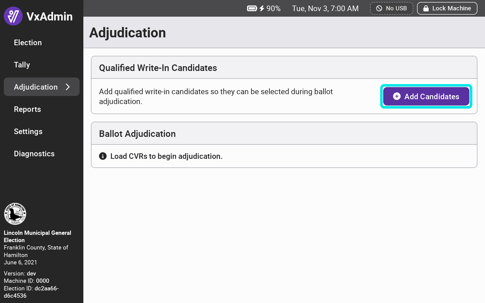
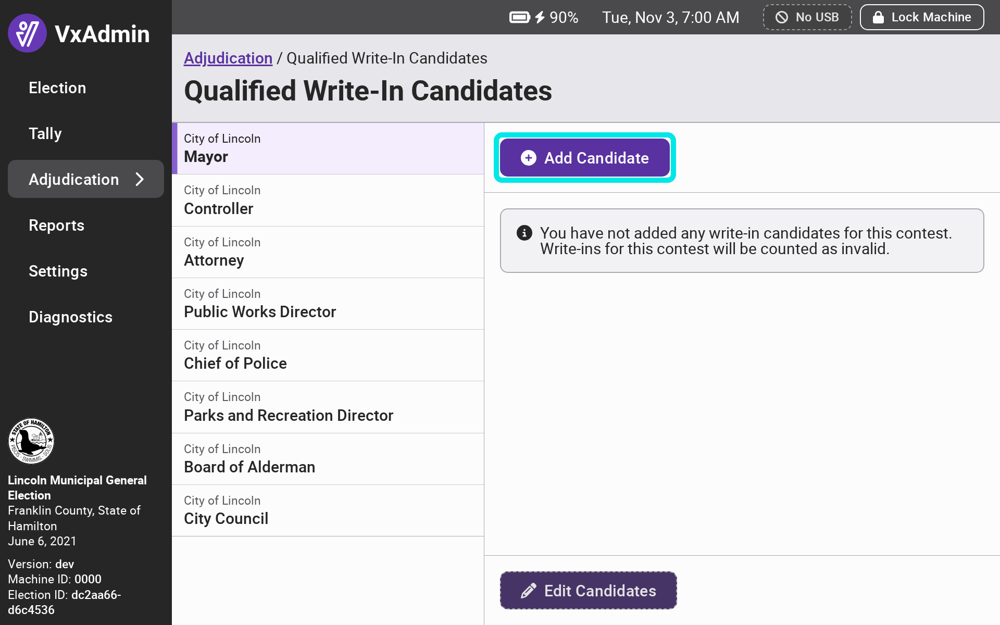
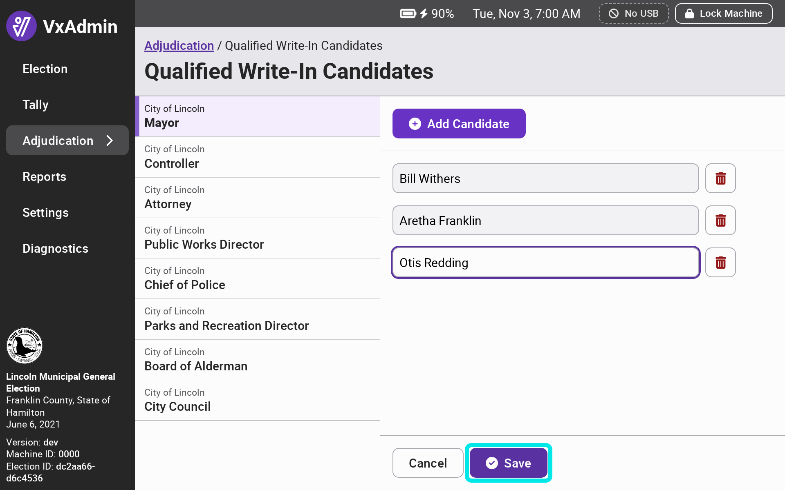
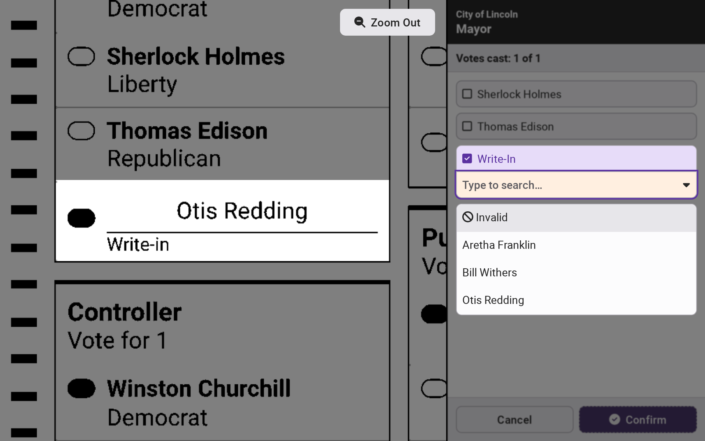
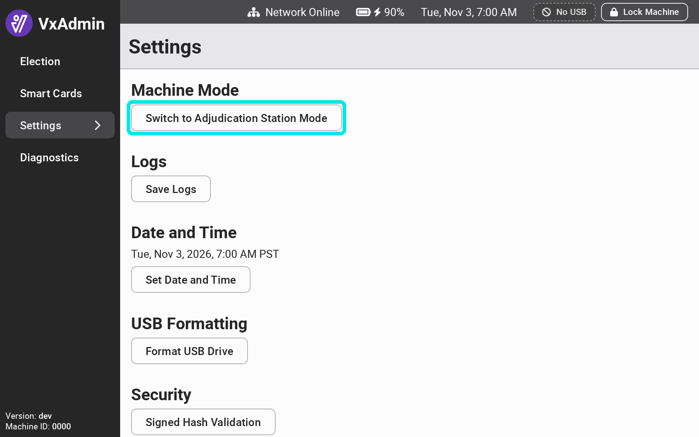
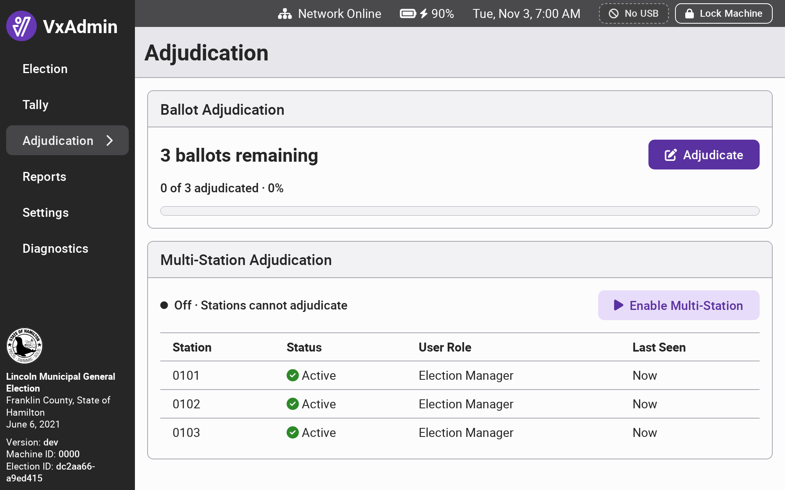
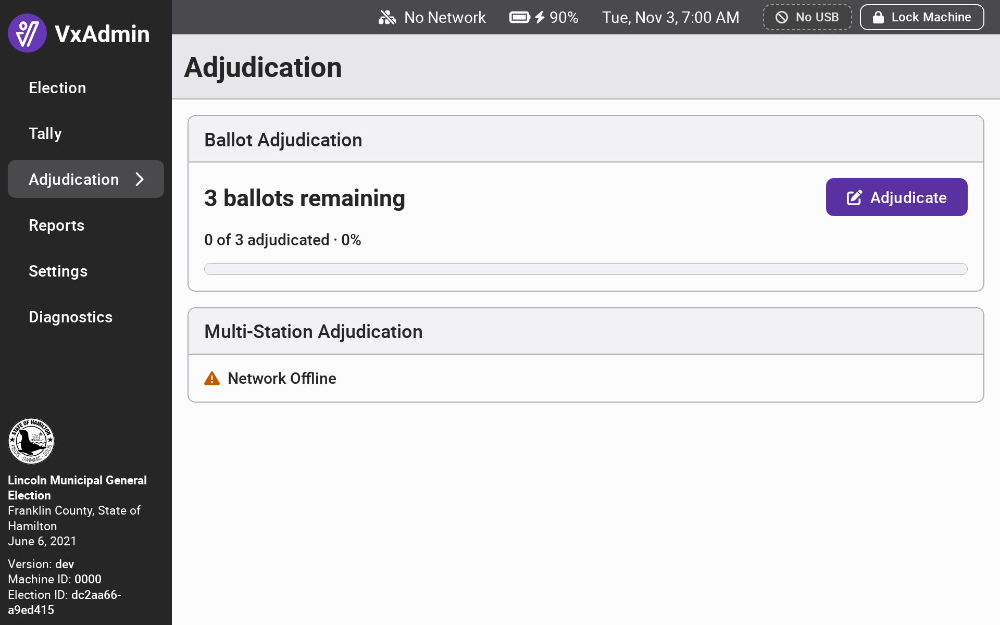
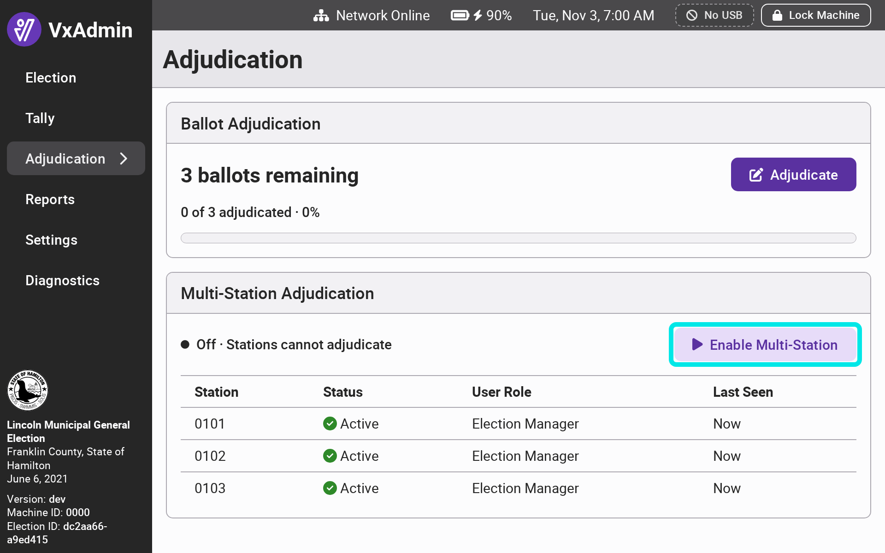
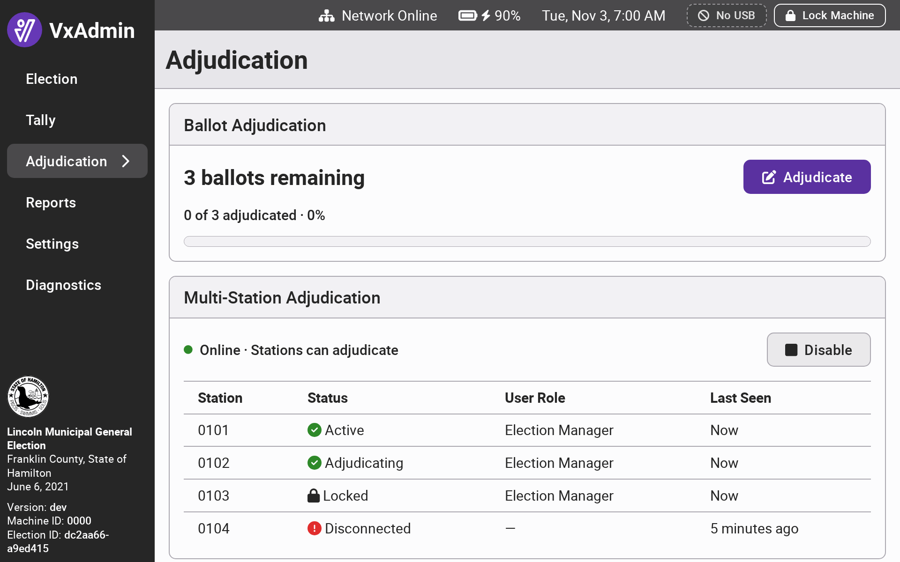
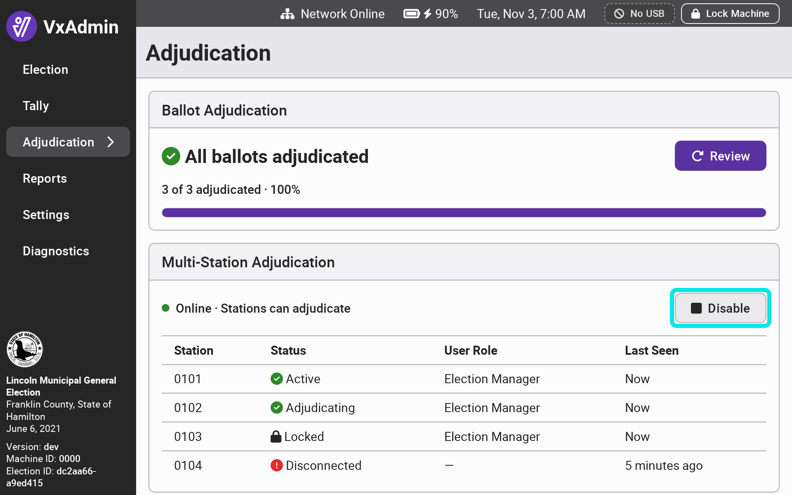

# Set Up Pre-Election Adjudication

## System Settings

The system settings in the election package determine which ballots are flagged for adjudication in VxAdmin. Ballots with write-ins or crossover voting are always flagged. Ballots with the following adjudication reasons are only adjudicated if they are turned on in the system settings: overvotes, undervotes, blank ballots, unmarked write-ins, and marginal marks. Ensure that your system settings match your adjudication needs in VxHub or whatever system you use to create election packages.

The system settings may also be configured to count VxCentralScan ballots only after adjudication. If so, ballots scanned on VxCentralScan that need adjudication are not included in tally reports until they have been adjudicated. Ballot count reports still include these ballots and can be filtered by reporting status to show which ballots are counted and which are not yet counted.

## Add Qualified Write-In Candidates

If only qualified (also known as "certified") write-ins are allowed in your jurisdiction, then you must input the names of those qualified write-in candidates prior to starting adjudication.

* [ ] Select `Adjudication` from the side menu
* [ ] Select `Add Candidates`

<figure><figcaption></figcaption></figure>

For each contest with qualified write-in candidates:

* [ ] Select `Add Candidate`
* [ ] Type the candidate name
* [ ] Repeat for each qualified write-in candidate in the contest
* [ ] Select `Save`

<figure><figcaption></figcaption></figure>

<figure><figcaption></figcaption></figure>

The added candidates are the only options for write-in adjudication. If no candidates are added for a contest, write-ins for that contest can only be adjudicated as invalid.

<figure><figcaption></figcaption></figure>

## Multi-Station Adjudication

Multiple VxAdmins can be networked together to perform adjudication at multiple stations. Large jurisdictions with a high volume of ballots to adjudicate typically need multiple stations.

### Set Up the Network

The pieces of equipment needed for multi-station adjudication:

* Ethernet network switch
* Ethernet cables
* Ethernet to USB-C adapter

All networking equipment should have been sold to you by VotingWorks. If you need new or additional networking equipment, please reach out to VotingWorks.

To physically set up the network:

* [ ] Connect the network switch to power
* [ ] Connect each VxAdmin to one of the Ethernet switch ports via the USB-C to Ethernet adapter and the Ethernet cable

No network configuration is required.

You must choose one VxAdmin to act as the "host VxAdmin." The host VxAdmin is where all data is stored and where all VxAdmin features are available. All other VxAdmins must be configured as adjudication stations. Adjudication stations are only for adjudication. To switch a VxAdmin to adjudication station mode:

* [ ] Log in as a system administrator
* [ ] Select `Settings` from the side menu
* [ ] Select `Switch to Adjudication Station Mode`

VxAdmin prompts you to reboot the computer. If you don't see the option to `Switch to Adjudication Station Mode`, your VxAdmin may not have networking enabled and you should contact VotingWorks.

<figure><figcaption></figcaption></figure>

If your network is properly set up, you should see the list of the connected adjudication stations on the host's `Adjudication` screen.

<figure><figcaption></figcaption></figure>

If there is a problem with your network, a status indicator appears on the host's `Adjudication` page or on the adjudication station.

<figure><figcaption></figcaption></figure>

### Run Multi-Station Adjudication

The adjudication stations can only adjudicate if the host has turned on multi-station adjudication. To turn it on:

* [ ] Log in as an election manager at the host VxAdmin
* [ ] Select `Enable Multi-Station`

<figure><figcaption></figcaption></figure>

The adjudication stations can now adjudicate ballots. Adjudicators can log in with either an election manager card or a poll worker card. The adjudication process is exactly the same at adjudication stations as it is at the host except that adjudicators are not able to view previous ballots or skip ballots. Refer to the [Adjudication](../election-night-guides/adjudication.md "mention") guide for a walkthrough of the adjudication process.

You can monitor the progress of adjudication from the `Adjudication` screen at the host. You can also see the status of each station, e.g., "Locked" or "Adjudicating".

<figure><figcaption></figcaption></figure>

When adjudication is done for the day, turn off multi-station adjudication:

* [ ] Select `Disable`

<figure><figcaption></figcaption></figure>

#### Escalated Ballots

If an adjudicator at an adjudication station is unsure how to adjudicate a ballot, they can select `Escalate` instead of `Accept` to send the ballot to the host for election manager review. Any unsaved changes to the ballot are discarded and the station moves on to the next ballot.

Escalated ballots appear in a callout at the top of the host's `Adjudication` screen. Select `Adjudicate Escalated Ballots` to work through only the escalated ballots. Each escalated ballot is also labeled "Escalated for election manager review" when viewed at the host. Escalated ballots remain in the main adjudication queue as well, so they also come up when adjudicating all ballots from the host. Escalated ballots are resolved by adjudicating them at the host; ballots cannot be escalated from the host.
