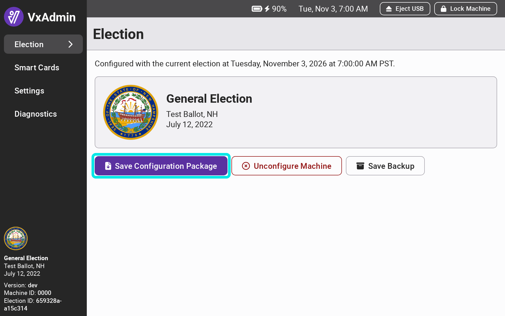
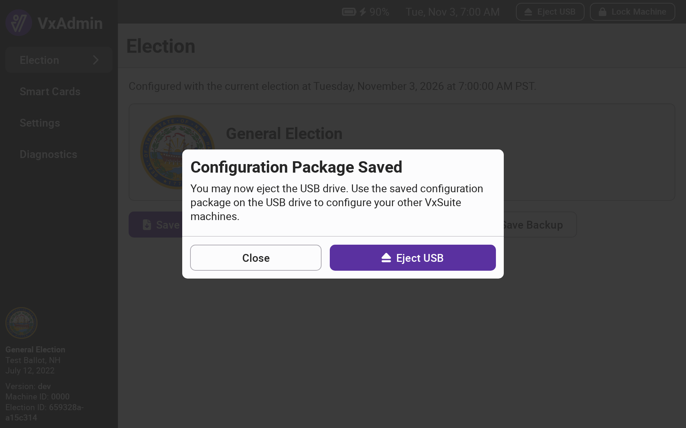

# Save the Configuration Package

To configure VxScan, VxCentralScan, VxMark, VxMarkScan, or VxPrint, you must first save the configuration package from VxAdmin to a USB drive.

* [ ] Select `Election` from the side menu
* [ ] Select `Save Configuration Package`

<figure><figcaption></figcaption></figure>

* [ ] If a USB drive isn't already inserted, insert a USB drive
* [ ] Select `Save`

<figure><figcaption></figcaption></figure>

VxAdmin saves the configuration package to the USB drive.

* [ ] Select `Eject USB`

<figure><figcaption></figcaption></figure>

VxAdmin confirms once it is safe to remove the USB drive.


The configuration package saved at VxAdmin is different from the election package used to configure your VxAdmin. VxScan, VxCentralScan, VxMark, VxMarkScan, and VxPrint can only be configured with configuration packages saved at VxAdmin.

