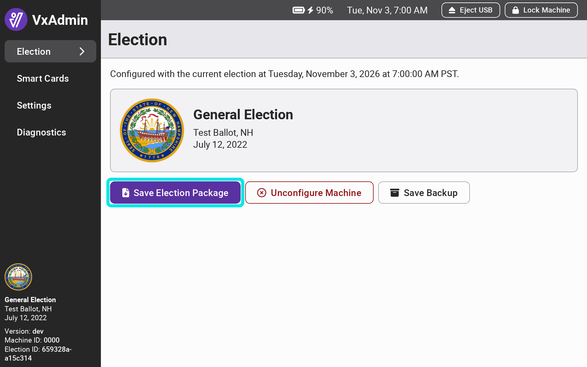
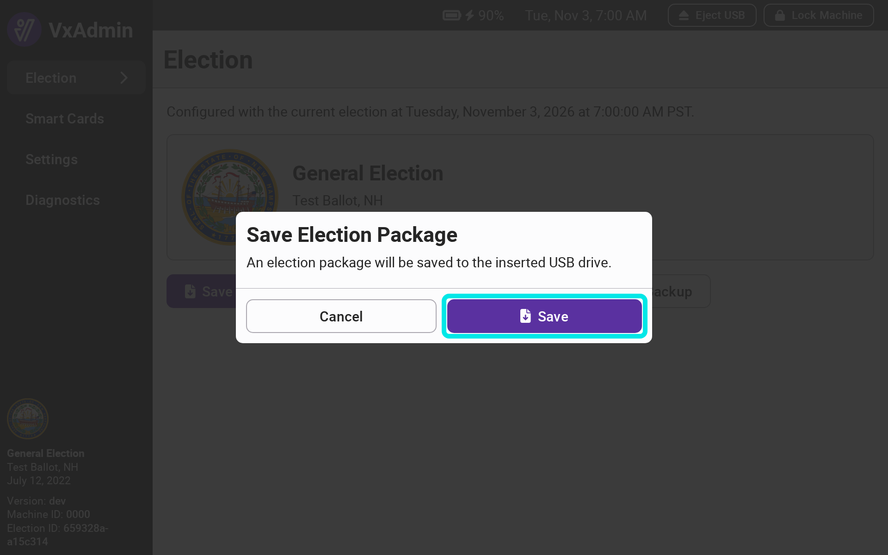

# Save Election Package

To configure VxScan, VxCentralScan, VxMark, VxMarkScan, or VxPrint, you must first save the election package from VxAdmin to a USB drive. You may do so as either the system administrator or the election manager. Select `Election` from the side menu and select `Save Election Package`.

<figure><figcaption></figcaption></figure>

If you don't already have a USB drive inserted, insert a USB drive. Then select `Save` to save the election package.

<figure><figcaption></figcaption></figure>

VxAdmin will save an election package to the USB drive. Once the file is saved, select `Eject USB`. VxAdmin will confirm once it is safe to remove the USB drive.


The election package saved at VxAdmin is different from the election package used to configure your VxAdmin. VxScan, VxCentralScan, VxMark, VxMarkScan, and VxPrint can only be configured with election packages saved at VxAdmin.

