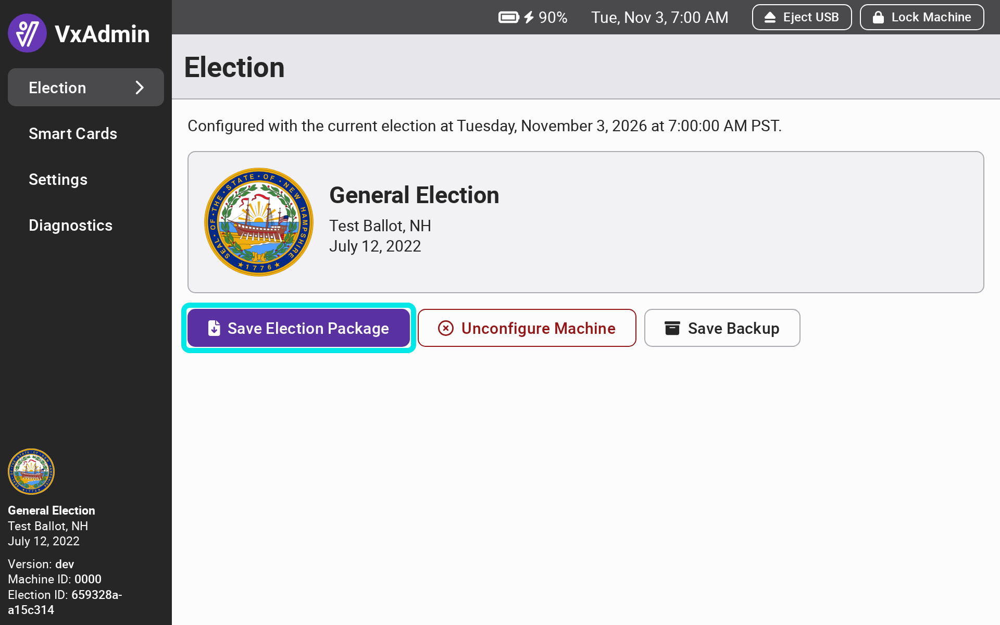
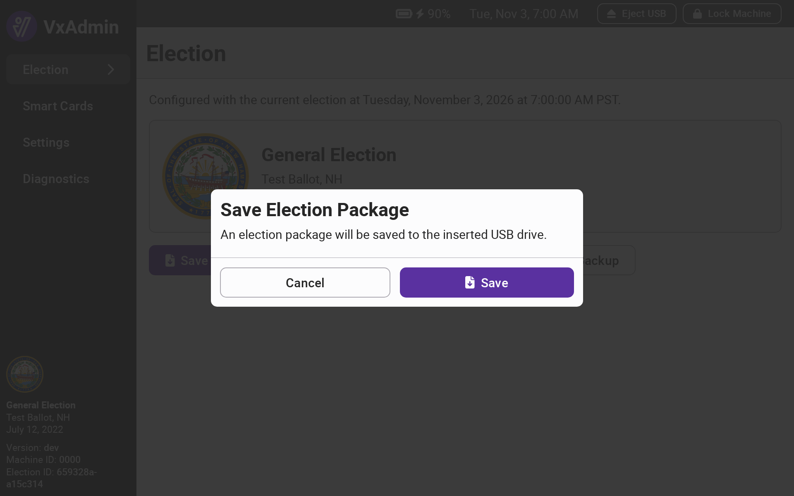
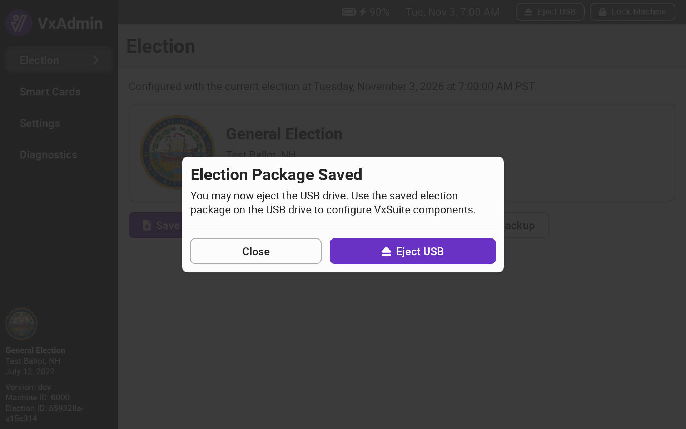

# Save the Election Package

To configure VxScan, VxCentralScan, VxMark, VxMarkScan, or VxPrint, you must first save the election package from VxAdmin to a USB drive.

* [ ] Select `Election` from the side menu
* [ ] Select `Save Election Package`

<figure><figcaption></figcaption></figure>

* [ ] If a USB drive isn't already inserted, insert a USB drive
* [ ] Select `Save`

<figure><figcaption></figcaption></figure>

VxAdmin saves the election package to the USB drive.

* [ ] Select `Eject USB`

<figure><figcaption></figcaption></figure>

VxAdmin confirms once it is safe to remove the USB drive.


The election package saved at VxAdmin is different from the election package used to configure your VxAdmin. VxScan, VxCentralScan, VxMark, VxMarkScan, and VxPrint can only be configured with election packages saved at VxAdmin.

