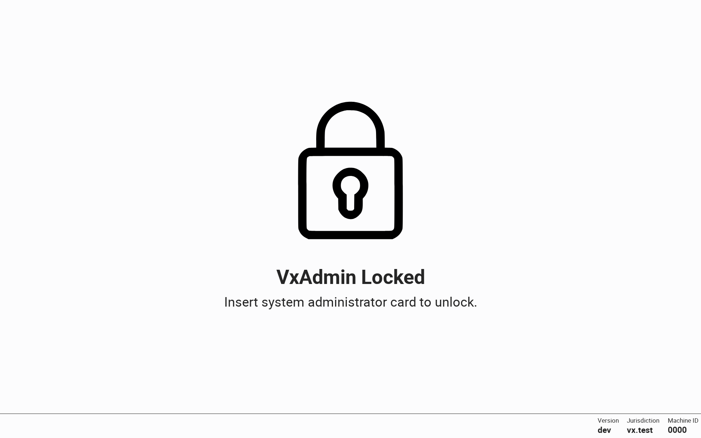
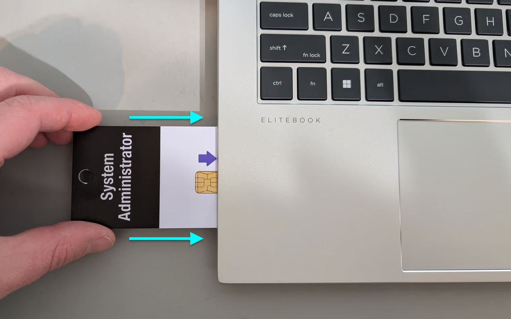
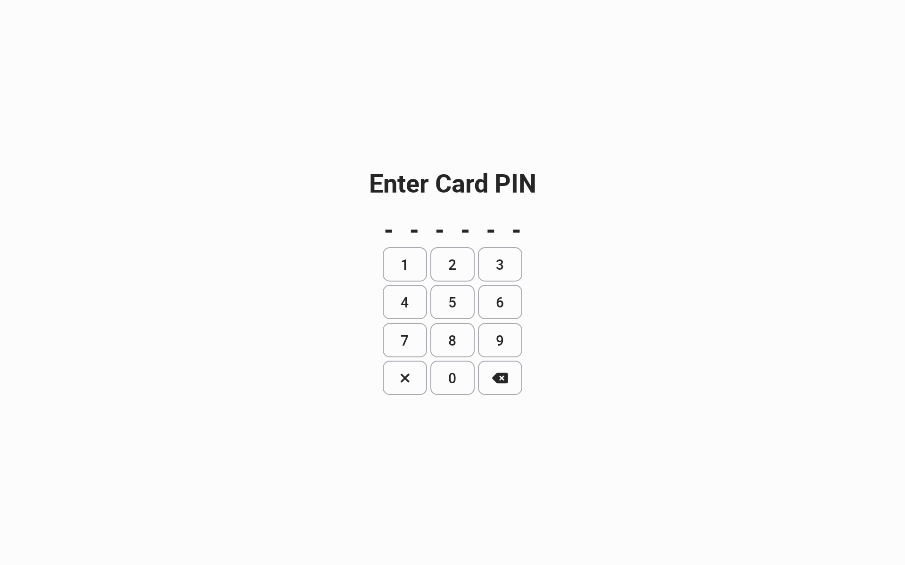
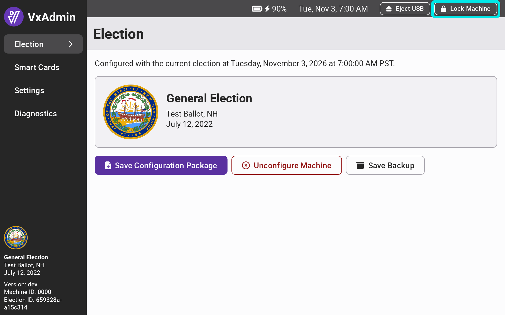

# Unlock and Lock

VxAdmin, VxCentralScan, and VxPrint require you to use a smart card and a PIN to log in. Each laptop has a smart card reader on the lower left hand side of the laptop.

## Unlock the Machine

All devices are locked after turning on. To unlock the machine:

* [ ] Insert your election manager or system administrator card into the smart card reader
* [ ] Enter the PIN
* [ ] Remove your card

<figure><figcaption></figcaption></figure> <figure><figcaption>
Insert smart card into card reader
</figcaption></figure> <figure><figcaption></figcaption></figure>

## Lock the Machine

Each machine should be locked when not in use.

* [ ] Select `Lock Machine` in the upper right hand corner of the screen

<figure><figcaption></figcaption></figure>
