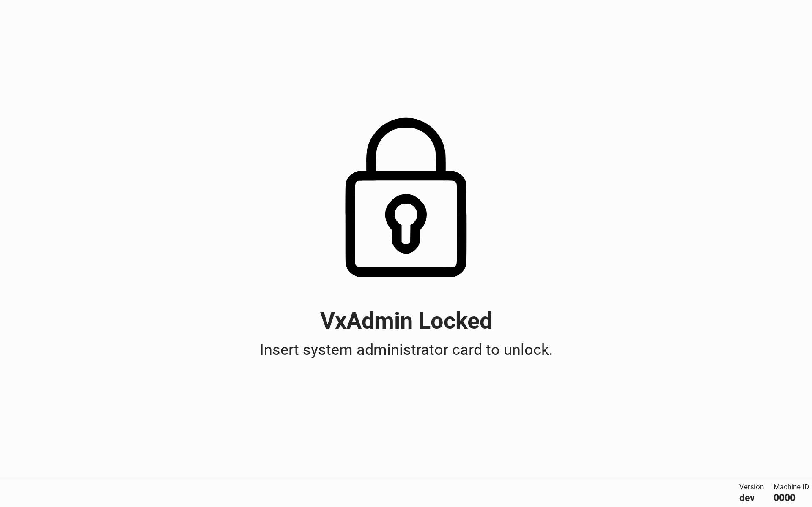
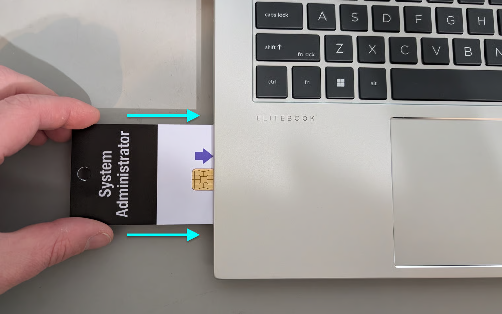
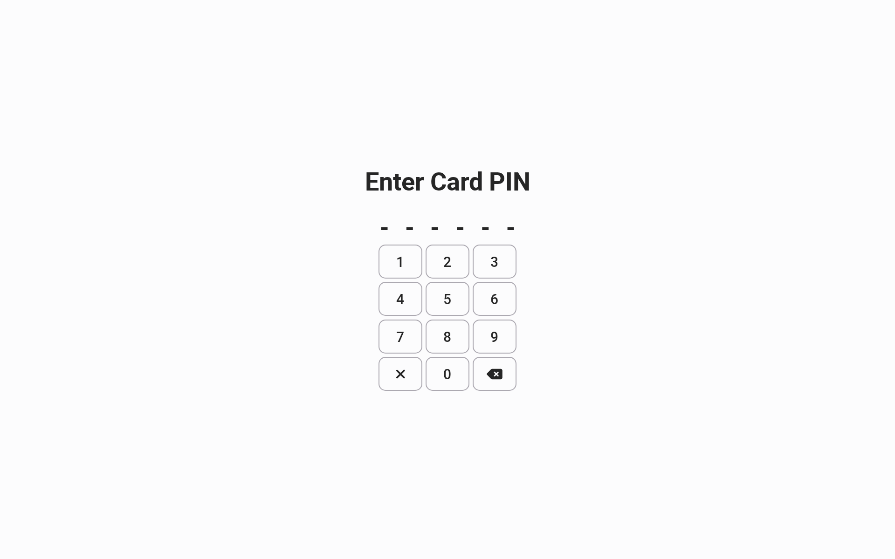
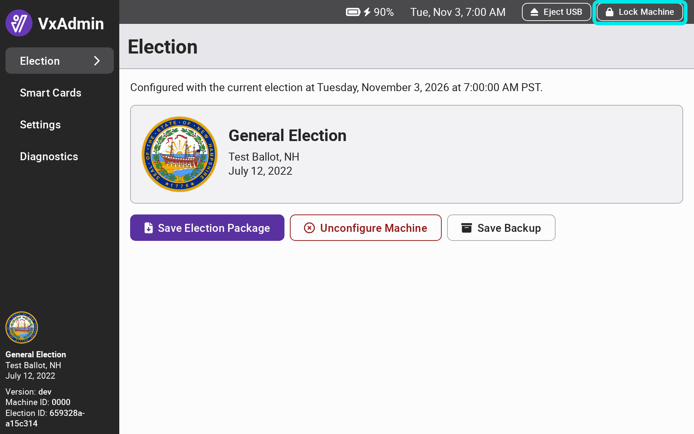

# Unlocking & Locking

### Unlocking

VxAdmin, VxCentralScan, and VxPrint require users to use a smart card and a PIN to log in. Each laptop has a smart card reader on the lower left hand side of the laptop.

All devices will be locked after turning on. To unlock the machine, insert your election manager or system administrator card into the smart card reader. Enter the PIN and remove your card.

<figure><figcaption>
Lock Screen
</figcaption></figure> <figure><figcaption>
Insert smart card into card reader
</figcaption></figure> <figure><figcaption>
PIN Input
</figcaption></figure>

### Locking

Lock the device by selecting `Lock Machine` in the upper right hand corner of the screen. Each machine should be locked when not in use.

<figure><figcaption></figcaption></figure>
