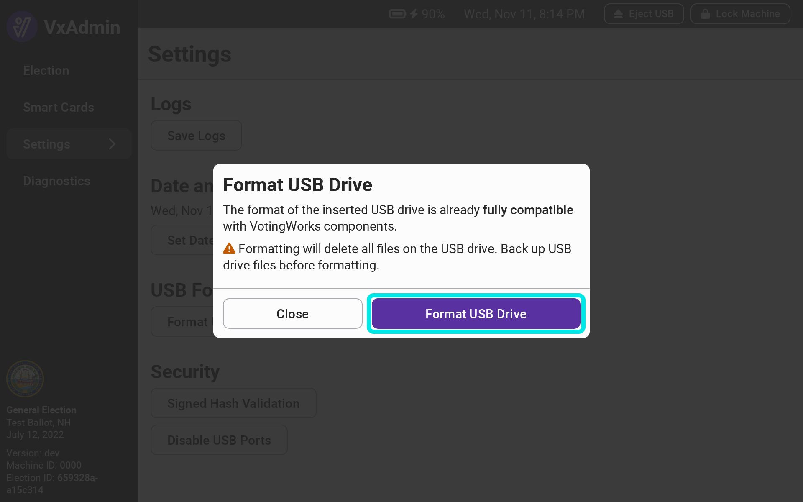

# USB Formatting


The following steps must be completed by a system administrator.


A USB drive with a single FAT32 or exFAT partition works without reformatting. If VxSuite reports that a drive can't be used, format it from VxAdmin.

VxAdmin formats USB drives with the exFAT filesystem, which can be read on Windows and macOS and has no limit on the size of individual files. A drive that isn't formatted as FAT32 or exFAT is not recognized until it is formatted.

In VxAdmin, select `Settings` from the side menu and select `Format USB Drive`.

<figure><figcaption></figcaption></figure>

Confirm you want to format the USB drive by selecting `Format USB Drive`. **Formatting the USB drive will delete all files on the USB drive.**

<figure><figcaption></figcaption></figure>

VxAdmin will then confirm your USB drive is ready for use. Repeat this step for all other USB drives.


Backup drives are not formatted at VxAdmin. See [backup-and-restore.md](backup-and-restore.md "mention").

