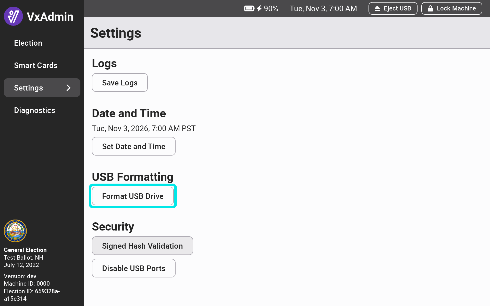
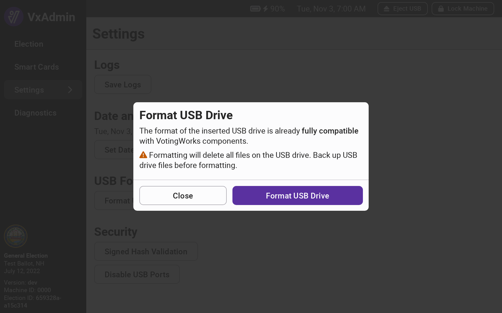
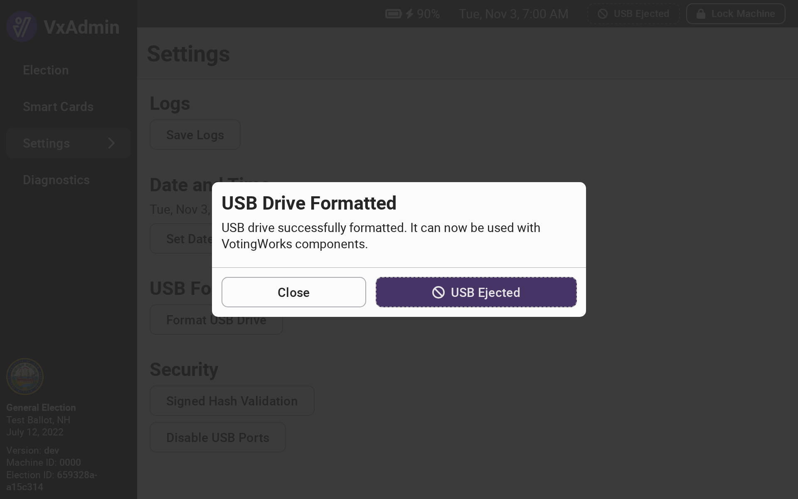

# Format USB Drives


These steps must be completed by a system administrator.


A USB drive with a single FAT32 or exFAT partition works without reformatting. If VxSuite reports that a drive can't be used, format it from VxAdmin.

VxAdmin formats USB drives with the exFAT filesystem, which can be read on Windows and macOS and has no limit on the size of individual files. A drive that isn't formatted as FAT32 or exFAT is not recognized until it is formatted.

* [ ] Select `Settings` from the side menu
* [ ] Select `Format USB Drive`

<figure><figcaption></figcaption></figure>


Formatting the USB drive deletes all files on the USB drive.


* [ ] Select `Format USB Drive` to confirm

<figure><figcaption></figcaption></figure>

VxAdmin then confirms your USB drive is ready for use. Repeat these steps for all other USB drives.

<figure><figcaption></figcaption></figure>


Backup drives are not formatted at VxAdmin. See [Back Up and Restore](backup-and-restore.md "mention").

