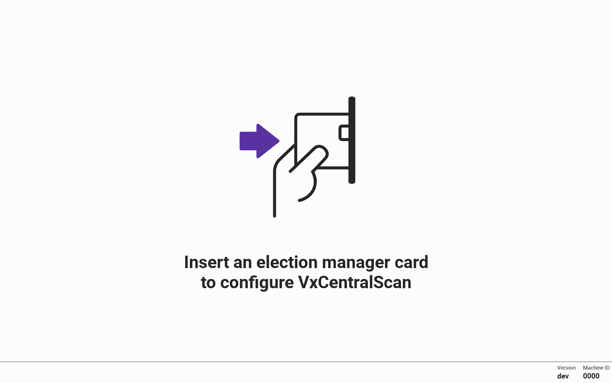
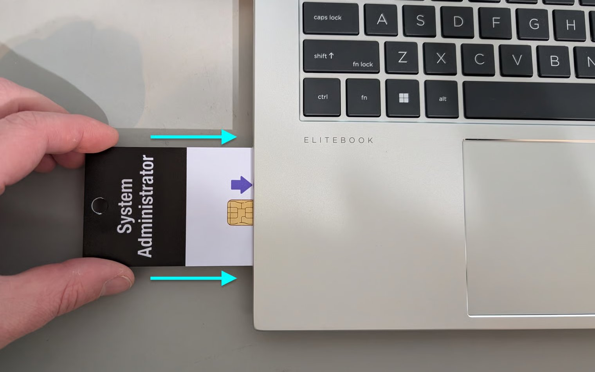
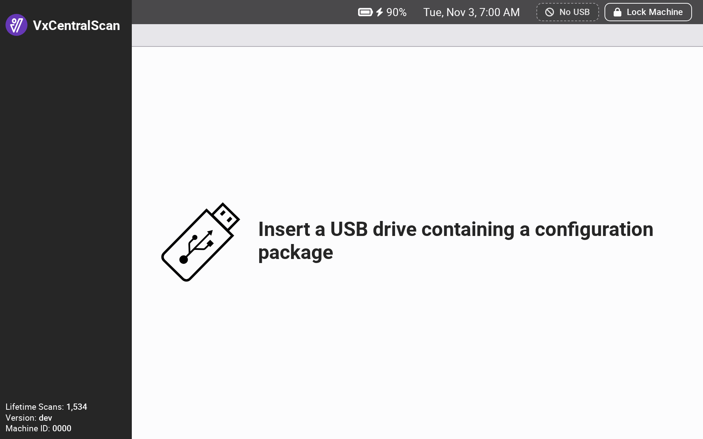
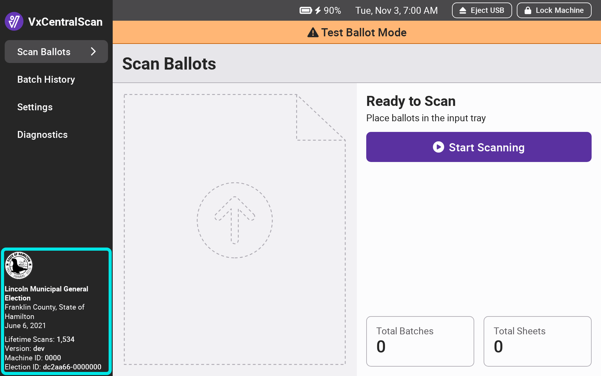
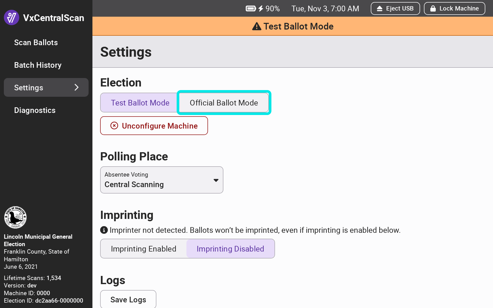
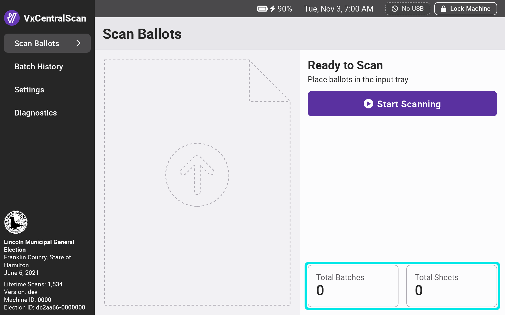
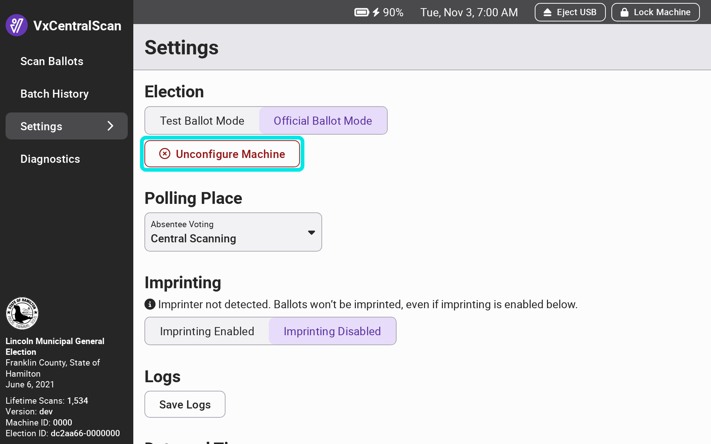
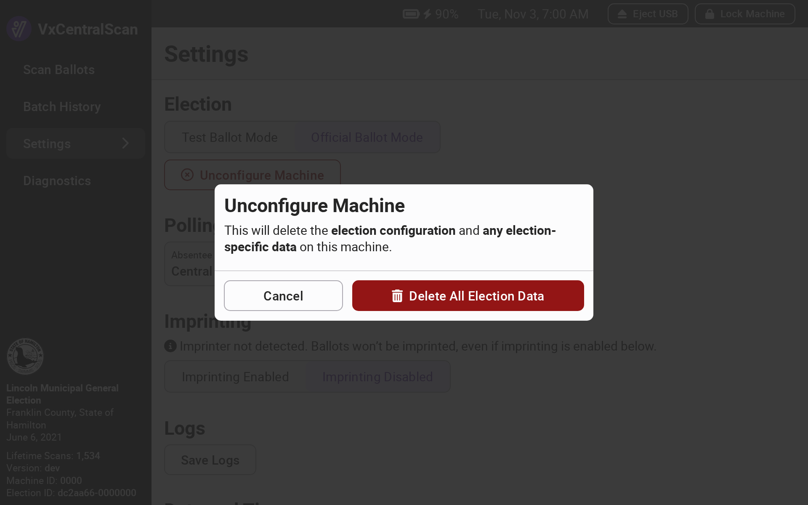

# Configure VxCentralScan


These steps must be completed by an election manager.


Before you configure VxCentralScan, you must set up the machine. Follow the steps in [VxCentralScan Hardware Setup](vxcentralscan-hardware-setup.md "mention").

To configure VxCentralScan, you must do two things in VxAdmin:

* [ ] Save the configuration package to a USB drive (see [Save the Configuration Package](../vxadmin-system-setup/save-election-package.md "mention"))
* [ ] Create an election manager card (see [Smart Cards and User Roles](../vxadmin-system-setup/programming-cards.md "mention"))

## Load the Configuration Package

Once the configuration package is saved to a USB drive, you can load the file to VxCentralScan.

* [ ] Set up the VxCentralScan hardware
* [ ] Turn on the VxCentralScan laptop
* [ ] Insert an election manager card to unlock the machine

<figure><figcaption></figcaption></figure> <figure><figcaption></figcaption></figure>

* [ ] Insert a USB drive with the configuration package saved from VxAdmin

The configuration package loads automatically.

<figure><figcaption></figcaption></figure>

VxCentralScan is now configured and in test ballot mode. The election summary information (name, date, jurisdiction, etc.) is shown in the bottom left corner of the screen.

* [ ] Confirm that the election summary information is correct

<figure><figcaption></figcaption></figure>

## Select a Polling Place

There's usually no need to set the polling place on VxCentralScan. For most jurisdictions, it defaults to an absentee polling place like "Central Scanning" or "Absentee Voting" that covers all precincts in the jurisdiction. If VxCentralScan must be limited to certain precincts, select a different polling place from the dropdown. If ballots outside the selected polling place are scanned, VxCentralScan stops on those ballots and doesn't allow tabulating them. The polling place cannot be changed once ballots have been scanned.

## Set the Ballot Mode

When testing is complete, switch VxCentralScan to official ballot mode on the `Settings` screen:

<figure><figcaption></figcaption></figure>

The `Scan Ballots` page should show zeroes for "Total Batches" and "Total Sheets," and there should also be no test ballot mode banner. VxCentralScan is now ready for the election.

<figure><figcaption></figcaption></figure>

## Remove Configuration and Election Data

To remove the election configuration and all election data from VxCentralScan:

* [ ] Insert an election manager card
* [ ] Select `Settings` from the side menu
* [ ] Select `Unconfigure Machine`
* [ ] Confirm by selecting `Delete All Election Data`

<figure><figcaption></figcaption></figure> <figure><figcaption></figcaption></figure>

You can now configure VxCentralScan with a different election package.


The system administrator card can also be used to unconfigure the machine, which may be useful if the election manager card for a previous election is no longer available.

