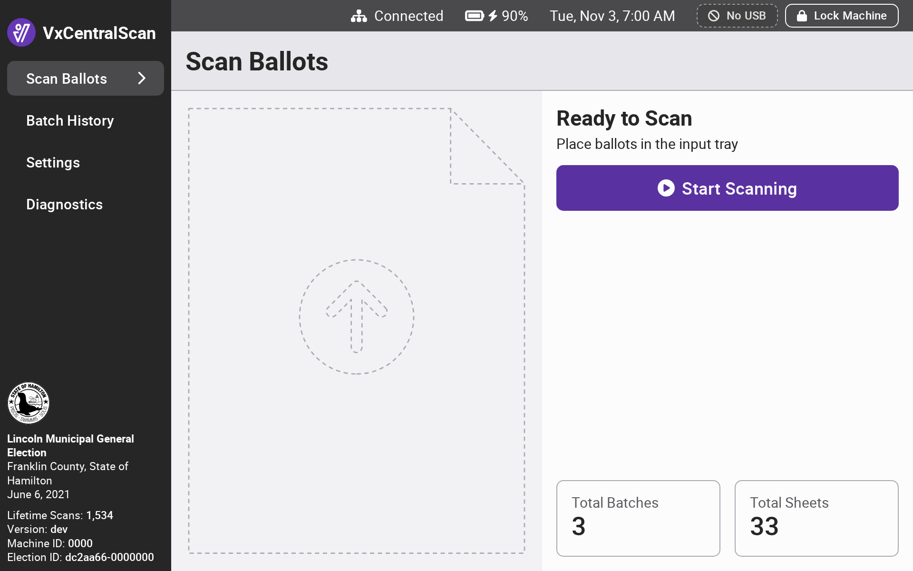
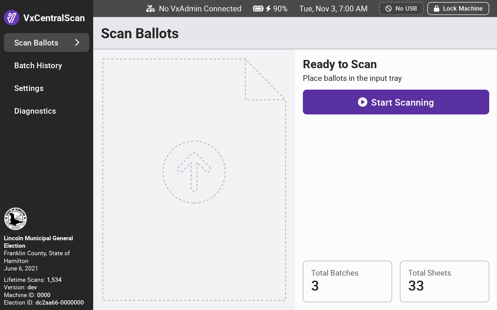
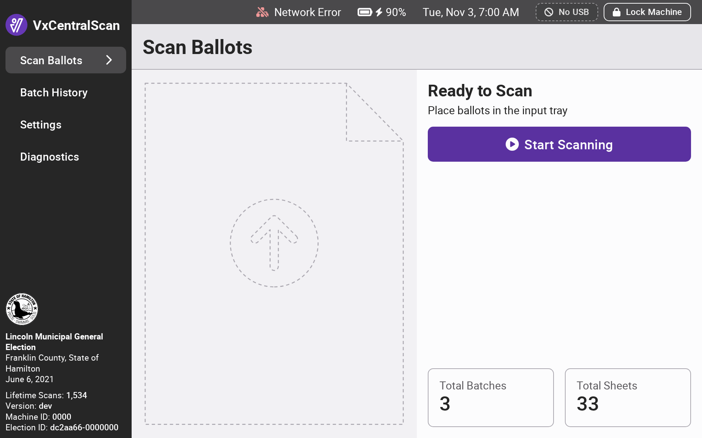
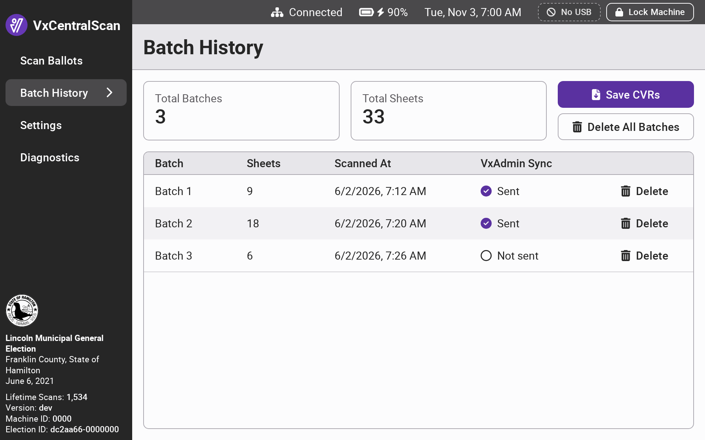
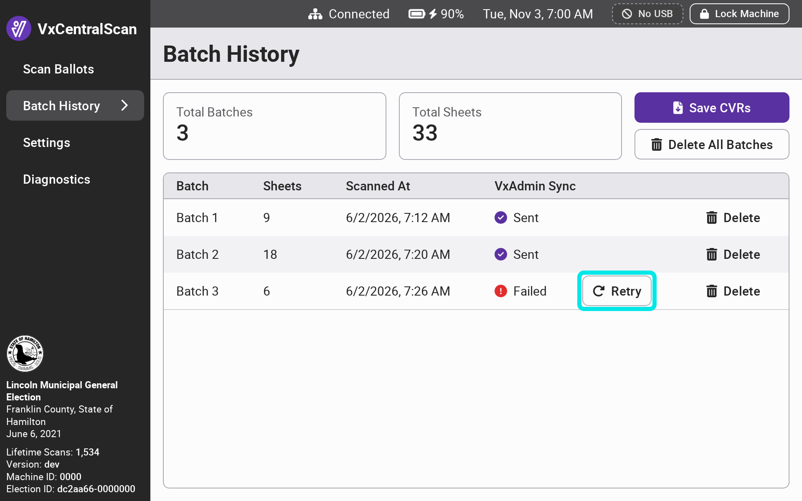

# Network VxCentralScan

VxCentralScan can be connected to the host VxAdmin over a wired network. When it's connected, each batch you save sends its cast vote records (CVRs) to VxAdmin automatically, so you don't need to carry them over on a USB drive. Set up the network before scanning begins, at the same time as the VxAdmin network for multi-station adjudication, if you use it.

## Set Up the Network

VxCentralScan uses the same networking equipment as multi-station adjudication:

* Ethernet network switch
* Ethernet cables
* Ethernet to USB-C adapter

All networking equipment should have been sold to you by VotingWorks. If you need new or additional networking equipment, please reach out to VotingWorks.

A network can hold up to 8 machines in total: 1 host VxAdmin plus any combination of up to 7 adjudication stations and VxCentralScans. For example, 1 host VxAdmin and 7 VxCentralScans, or 1 host VxAdmin, 3 adjudication stations, and 4 VxCentralScans.

To physically set up the network:

* [ ] Set up the host VxAdmin and the network switch as described in [Set Up Pre-Election Adjudication > Set Up the Network](../vxadmin-system-setup/pre-election-adjudication-setup.md#set-up-the-network)
* [ ] Connect each VxCentralScan to one of the Ethernet switch ports via the USB-C to Ethernet adapter and the Ethernet cable

No network configuration is required. Networking is turned on for each VxCentralScan by VotingWorks. If VxCentralScan doesn't show a network status at the top of the screen, networking may not be turned on for it and you should contact VotingWorks.

## Check the Connection

Once VxCentralScan and the host VxAdmin are both running and configured for the same election, VxCentralScan finds the host VxAdmin on its own. The network status at the top of the screen should show "Connected".

<figure><figcaption></figcaption></figure>

If it doesn't, the status tells you what to check:

* "No Network" - VxCentralScan isn't connected to the network. Check the Ethernet cable, the adapter, and that the switch is powered on.
* "No VxAdmin Connected" - VxCentralScan is on the network but hasn't connected to a host VxAdmin. Check that the host VxAdmin is turned on, connected to the switch, and configured for the same election as VxCentralScan.
* "Network Error" - VxCentralScan found more than one host VxAdmin, or a host VxAdmin running a different software version. Make sure only one VxAdmin is the host and that all networked machines run the same software version.

<figure><figcaption></figcaption></figure> <figure><figcaption></figcaption></figure>

The `Diagnostics` screen shows more detail about the network status; see [VxCentralScan Diagnostics](vxcentralscan-diagnostics.md "mention").

## Send CVRs to VxAdmin

Scan ballots as described in [Central Scanning](scanning-ballots.md "mention"). Each time you select `Save Batch`, VxCentralScan sends the batch's CVRs to the host VxAdmin. You don't need to select `Save CVRs`.

To check that every batch has been sent:

* [ ] Go to the `Batch History` page

Each batch should show that it has been sent to VxAdmin.

<figure><figcaption></figcaption></figure>

If a batch could not be sent, for example because the network was disconnected:

* [ ] Check that the network status shows "Connected"
* [ ] Select `Retry` for the batch

<figure><figcaption></figcaption></figure>

Sending a batch again is safe: VxAdmin ignores CVRs it has already loaded.

## View Networked Scanners on VxAdmin

The host VxAdmin lists each networked VxCentralScan and its status in its "Networked Scanners" view; see [Set Up Pre-Election Adjudication > Networked VxCentralScans](../vxadmin-system-setup/pre-election-adjudication-setup.md#networked-vxcentralscans). CVRs sent by a networked VxCentralScan appear on the host VxAdmin's `Tally` screen without loading a USB drive; see [Tally Results](../election-night-guides/tally-results.md "mention").

## Save CVRs to a USB Drive

A networked VxCentralScan can still save CVRs to a USB drive, for example if the network is unavailable. Follow the steps in [Central Scanning > Batch History and Cast Vote Records (CVRs)](scanning-ballots.md#batch-history-and-cast-vote-records-cvrs) and load the USB drive into VxAdmin as usual.
