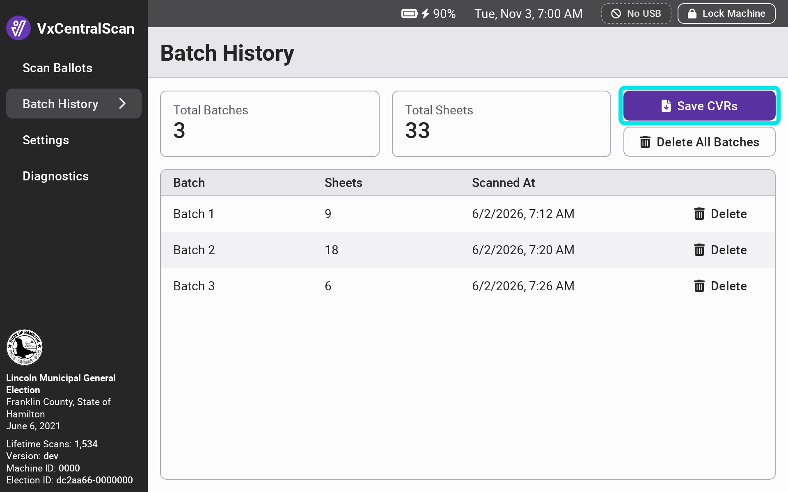
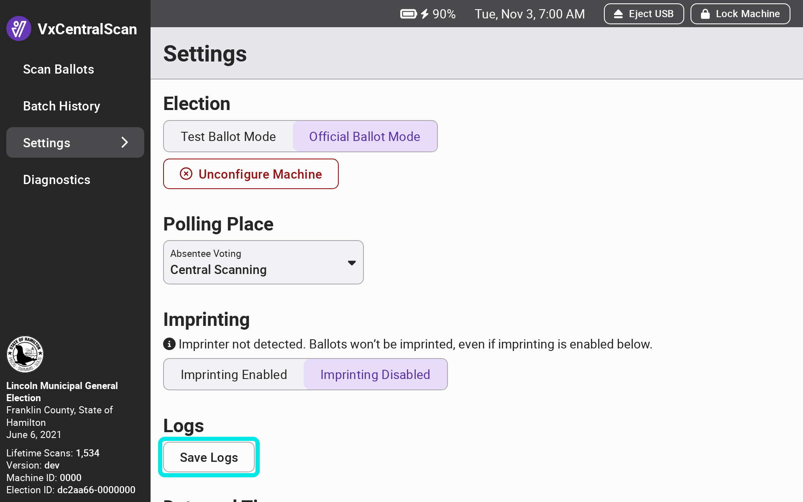
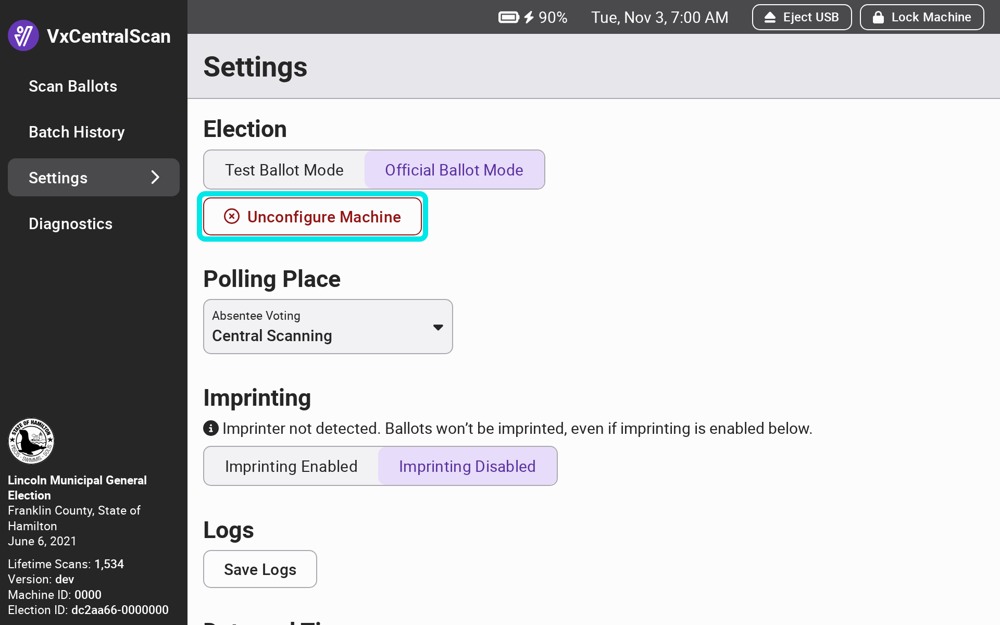
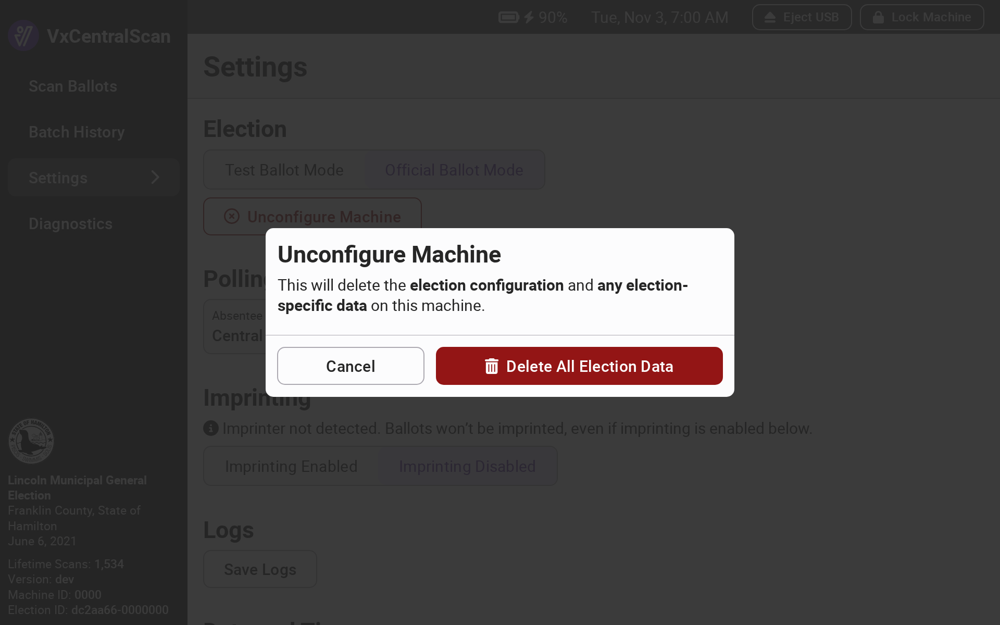

# Retaining and Removing Files - VxCentralScan

After the election, save a backup of the VxCentralScan files and then remove them from the machine.

## Retain Election Files

VotingWorks recommends retaining a backup of the cast vote records (CVRs) and the logs on VxCentralScan.

* [ ] If the CVRs were not saved on election night, select `Save CVRs` from the `Batch History` page
* [ ] Select `Settings` from the side menu
* [ ] Select `Save Logs`
* [ ] Select a log format (VotingWorks recommends the `Default` format unless instructed otherwise)
* [ ] Select `Save`

<figure><figcaption></figcaption></figure> <figure><figcaption></figcaption></figure>

## Remove Election Files

To remove the election configuration and all election data from VxCentralScan:

* [ ] Select `Settings` from the side menu
* [ ] Select `Unconfigure Machine`
* [ ] Confirm by selecting `Delete All Election Data`

<figure><figcaption></figcaption></figure> <figure><figcaption></figcaption></figure>

