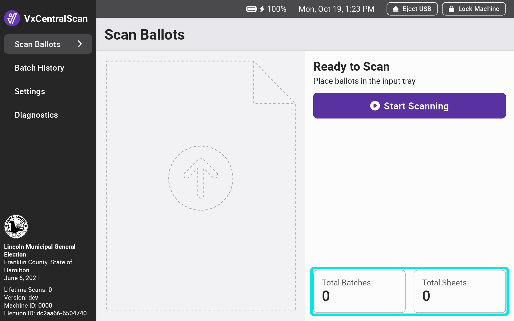
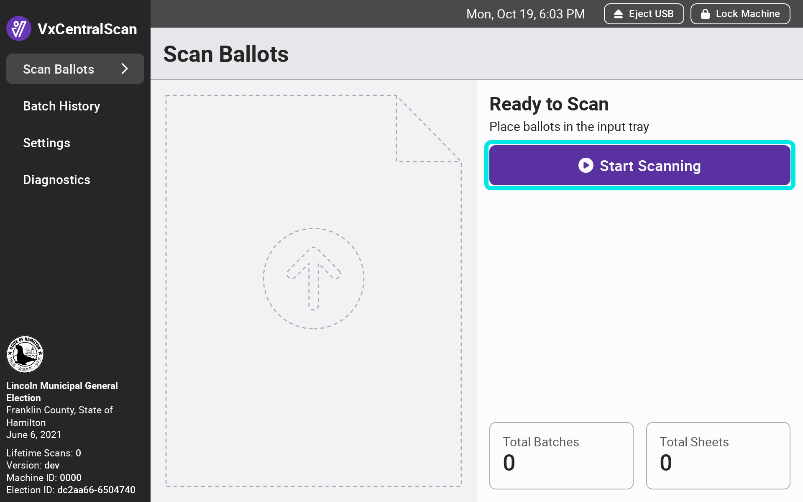
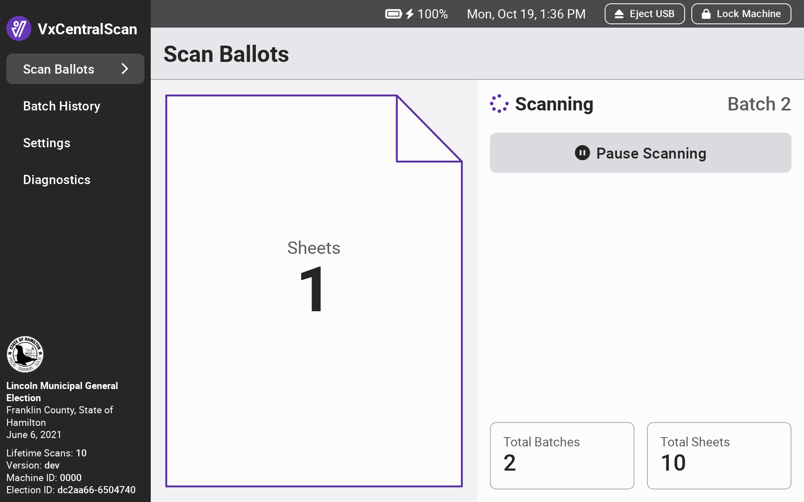
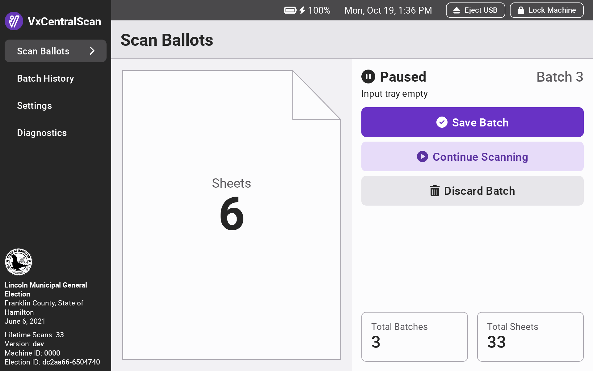
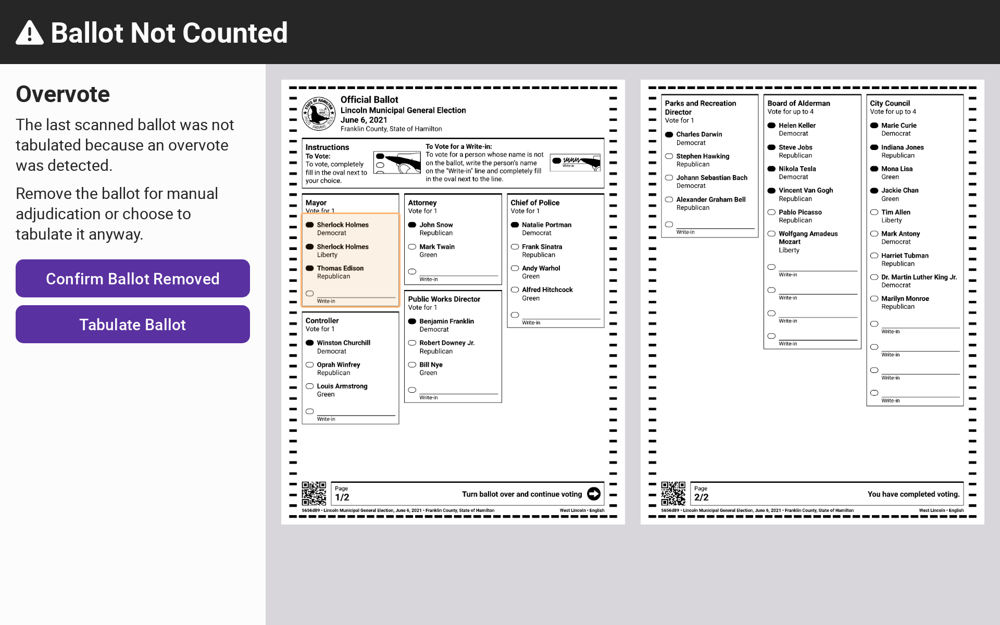
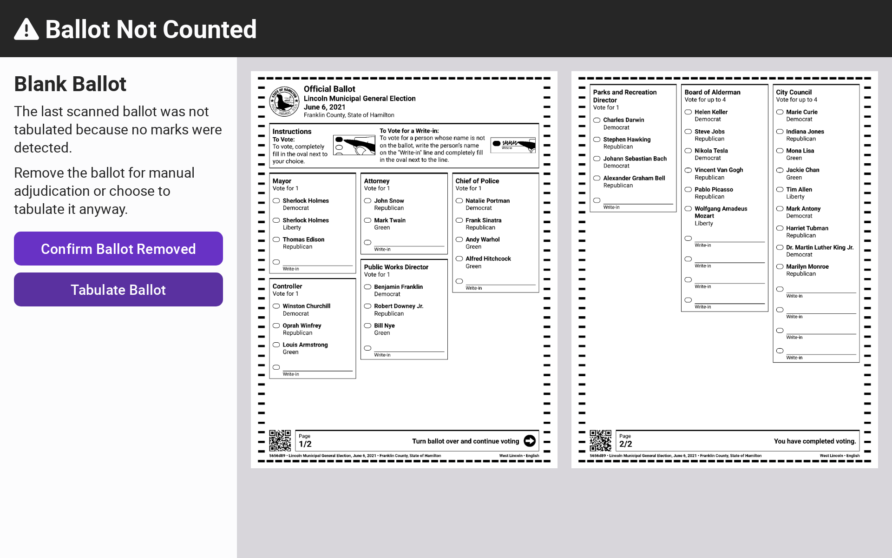
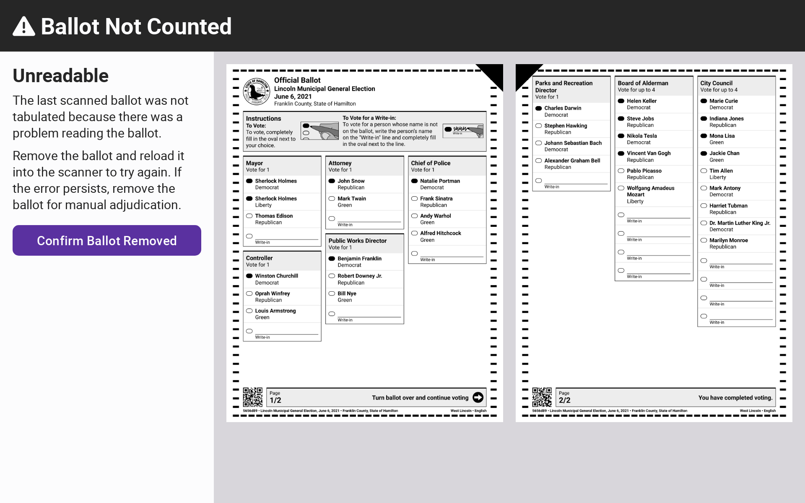
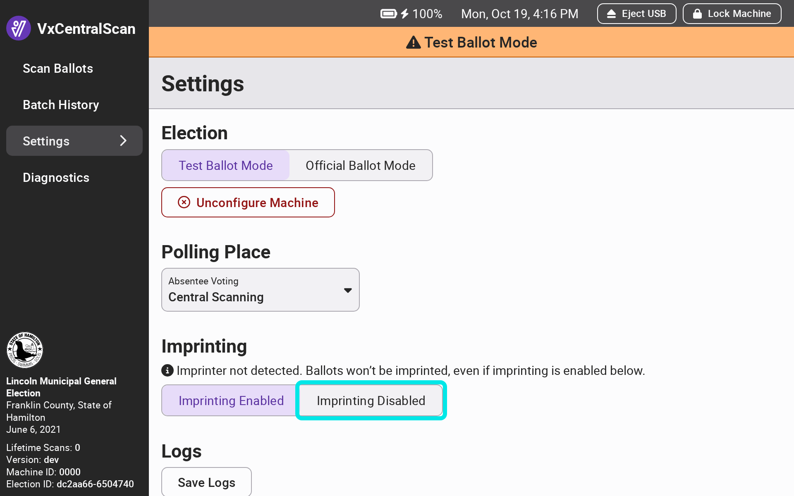

# Central Scanning

VxCentralScan is a central scanner that allows you to quickly scan large batches of ballots. VxCentralScan is often used to scan absentee and provisional ballots, but can be used to scan any ballot. VxCentralScan can also be used to quickly verify a test deck or re-tabulate an out-of-balance precinct.

Follow the [vxcentralscan-hardware-setup.md](vxcentralscan-hardware-setup.md "mention") instructions to prepare the system for use.

## Scan Ballot Batches

Before scanning the first batch of ballots, confirm that VxCentralScan does not have a yellow test mode banner at the top and displays zeroes under "Total Batches" and "Total Sheets." If the test mode banner is present, go to `Settings` to switch to official ballot mode. If the counts are not zero, you may go to `Batch History` and select `Delete All Batches`.&#x20;

<figure><figcaption></figcaption></figure>

Load a stack of ballots into the feeder tray of the scanner. VotingWorks recommends the following batch sizes for typical, thick ballot paper:

* Ricoh fi-8170 - maximum 30 ballot sheets at a time
* Ricoh fi-7600 - maximum 100 ballot sheets at a time
* Ricoh fi-8950 - maximum 250 ballot sheets at a time

The ballots need to be in a neat stack, unfolded and lying flat, but ballots can be in any orientation (e.g. upside down or backwards is fine).

Select `Start Scanning`. The "Sheets" count will start going up as the scanner processes each ballot.

<figure><figcaption></figcaption></figure> <figure><figcaption></figcaption></figure>

Once the input tray is empty, you will have the option to save the batch, discard the batch, or continue scanning:

* **Save Batch** - Finalizes the batch and its CVRs. This is the most common choice.
* **Continue Scanning** - Continues scanning with any ballots added to the input tray. This is typically used when a batch is too large to fit in the input tray and must be split into multiple loads.
* **Discard Batch** - Erases all data related to the batch. Use this if the batch needs to be rescanned or was scanned accidentally.&#x20;

<figure><figcaption></figcaption></figure>

After saving a batch, remove it from the output tray on the scanner and place the next stack of ballots in the input tray. Repeat the scanning process until all ballots are scanned.


If you find an issue with a batch after it has been saved, it can be deleted from the `Batch History` page by an election manager.


## Handle Ballots Needing Attention

VxCentralScan will stop scanning and present a review screen if a ballot needs attention. The review screen will display an image of the scanned ballot sheet, the reason why scanning was stopped, and confirm that this ballot sheet has not been tabulated yet. There are two reasons VxCentralScan might stop on a ballot: the ballot needs adjudication or the ballot could not be accepted.&#x20;

### Ballots Needing Adjudication

VxCentralScan may be configured to stop on ballots requiring adjudication for any combination of these reasons: overvotes, blank ballots, undervotes, or marginal marks.

When the scanner stops, remove the last ballot sheet scanned from the scanner output tray and confirm it matches the ballot sheet displayed onscreen. Once removed, follow your jurisdiction's review requirements. If the ballot needs to be reviewed by someone not operating the scanner or needs to be duplicated to be tabulated properly, select `Confirm Ballot Removed`. If the ballot should be tabulated as-is, meaning that overvoted contests and marginal marks will be ignored but any other valid votes will be counted, select `Tabulate Ballot`.&#x20;

<figure><figcaption></figcaption></figure> <figure><figcaption></figcaption></figure>

After accepting or removing the ballot, the batch will be paused. You can choose to continue scanning the rest of the ballots in the input tray or to discard the batch.

<figure><figcaption></figcaption></figure>


The scanner only presents one adjudication reason at a time. For example if the scanner is configured to stop on overvotes and undervotes and a ballot has both, the scanner will display the overvote notification. The order of priority is overvotes, blank ballot, undervotes, and then marginal marks.


### Unreadable and Rejected Ballots

VxCentralScan will show an "Unreadable" ballot screen if it's unable to interpret the ballot due to page skew, dust, or damage. When a ballot sheet is shown as unreadable, you can safely remove the ballot and re-scan the ballot sheet. If the ballot is unreadable on a second scan, you should remove the ballot for duplication.

<figure><figcaption></figcaption></figure>

The ballot also might be rejected because it doesn't match how the scanner is configured. For example, the ballot may be from the wrong election, may be in the wrong mode (test vs. official), or may be from a precinct that VxCentralScan is not configured to accept.

## Imprinting

Imprinters are an optional add-on for VxCentralScan's COTS scanners - see [VxCentralScan Hardware Setup > Imprinting](vxcentralscan-hardware-setup.md#imprinting) for additional details. If an imprinter is installed, an audit ID will be printed on the edge of each ballot sheet. The audit ID is a shortened version of the batch ID plus the number of the ballot within the batch.&#x20;

Before scanning ballots, ideally during logic and accuracy testing, ensure the imprinter is properly aligned such that it prints on the edge of the ballot by scanning a test sheet.

If an imprinter is installed, imprinting is enabled by default. In order to skip imprinting for an election or for a batch, an election manager may go to `Settings` and toggle to `Imprinting Disabled`. This setting will reset to `Imprinting Enabled` for each election.

<figure><figcaption></figcaption></figure>

## Batch History and Cast Vote Records (CVRs)

Navigate to the `Batch History` page to see the list of scanned batches. For each batch, the list shows the batch name (e.g. "Batch 4"), the number of ballot sheets in that batch, and the time at which the batch was saved.

<figure><figcaption></figcaption></figure>

If a batch was scanned incorrectly or accidentally, an election manager may use the `Delete` or `Delete All Batches` button.

To export CVRs for loading into VxAdmin for further adjudication and reporting, select the `Save CVRs` button in the top right.

<figure><figcaption></figcaption></figure>

You'll be prompted to insert a USB drive. Once recognized, select `Save` and then `Eject USB`. Once the USB drive is ejected, remove the USB drive.

If using multiple VxCentralScan stations, repeat saving CVRs for each one.


Tabulated ballots should be sealed into a secure container post-tabulation with the seal number recorded as required. Follow state guidelines to ensure proper retention.

