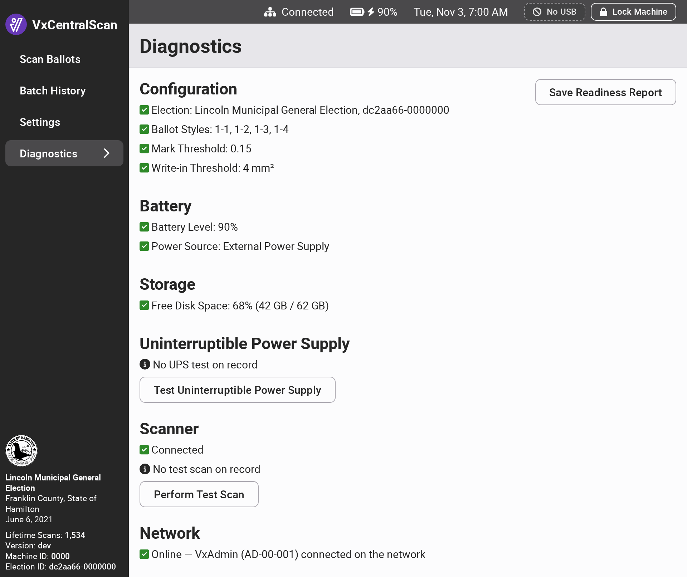
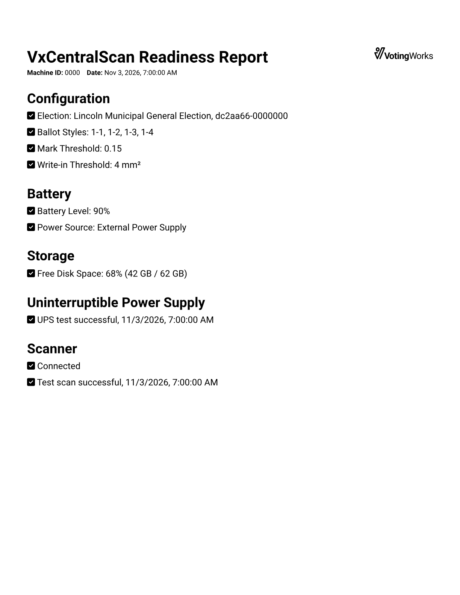

# VxCentralScan Diagnostics

In preparation for an election or in response to issues, the diagnostics interface can help verify VxCentralScan is functioning as expected or pinpoint problems that do arise.

The VxCentralScan diagnostics screen shows information about the currently configured election, if any, the current battery level and charging status, and the disk space available to the application. For large elections, monitor the disk space to ensure that you don't exceed system storage limits. The uninterruptible power supply test asks you to confirm that the scanner's uninterruptible power supply is connected and fully charged.

The scanner status indicates whether the scanner is connected or not. To test the scanner, select `Perform Test Scan` and insert a blank sheet of paper when prompted. This test verifies the scanner is clean and ballot images are clear. If the test fails, you'll be prompted to clean the scanner. The test also fails if the sheet is not blank.

If VxCentralScan is networked to the host VxAdmin, the screen also has a network section showing whether VxCentralScan is connected to the network and to a host VxAdmin, and if not, why. See [Network VxCentralScan](network-vxcentralscan.md "mention").

<figure><figcaption></figcaption></figure>

## Readiness Report

The readiness report can be used as a record of system diagnostic verification. Select `Save Readiness Report` to save a copy to a USB drive.

<figure><figcaption></figcaption></figure>
