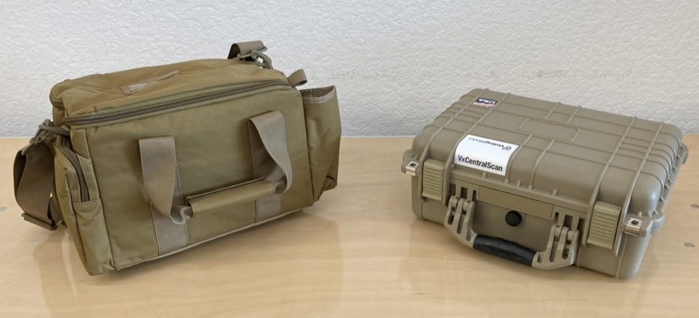
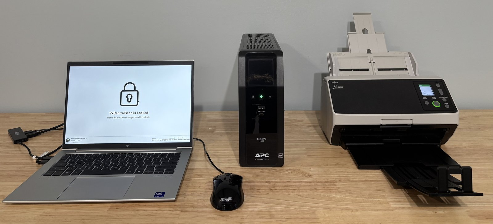
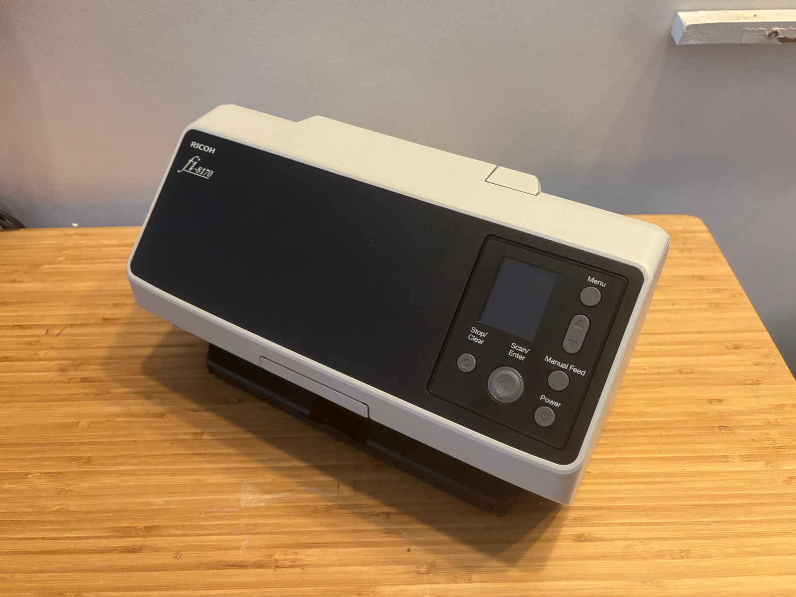
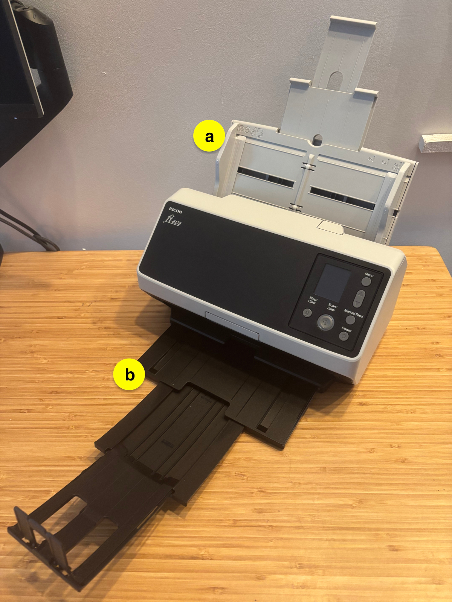
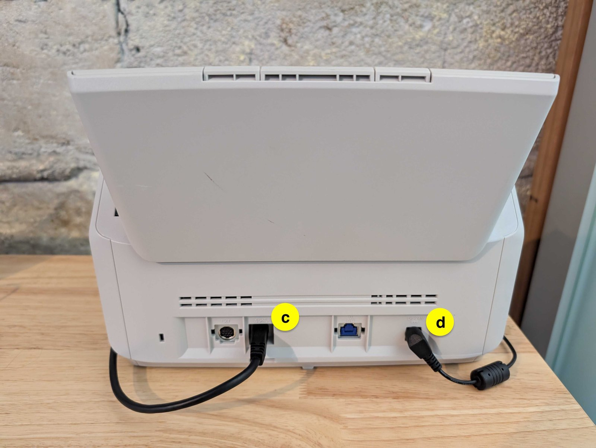
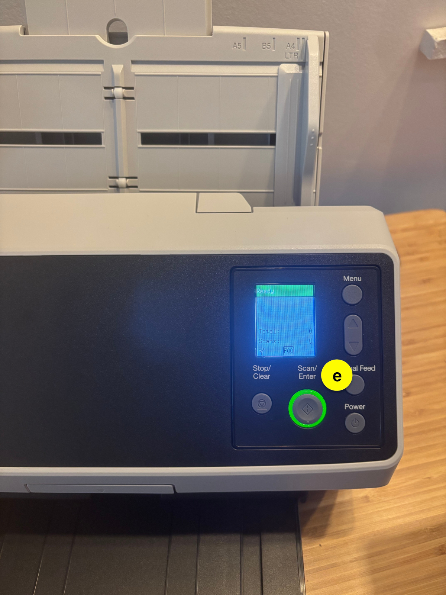
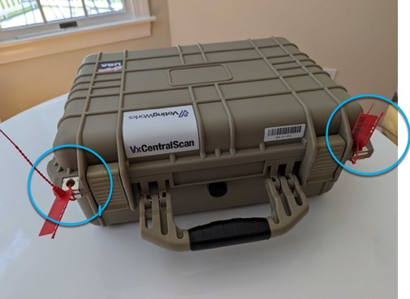
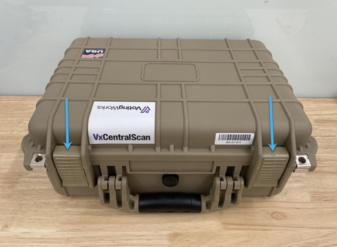
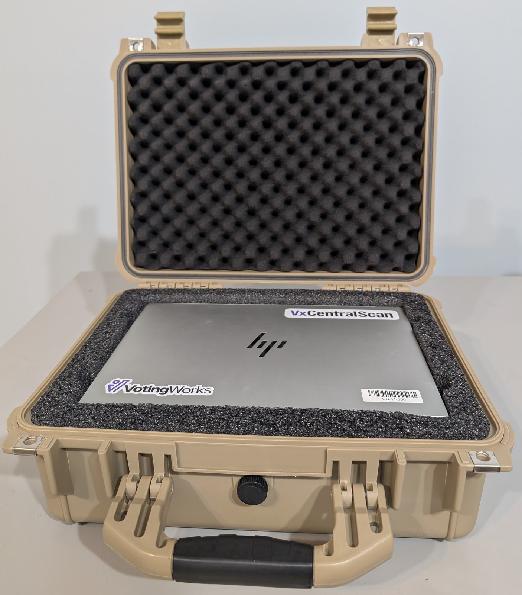
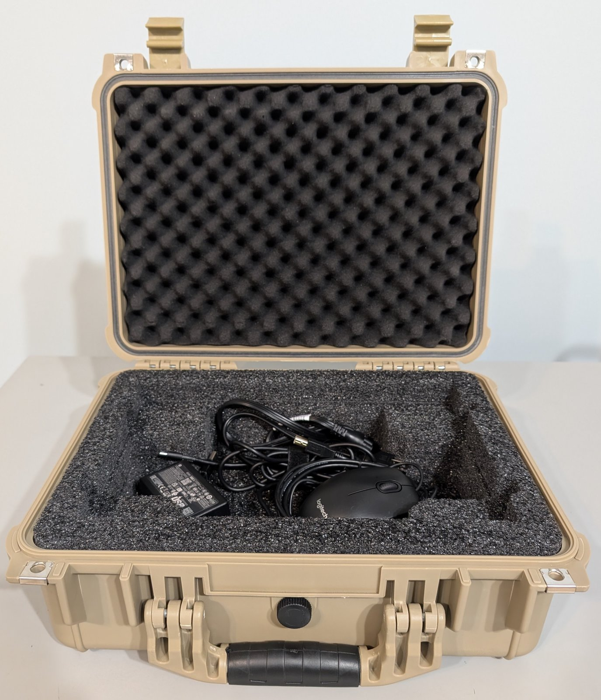

# VxCentralScan Hardware Setup

## Hardware Overview

VxCentralScan is a commercial off-the-shelf (COTS) laptop pre-installed with VxCentralScan software that connects to a batch scanner.

<figure><figcaption></figcaption></figure> <figure><figcaption></figcaption></figure>

Four models of scanner are supported:

* Ricoh fi-8170 - Small. Recommended maximum batch size of 30 ballots.
* Ricoh fi-7600 - Medium. Recommended maximum batch size of 100 ballots.
* Ricoh fi-8950 - Large. Recommended maximum batch size of 250 ballots.
* interScan DeskPro 631 - Extra-large. Recommended maximum batch size of 250 ballots.

Backup power for the scanner is provided by the APC uninterruptible power supply (UPS).

## Set Up VxCentralScan

VxCentralScan can be set up through the following steps:

1. **Unbox and set up the scanner.** For the Ricoh fi-8170:
   * [ ] Remove the scanner and power cord from the case
   * [ ] Attach and pull out the paper feed guide tray (A)
   * [ ] Pull out the paper holder tray (B)
   * [ ] Plug the USB cord (C) into the back of the scanner and into the USB hub
   * [ ] Plug the power cord (D) into the back of the scanner and into the APC UPS
   * [ ] Plug the UPS into a power outlet
   * [ ] Turn on the UPS
   * [ ] Press the power button (E) to turn the scanner on

   
<figure><figcaption>
Remove the scanner and power cord from the case
</figcaption></figure> <figure><figcaption>
Attach and pull out the paper trays
</figcaption></figure>

   
<figure><figcaption>
Plug in the cords
</figcaption></figure> <figure><figcaption>
Press the power button to turn on
</figcaption></figure>

   For the interScan DeskPro 631:
   * [ ] Set up the scanner, including the extended input tray and output hopper if used, as described in the manufacturer's instructions
   * [ ] Plug the USB cord into the back of the scanner and into the USB hub
   * [ ] Plug in the scanner's power cord
   * [ ] Turn the scanner on

2. **Set up the VxCentralScan laptop:**
   * [ ] Remove and document seals as necessary
   * [ ] Open the case by lifting the latches on the front

   
<figure><figcaption>
Remove and document seals as necessary
</figcaption></figure> <figure><figcaption>
Lift the latches
</figcaption></figure>

   * [ ] Remove the laptop
   * [ ] Pull the power cord (A) out and plug into the laptop and an outlet
   * [ ] Pull the USB hub (B) out and plug into the laptop
   * [ ] Pull the scanner cord (C) out and plug into the USB hub and the scanner
   * [ ] Turn the laptop on

   
<figure><figcaption>
Remove the laptop
</figcaption></figure> <figure><figcaption>
Remove the components
</figcaption></figure> <figure><figcaption>
Plug in the components
</figcaption></figure>

## Pack Up VxCentralScan

To pack up VxCentralScan:

* [ ] Place all of the components back into the case as displayed above
* [ ] Package the batch document scanner
* [ ] Secure the laptop case as required by sealing the eyelets highlighted below

<figure><figcaption>
Seal the case
</figcaption></figure>

## Imprinting

All four scanners can be used with an optional imprinter:

* Ricoh fi-8170 - Uses the fi-819PRB. See the [fi-819PRB user guide](https://github.com/votingworks/docs-vxsuite-v4/blob/main/hardware-assets/cots-documentation/central-system/ricoh-fi-8170/ricoh-fi-819prb-user-guide.pdf) for assembly instructions.
* Ricoh fi-7600 - Uses the fi-760PRB. See the [fi-760PRB user guide](https://github.com/votingworks/docs-vxsuite-v4/blob/main/hardware-assets/cots-documentation/central-system/ricoh-fi-7600/ricoh-fi-760prb-user-guide.pdf) for assembly instructions.
* Ricoh fi-8950 - Uses the fi-890PRB. See the [fi-890PRB user guide](https://github.com/votingworks/docs-vxsuite-v4/blob/main/hardware-assets/cots-documentation/central-system/ricoh-fi-8950/ricoh-fi-890prb-user-guide.pdf). The one-time installation must be performed by a Ricoh support technician.
* interScan DeskPro 631 - Uses the HD Rear Imprinter (PN: 6X-IM-SPDPST-R), which prints on each ballot after it is scanned. The one-time installation must be performed by an interScan technician.

For the detachable imprinters, the scanner must be off when attaching the imprinter. After the imprinter is attached, adjust the paper guides on the imprinter to match the paper width of each batch, which is 8.5 in. for hand-marked paper ballots and ballots printed by VxMark, or 8 in. for ballots printed by VxMarkScan.

For all imprinters, adjust the position of the imprinter to ensure that imprinting is done outside of the ballot marking area on each ballot. Test imprinting on blank paper or test ballots before using it on official ballots.

## Scanner Maintenance

Clean the scanner before every election. Replace the rollers occasionally depending on scanning volume. Consult [VxAdmin, VxCentralScan, & VxPrint Maintenance Manual](../system-maintenance/vxadmin-and-vxcentralscan-maintenance-manual.md "mention") for instructions on cleaning and maintaining each scanner.
