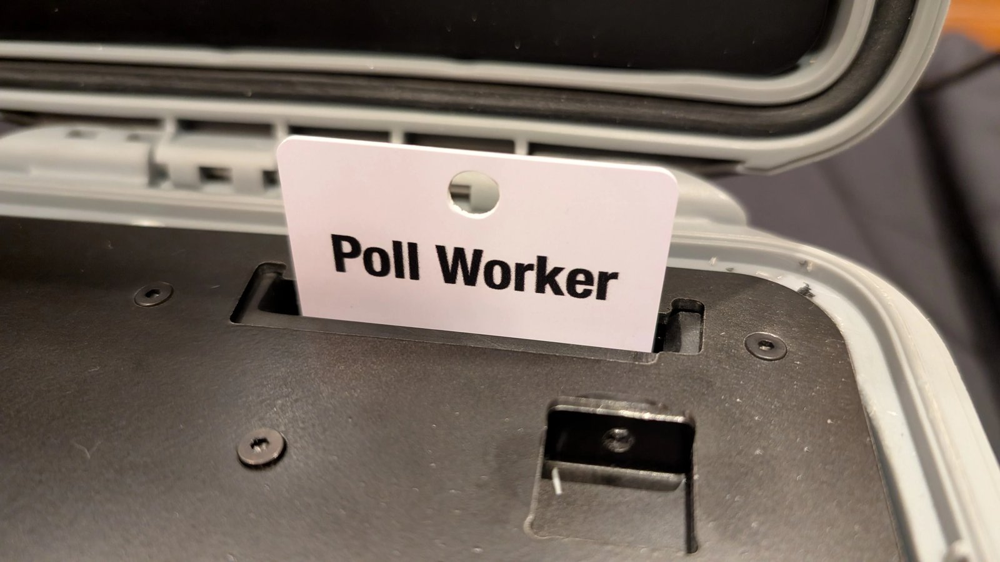
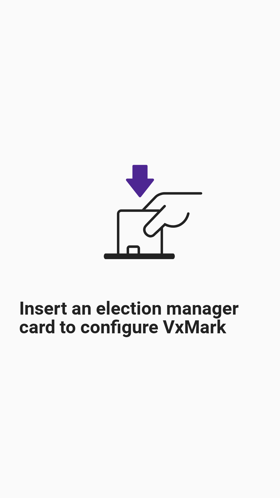
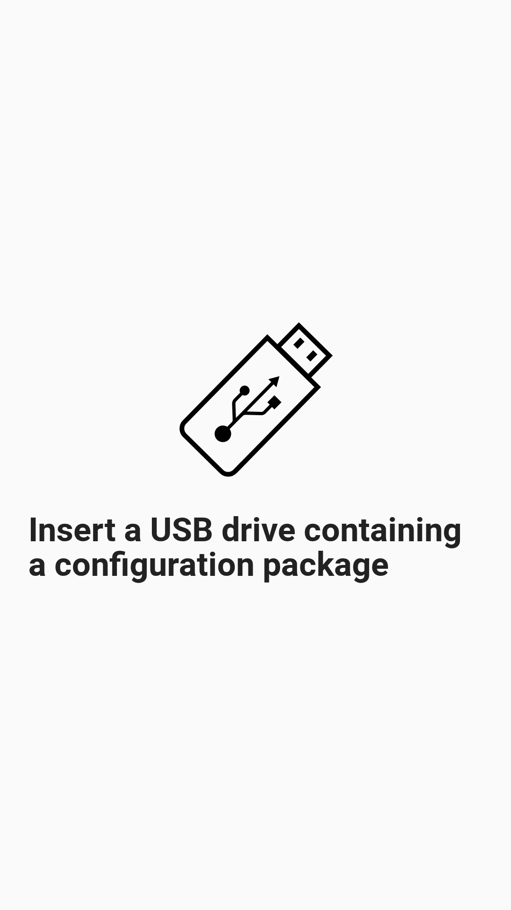
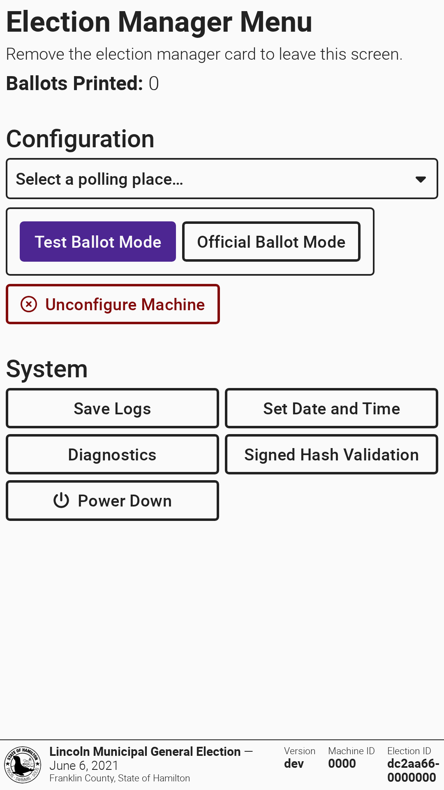
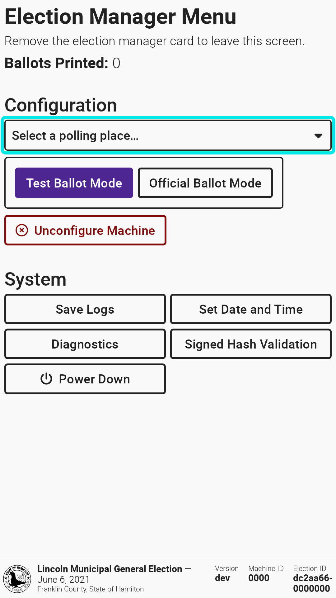
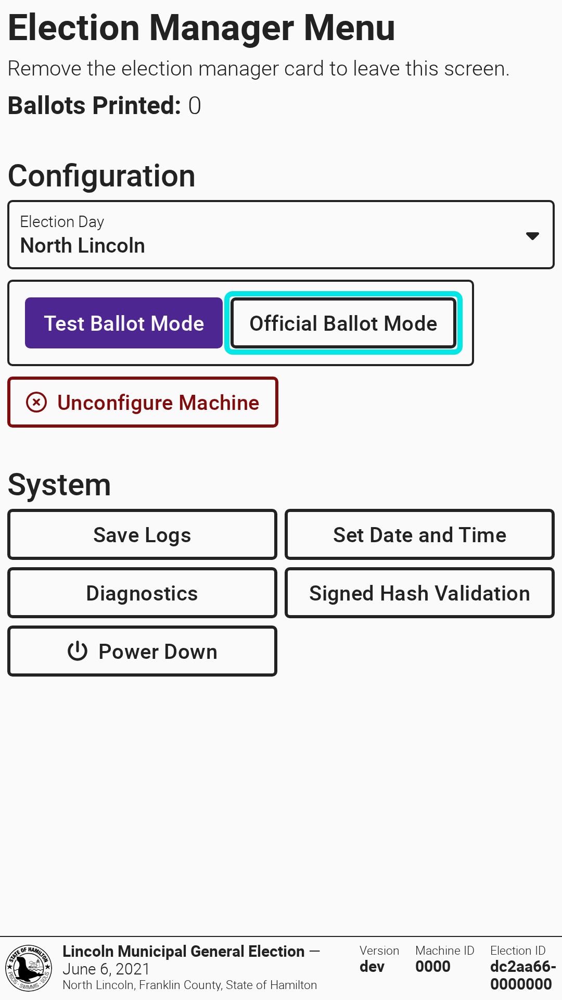
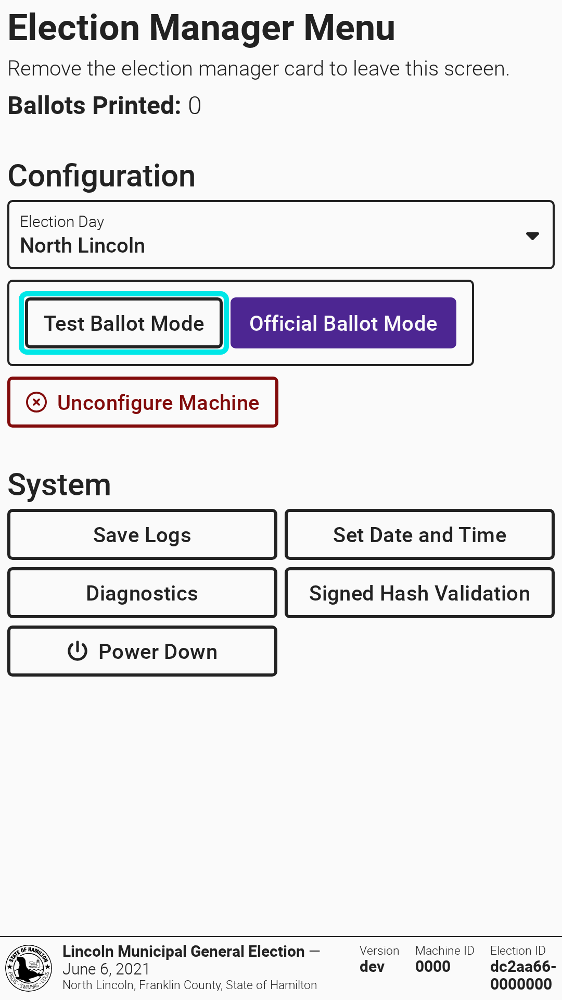
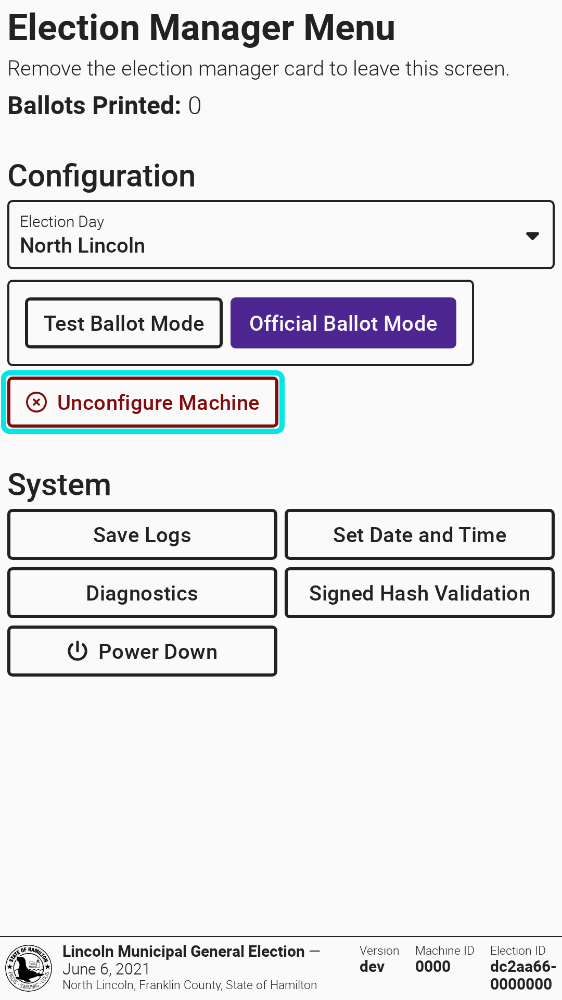
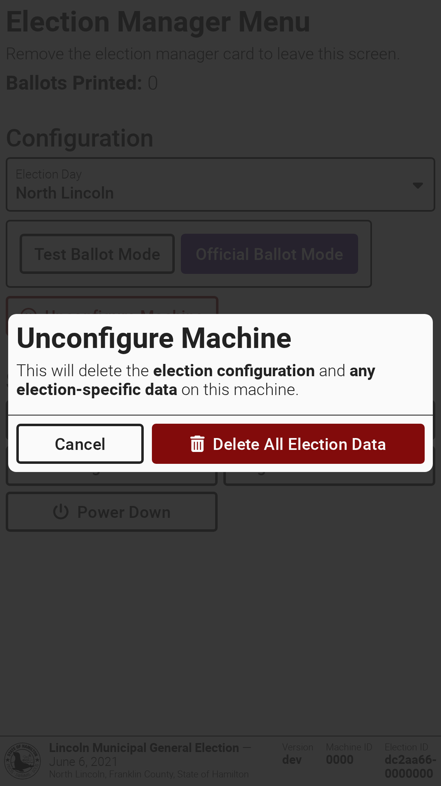

# Configure VxMark


These steps must be completed by an election manager.


Before you configure VxMark, you must set up the machine. Follow the steps in [VxMark Hardware Setup](vxmark-hardware-setup.md "mention").

To configure VxMark, you must do two things in VxAdmin:

* [ ] Save the configuration package to a USB drive (see [Save the Configuration Package](../vxadmin-system-setup/save-election-package.md "mention"))
* [ ] Create an election manager card (see [Smart Cards and User Roles](../vxadmin-system-setup/programming-cards.md "mention"))

## Insert Smart Cards and USB Drives

The smart card reader is to the right in the back of the case. Insert smart cards with the chip facing toward you. The USB port is located directly in front of the smart card reader.

<figure><figcaption></figcaption></figure>

## Load the Configuration Package

An unconfigured machine prompts you to insert an election manager card to log in and then insert a USB drive with the configuration package saved from VxAdmin.

* [ ] Insert an election manager card
* [ ] Insert a USB drive with the configuration package saved from VxAdmin

After the USB drive is inserted, VxMark automatically begins loading all ballot styles for the election. After the configuration package is done loading, the election manager menu appears and VxMark is in test ballot mode.

<figure><figcaption></figcaption></figure> <figure><figcaption></figcaption></figure> <figure><figcaption></figcaption></figure>

## Select a Polling Place

Use the `Select a polling place...` dropdown to choose a polling place. Only ballot styles for the selected polling place are options for voting.

<figure><figcaption></figcaption></figure>


If your election package defines only one polling place, there is no need to select one and the `Select a polling place...` dropdown isn't visible.


## Set the Ballot Mode

Use the toggle button to switch between `Test Ballot Mode` and `Official Ballot Mode`. The machine must be in official ballot mode on election day. Review the [L\&A Overview](../logic-and-accuracy-pre-election-testing/l-and-a-overview.md "mention") instructions to understand which mode to use during logic and accuracy (L&A) testing.

<figure><figcaption></figcaption></figure> <figure><figcaption></figcaption></figure>

## Remove Configuration and Election Data

To remove the election configuration and all election data from VxMark:

* [ ] Insert an election manager card
* [ ] Select `Unconfigure Machine`
* [ ] Confirm by selecting `Delete All Election Data`

<figure><figcaption></figcaption></figure> <figure><figcaption></figcaption></figure>

You can now configure VxMark with a different election package.


The system administrator card can also be used to unconfigure the machine, which may be useful if the election manager card for a previous election is no longer available.

