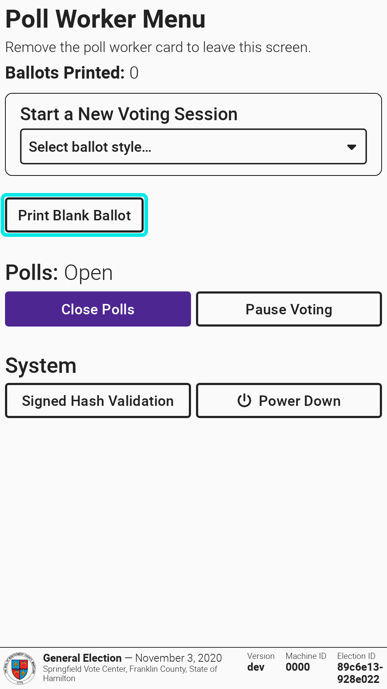
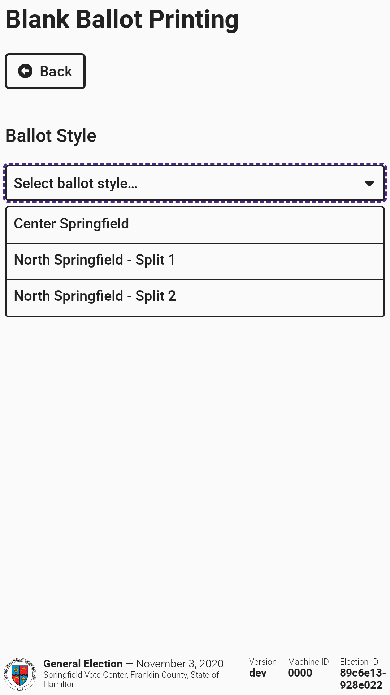
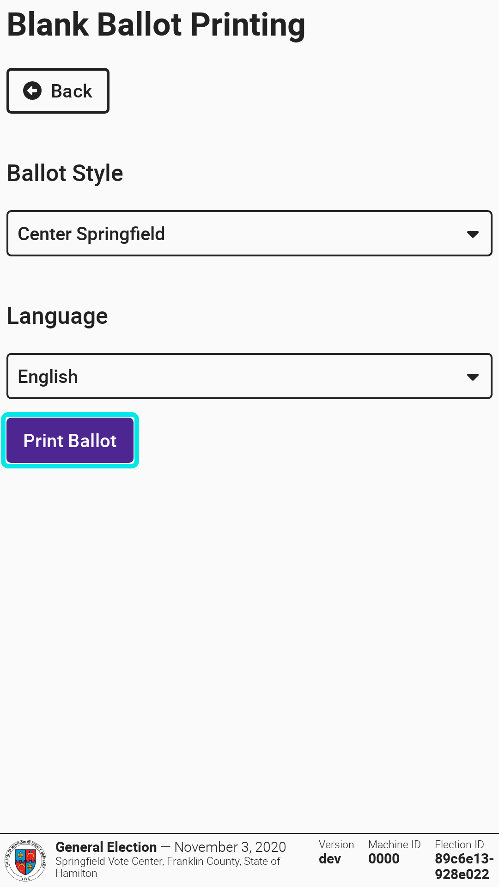

# Printing Blank Ballots

If your jurisdiction has enabled blank ballot printing, poll workers can print an unmarked ballot from VxMark for a voter to mark by hand. Blank ballots can only be printed while polls are open.


If the `Print Blank Ballot` button does not appear on the poll worker menu, blank ballot printing is not enabled for your election or the polls are not open.


To print a blank ballot:

* [ ] Insert a poll worker card into the card reader in the back right
* [ ] Select `Print Blank Ballot`
* [ ] Select the voter's ballot style
* [ ] If prompted, select the ballot language
* [ ] Select `Print Ballot`
* [ ] Remove the printed ballot from the printer and select `Done`
* [ ] Select `Back` to return to the poll worker menu, or remove the poll worker card

<figure><figcaption></figcaption></figure> <figure><figcaption></figcaption></figure> <figure><figcaption></figcaption></figure>

Blank ballots are included in the number of ballots printed shown on the poll worker menu.
