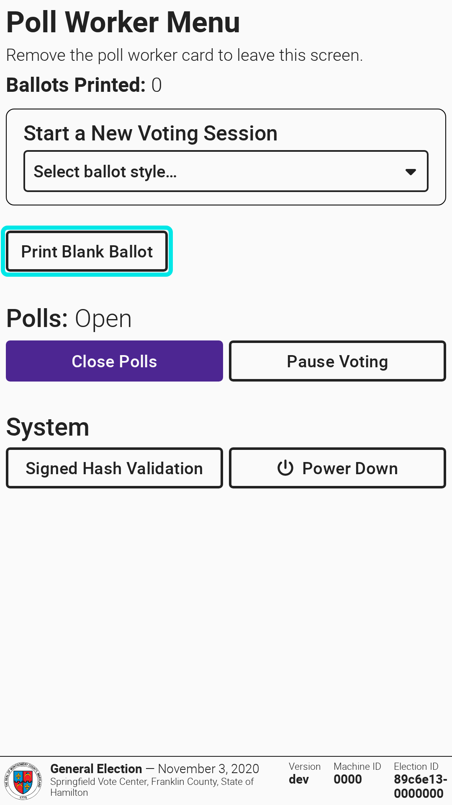
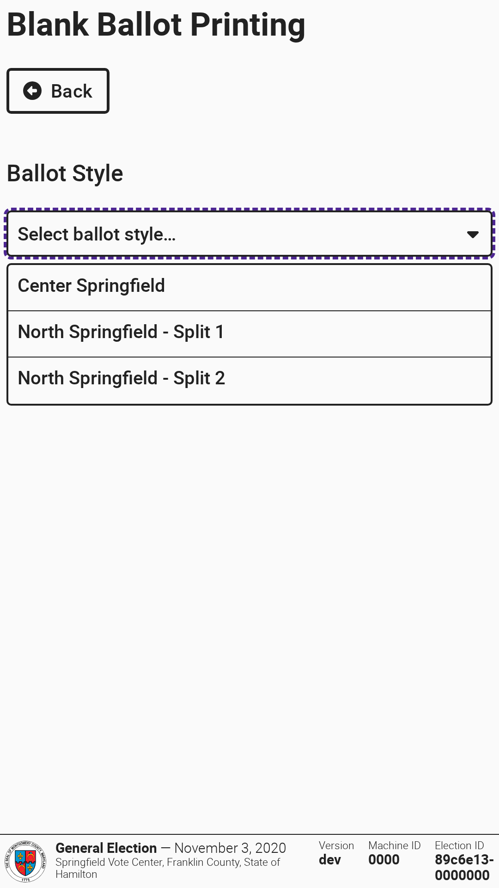
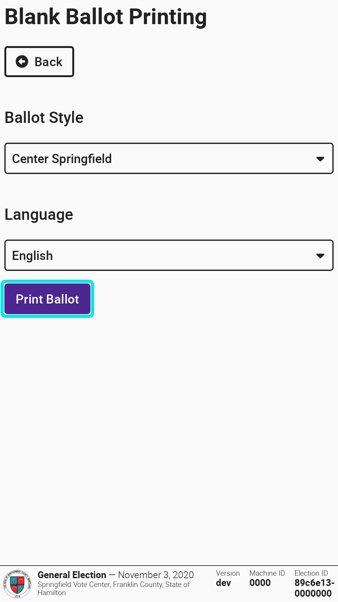
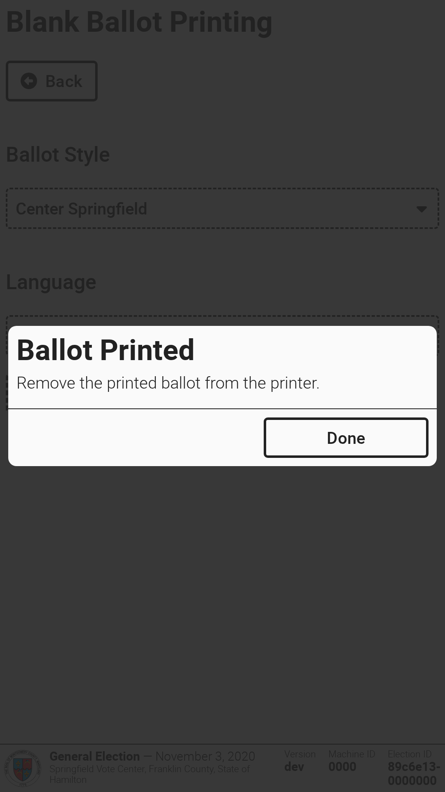
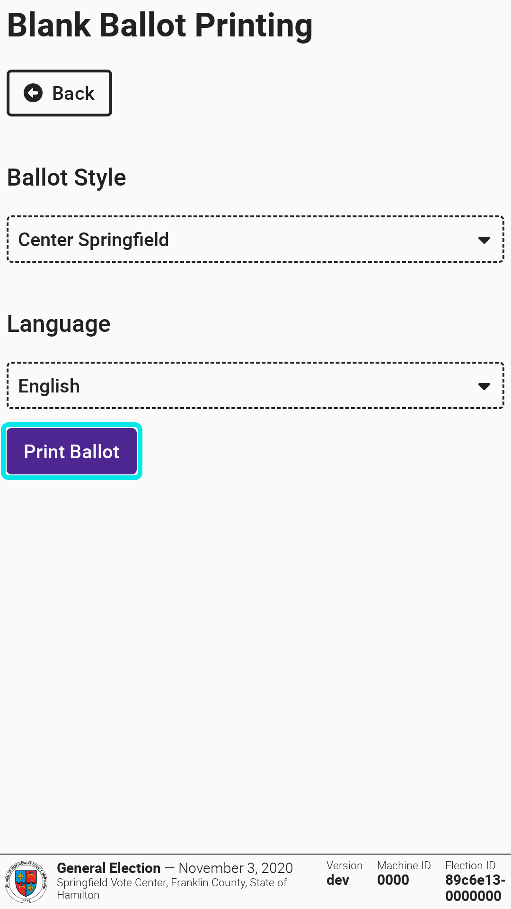

# Print Blank Ballots

If your jurisdiction has enabled blank ballot printing, poll workers can print an unmarked ballot from VxMark for a voter to mark by hand. Blank ballots can only be printed while polls are open.


If the `Print Blank Ballot` button does not appear on the poll worker menu, blank ballot printing is not enabled for your election or the polls are not open.


## Print a Blank Ballot

To print a blank ballot:

* [ ] Insert a poll worker card into the card reader in the back right
* [ ] Select `Print Blank Ballot`
* [ ] Select the voter's ballot style
* [ ] If prompted, select the ballot language
* [ ] Select `Print Ballot`
* [ ] Remove the printed ballot from the printer
* [ ] Select `Done`
* [ ] Select `Back` to return to the poll worker menu, or remove the poll worker card

<figure><figcaption></figcaption></figure> <figure><figcaption></figcaption></figure>

<figure><figcaption></figcaption></figure> <figure><figcaption></figcaption></figure>

Blank ballots are included in the number of ballots printed shown on the poll worker menu.

## Print a Blank Ballot from a Barcode

VxMark can also print a blank ballot from a voter's ballot style barcode, with the ballot style, precinct, and language taken from the barcode. To use it, an election manager sets "Barcode Activation Mode" to `Print Ballot` on the election manager menu. The setting appears only when your election allows both barcode activation and blank ballot printing. In this mode, scanning a barcode prints a blank ballot instead of starting a voting session.

To print a blank ballot from a barcode:

* [ ] Insert a poll worker card into the card reader in the back right
* [ ] Scan the voter's ballot style barcode with the barcode reader

VxMark opens the "Blank Ballot Printing" screen with the ballot style, precinct, and language from the barcode. They can't be changed on this screen.

* [ ] Check that the ballot style and language are the ones the voter needs
* [ ] Select `Print Ballot`
* [ ] Remove the printed ballot from the printer
* [ ] Select `Done`

VxMark returns to the poll worker menu. To cancel without printing, select `Back`.

<figure><figcaption></figcaption></figure>


VxMark ignores a scan if the polls are not open, no poll worker card is inserted, a voting session is active, or the ballot style isn't available at this machine's polling place. It also ignores another scan until you select `Done` or `Back` for the current one.

