# Voting Sessions

## Activate a Voting Session


A voter may bring their own personal assistive technology (PAT) device (e.g., jelly bean switch or sip-and-puff device) or headphones. It must have a 3.5 mm plug or connector. Once plugged in, a test screen pops up to assist in configuration. See [VxMark Diagnostics](diagnostics.md "mention") for instructions.




In order to start a new voting session on VxMark:

* [ ] Insert a poll worker card into the card reader in the back right
* [ ] Select the voter's ballot style
* [ ] Remove the poll worker card to begin the voting session

<figure>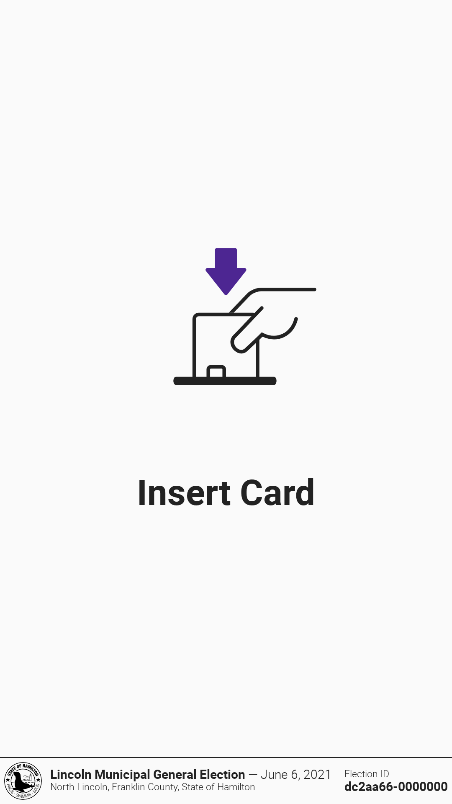<figcaption></figcaption></figure> <figure>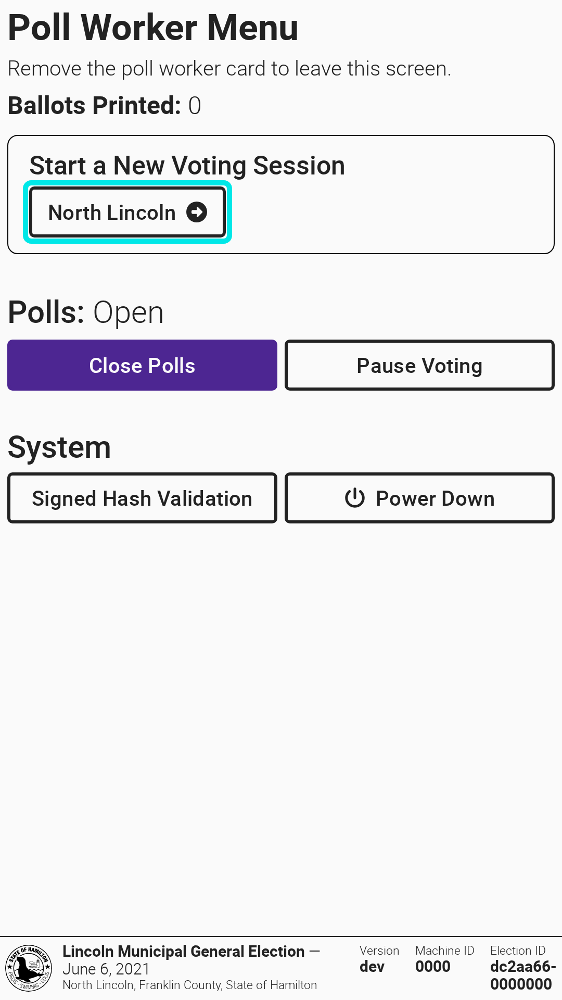<figcaption></figcaption></figure> <figure>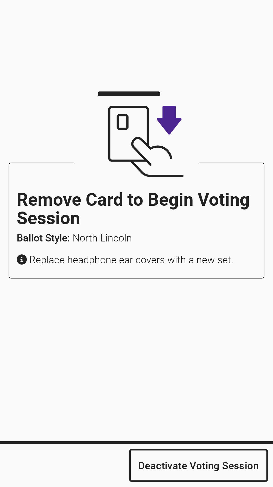<figcaption></figcaption></figure>


If the wrong ballot style or precinct was selected, insert the poll worker card (if not already inserted) and select `Deactivate Voting Session` to return to the poll worker menu.


## Mark a Ballot

Let the voter know they can begin voting by selecting `Start Voting`.

One contest will display at a time. The voter selects the candidate(s) of their choice. The voter moves to the next contest by selecting `Next`. The voter can skip a contest by selecting `Next` without making a selection. To return to a previous contest, select `Back`. A `More` button displays if there are more candidates or text than fit on a single screen.

<figure>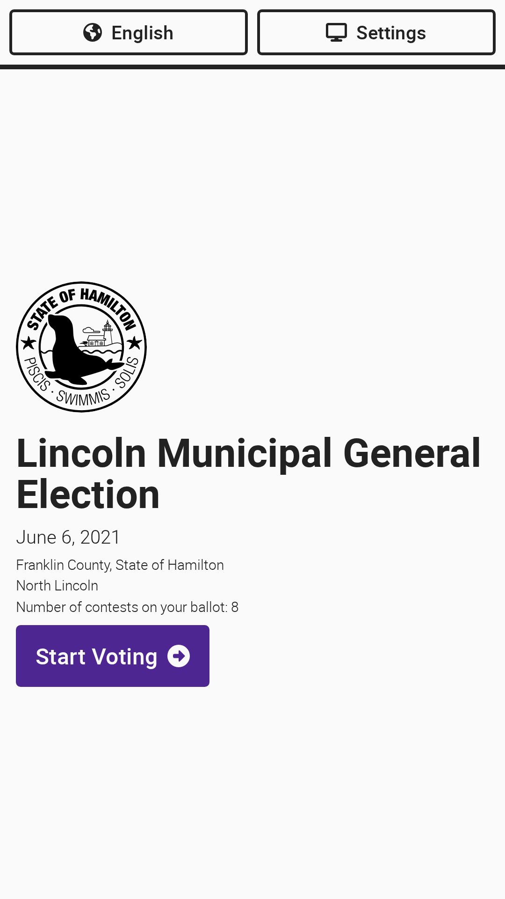<figcaption></figcaption></figure> <figure>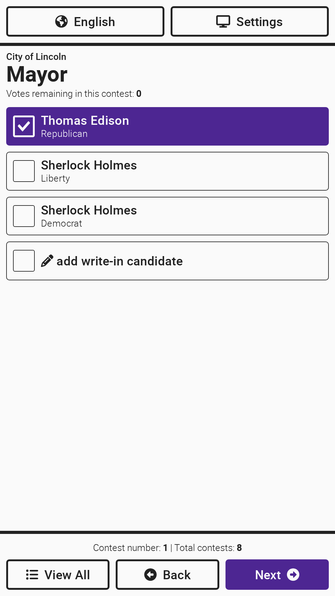<figcaption></figcaption></figure>


If a voter would like to change a selection, they must first deselect a candidate previously selected.


## Enter a Write-In

To enter a write-in candidate:

* [ ] Select `add write-in candidate`
* [ ] Use the keyboard to type in the candidate's name
* [ ] Select `Accept`

<figure>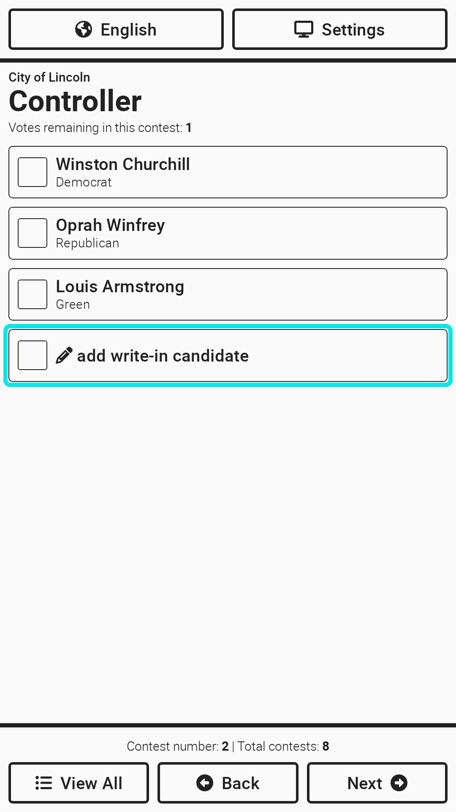<figcaption></figcaption></figure> <figure>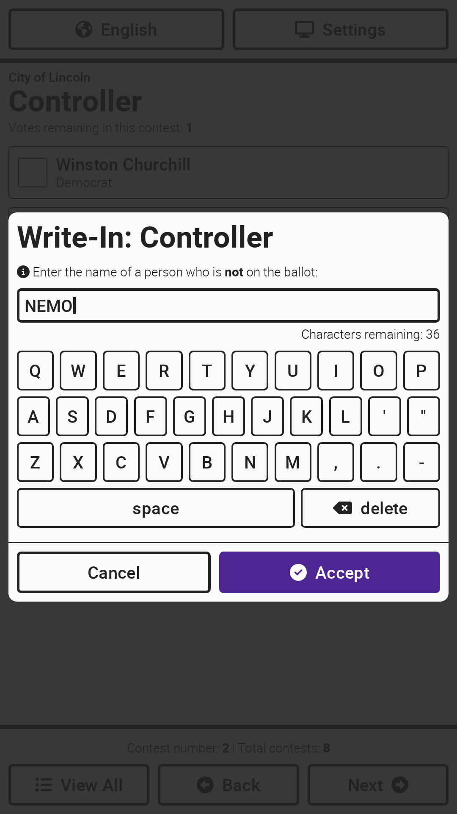<figcaption></figcaption></figure> <figure>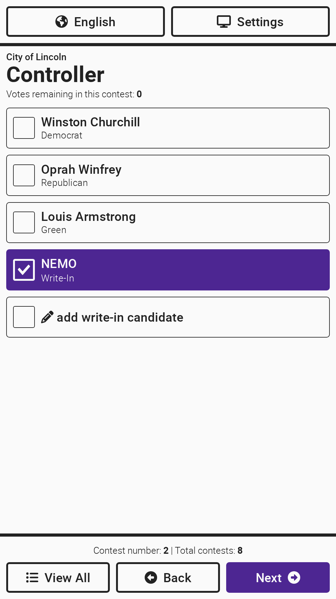<figcaption></figcaption></figure>

## Review Votes

After working through all contests, a "Review Your Votes" screen appears that allows the voter to change any vote by selecting `Change`. Once selections have been reviewed, select `Print My Ballot`. After the ballot prints, the voter should retrieve and review the printed ballot.

<figure>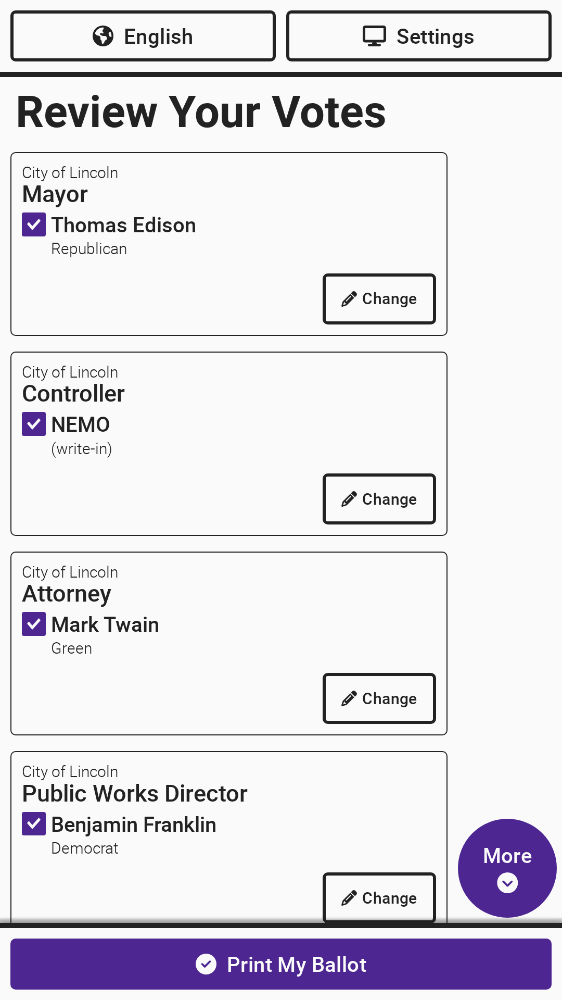<figcaption></figcaption></figure> <figure>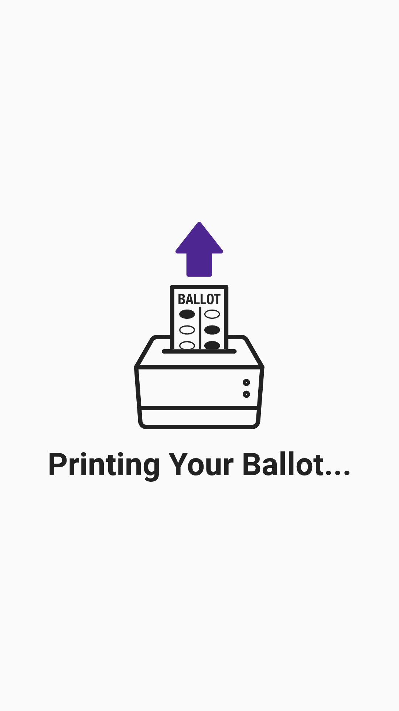<figcaption></figcaption></figure> <figure>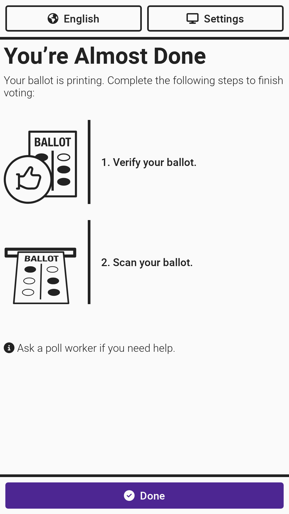<figcaption></figcaption></figure>


If the voter wants to make changes to their ballot after it has printed, they must complete a new voting session. The previous ballot must be spoiled.

