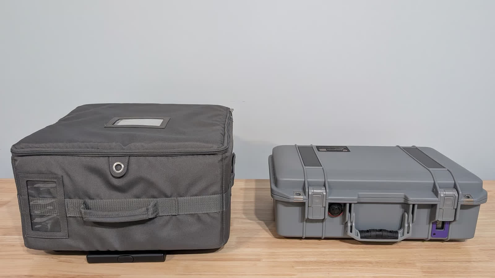
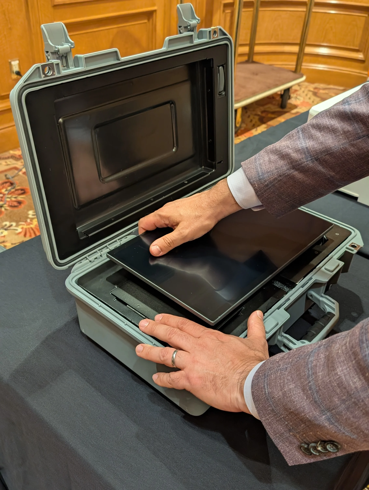
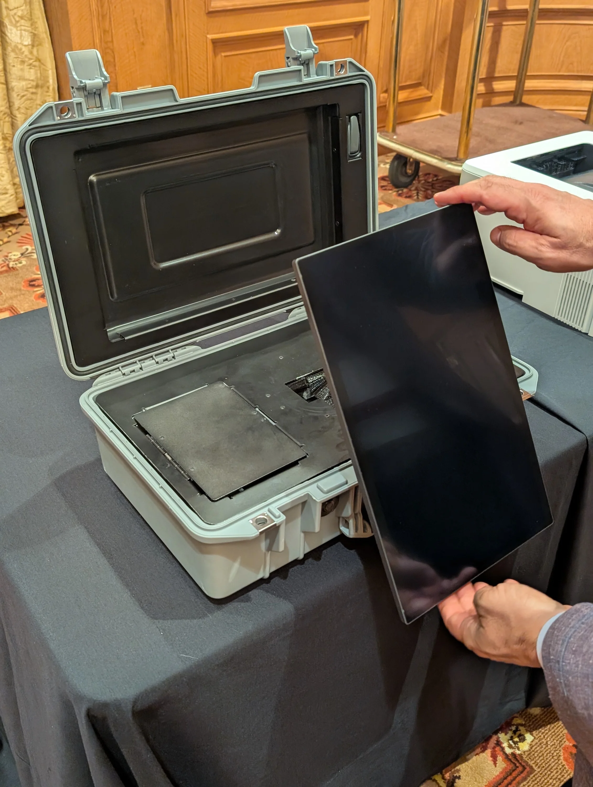
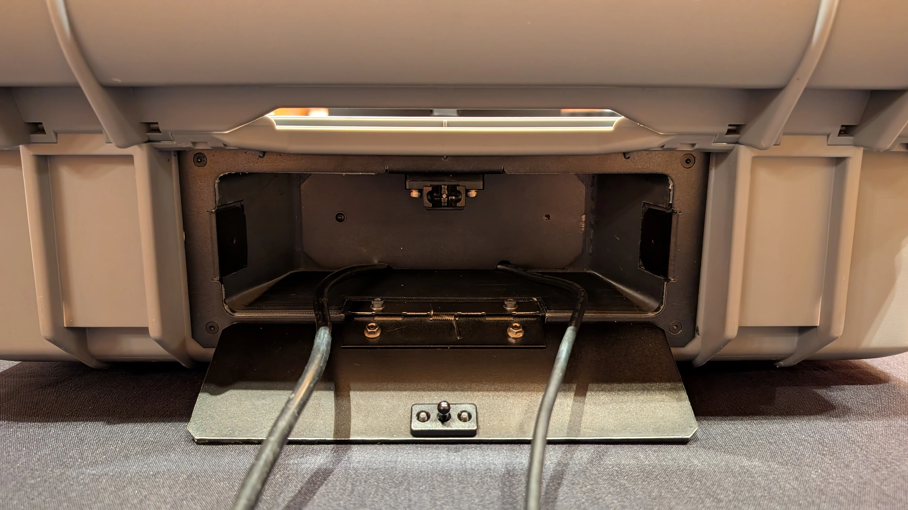
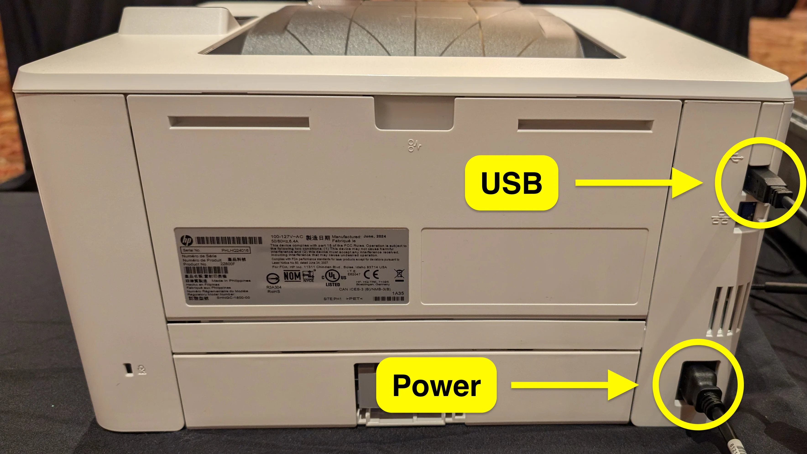
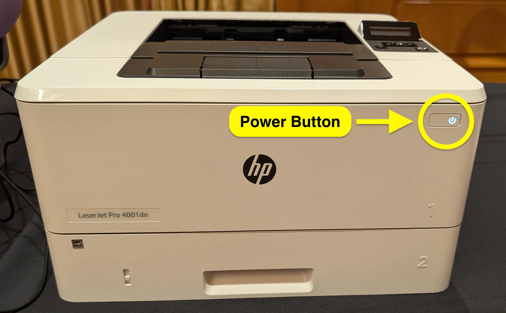

# VxMark Hardware Setup

**VxMark** has three primary components: the ballot-marking device (BMD) in a hard case, the printer, and a Goldenmate 1500VA/1000W uninterruptible power supply (UPS).

## VxMark Setup

* [ ] Place the VxMark case on a standard height table

<figure><figcaption></figcaption></figure>

* [ ] Open the VxMark case, breaking and documenting seals per the jurisdiction's procedures
* [ ] Tilt the screen forward and rotate it clockwise 90° so it faces the voter

<figure><figcaption></figcaption></figure> <figure><figcaption></figcaption></figure>

* [ ] Remove the headphones from the compartment to the left of the screen, plug them into the accessible controller, and hang them on the hook above the card reader
* [ ] Open the compartment on the back of the case by lifting the release knob behind the screen to reveal the power cable and printer USB cable

<figure><figcaption></figcaption></figure>

* [ ] Plug the VxMark power cable into the Goldenmate 1500VA/1000W UPS
* [ ] Plug the UPS into an outlet
* [ ] Turn the UPS on

## Printer Setup

* [ ] Remove the printer from its case and set it next to VxMark
* [ ] Connect the printer power cable to the printer
* [ ] Plug the printer power cable into the Goldenmate 1500VA/1000W UPS
* [ ] Connect the printer USB cable exiting the back of VxMark to the USB port on the printer
* [ ] Press the power button on the front of the printer

<figure><figcaption></figcaption></figure> <figure><figcaption></figcaption></figure>

