# Voting Session Language & Accessibility Settings

Voters have a number of options to change the VxMarkScan interface to suit their individual needs.

<figure>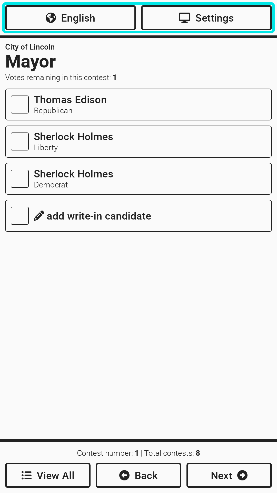<figcaption></figcaption></figure>

## Ballot Language

To change the language from English to another language:

* [ ] Select `English` at the top of the screen
* [ ] Select the preferred language from the language buttons that appear
* [ ] Select `Done`

<figure>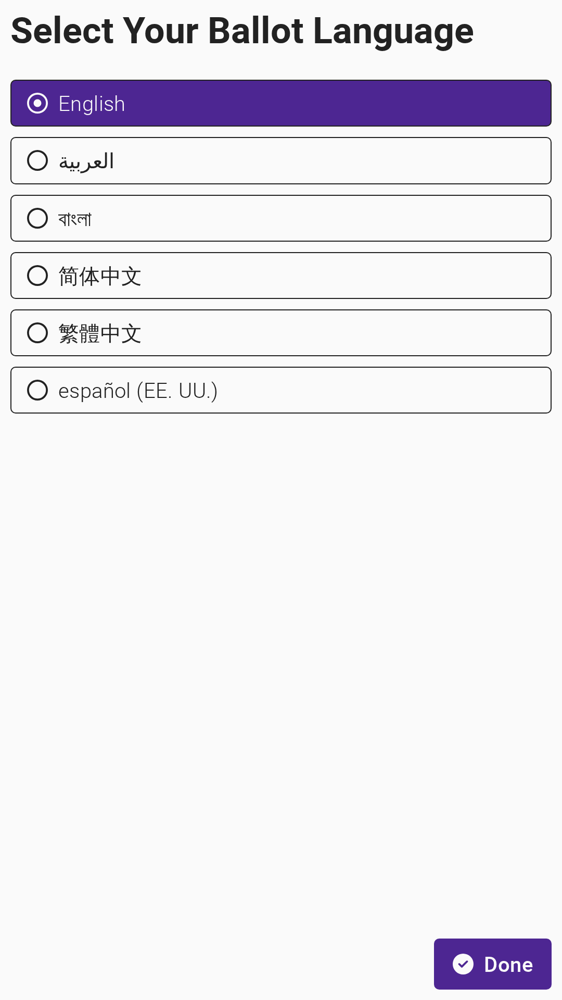<figcaption></figcaption></figure>

## Visual Settings

### Text and Screen Color

Four different color options are available to voters. The descriptions below say who may benefit most from each option, but the voter likely knows what setting is best for their disability.

* `White text, black background` - used by a person who finds white backgrounds too bright due to visual disabilities. May also be easier to read when room lighting causes a glare on the screen.
* `Gray text, dark background` - used by a person needing lower contrast. For example, a person with dyslexia may find the screen quieter.
* `Dark text, light background` - the default setting, used by most people.
* `Black text, white background` - used by people who need the highest contrast because of low vision or color perception disabilities or aging.

<figure>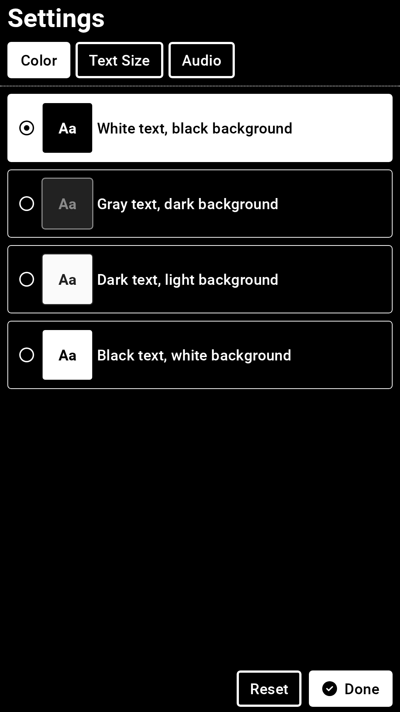<figcaption></figcaption></figure> <figure>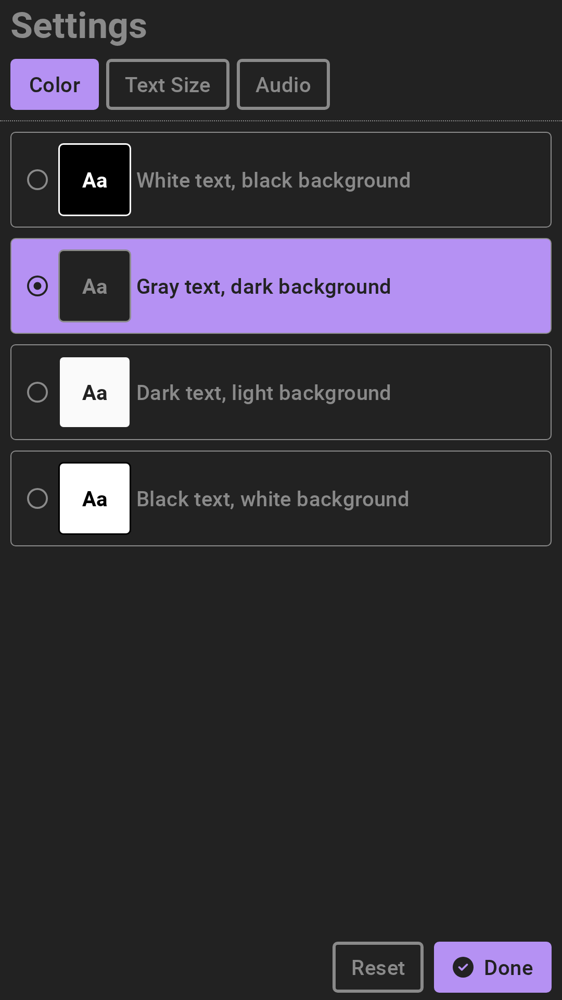<figcaption></figcaption></figure>

<figure>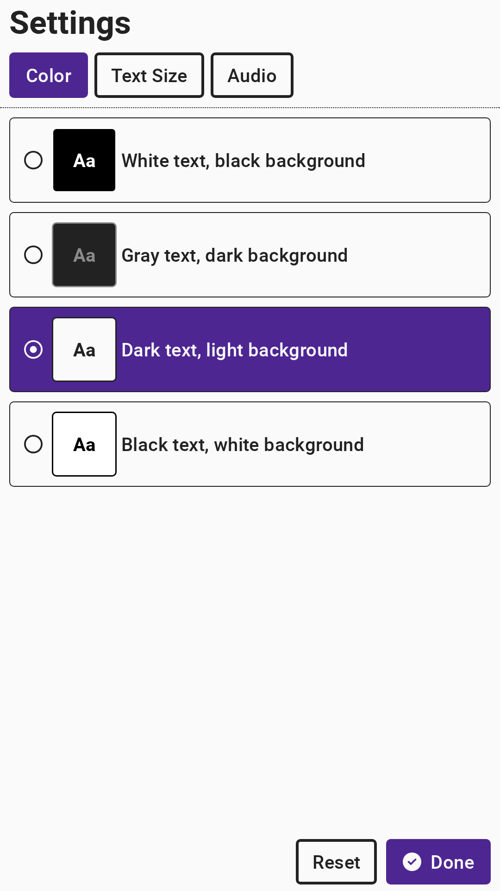<figcaption></figcaption></figure> <figure>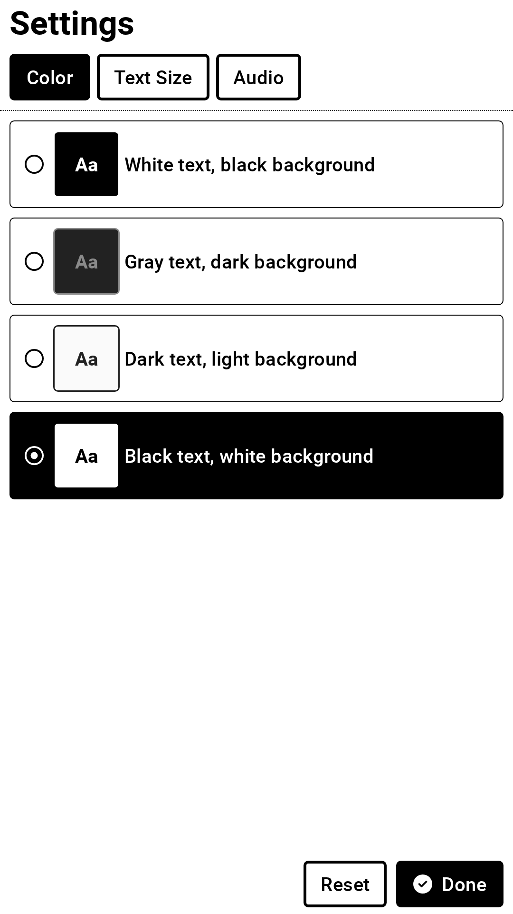<figcaption></figcaption></figure>

### Text Size

The default text size is `Medium`. A voter can select `Small`, `Large`, or `Extra-Large` based on their preferences. Select `Done` to save the selection.

<figure>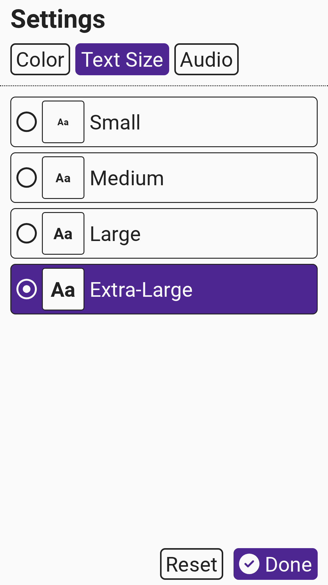<figcaption></figcaption></figure> <figure>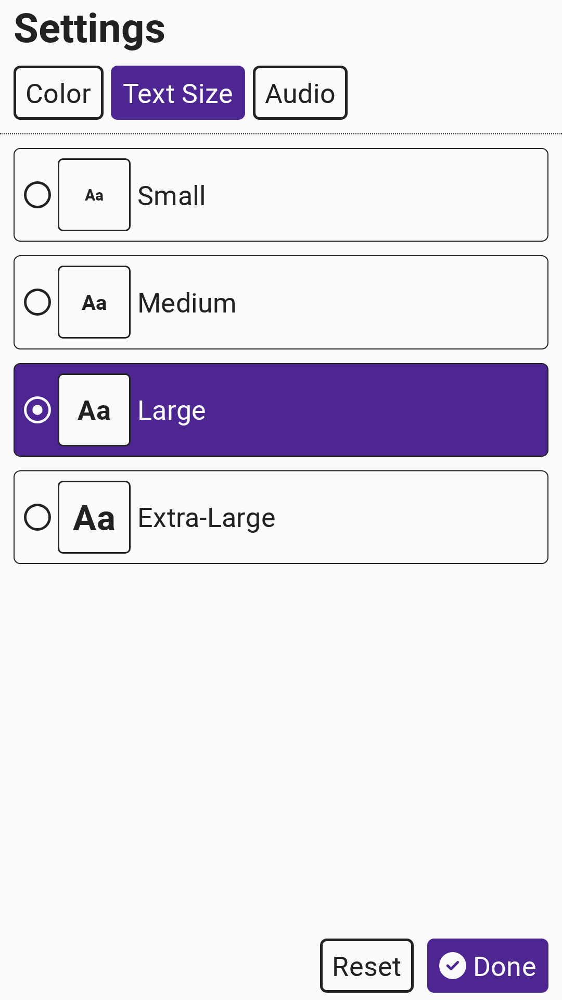<figcaption></figcaption></figure>

<figure>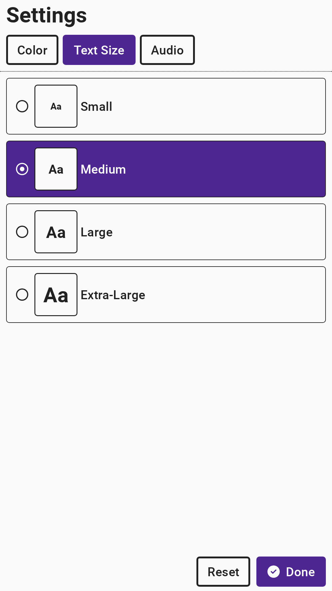<figcaption></figcaption></figure> <figure>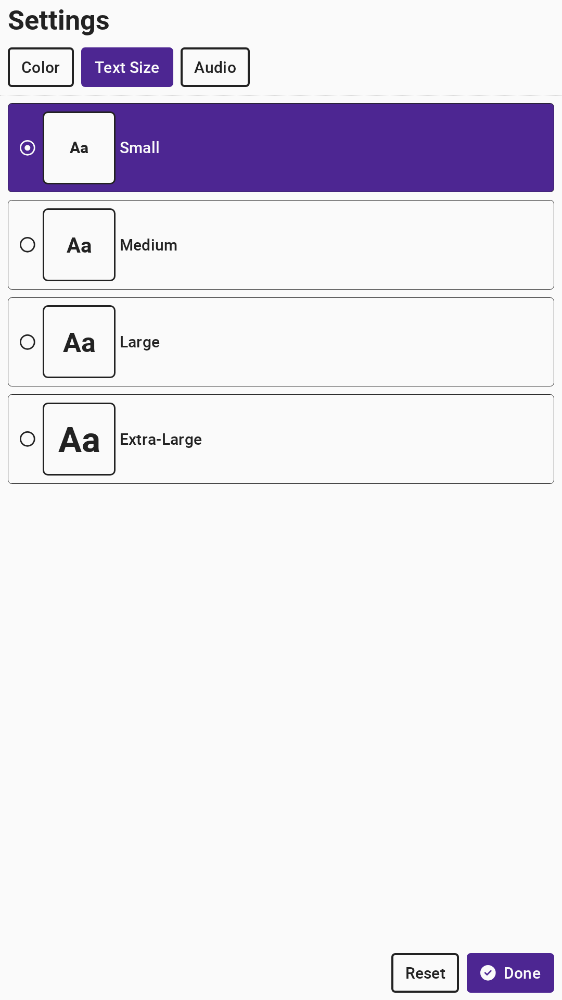<figcaption></figcaption></figure>

## Audio Settings

Audio is always on by default when headphones are plugged in. Instructions for all steps of the voting session are read to the voter in audio format, and all ballot content is read when the voter navigates to it.

Select `Mute Audio` to mute all sound. Select `Enable Audio-Only Mode` to hide the screen. Voters using only audio to navigate through the ballot may want to hide the screen for privacy. Additionally, a voter who has a T-coil neckloop may unplug the headphones and plug that device into the headphone jack.

Sanitize headphones after a voting session using the audio-tactile interface. To do so, discard the headphone ear covers and replace with a new set of ear covers. Disposable ear covers suitable for VxMarkScan are listed in the [Supply List](../miscellaneous/supply-list.md "mention").

<figure>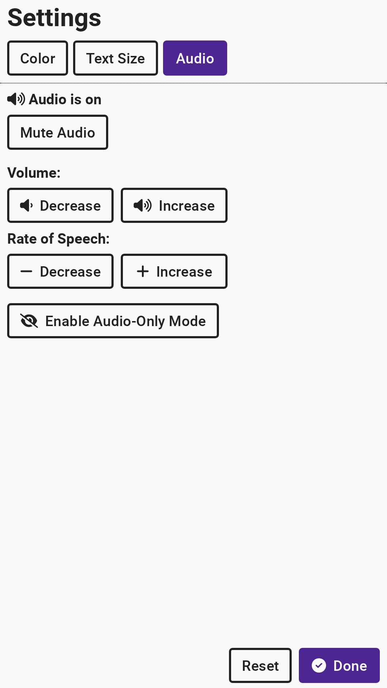<figcaption></figcaption></figure> <figure>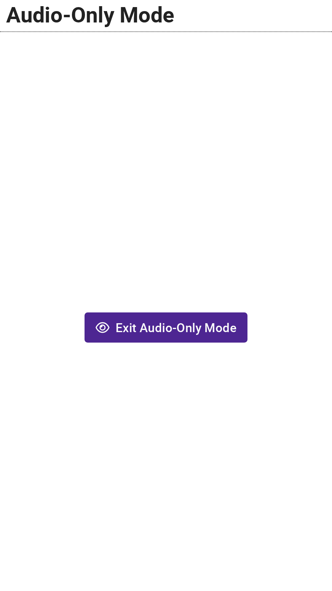<figcaption></figcaption></figure>


All selections above are made for a specific voting session and reset with the next voter.


## PAT Settings

VxMarkScan has a personal assistive technology (PAT) input port into which a voter can plug a dual-switch input such as a sip-and-puff device. When a PAT input is attached during a voting session, VxMarkScan enters a calibration flow where the voter maps their two inputs to "move" and "select." Different voters can calibrate their sip-and-puff devices differently such that sip is "move" for one and "select" for another. After calibration, a voter can access all VxMarkScan functionality throughout the voting session.

<figure>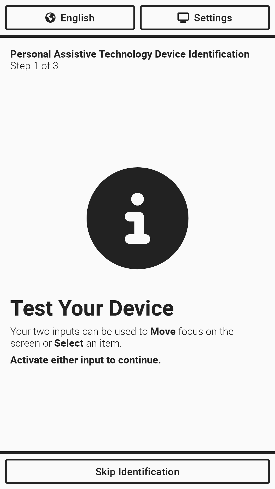<figcaption></figcaption></figure>
