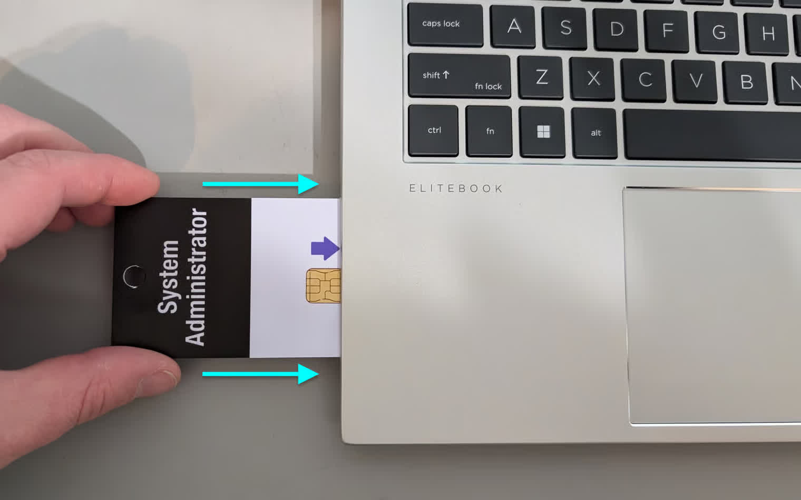
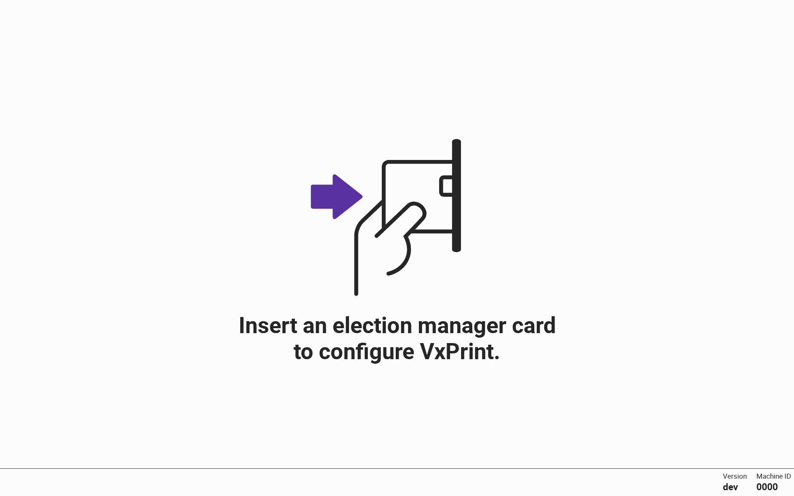
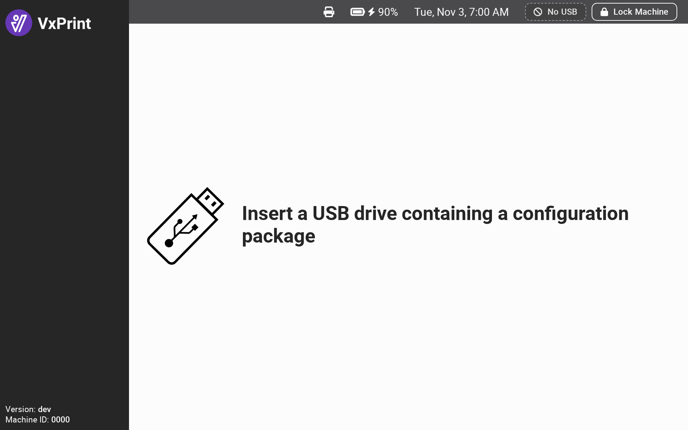
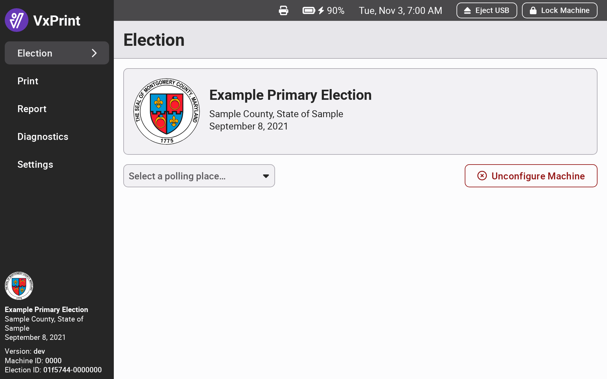
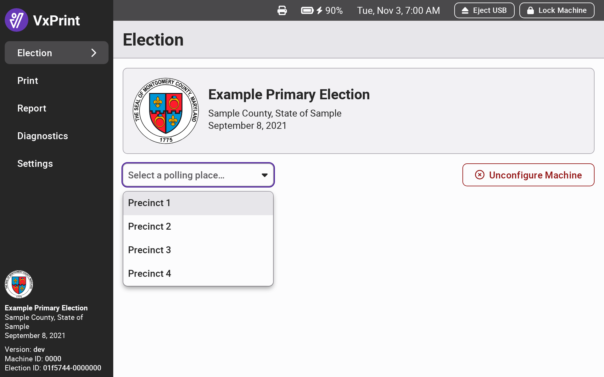
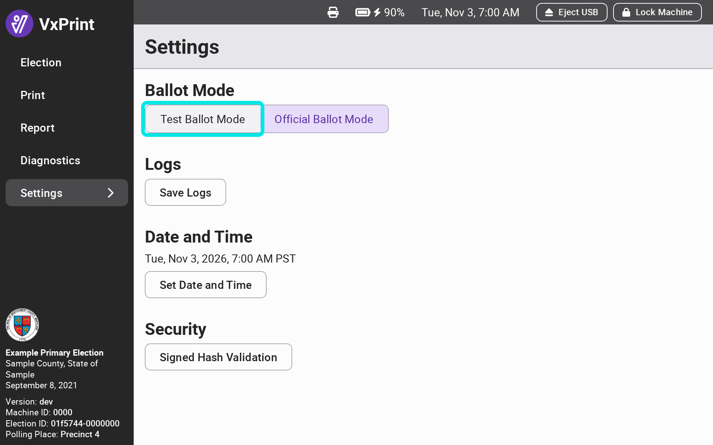
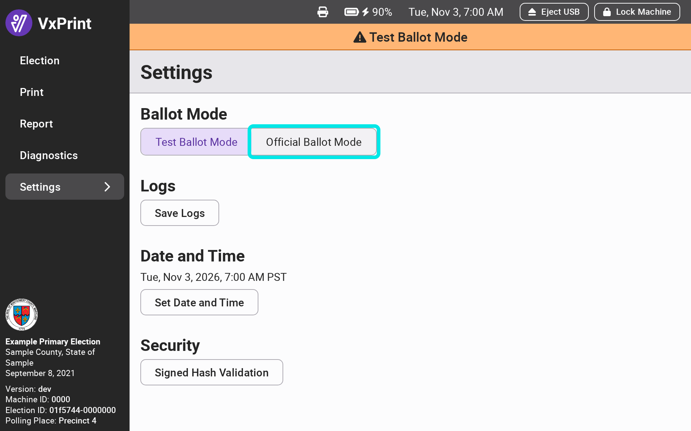
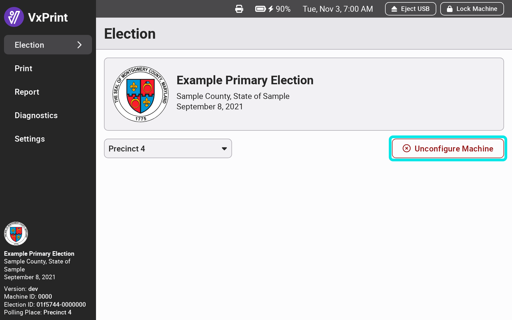
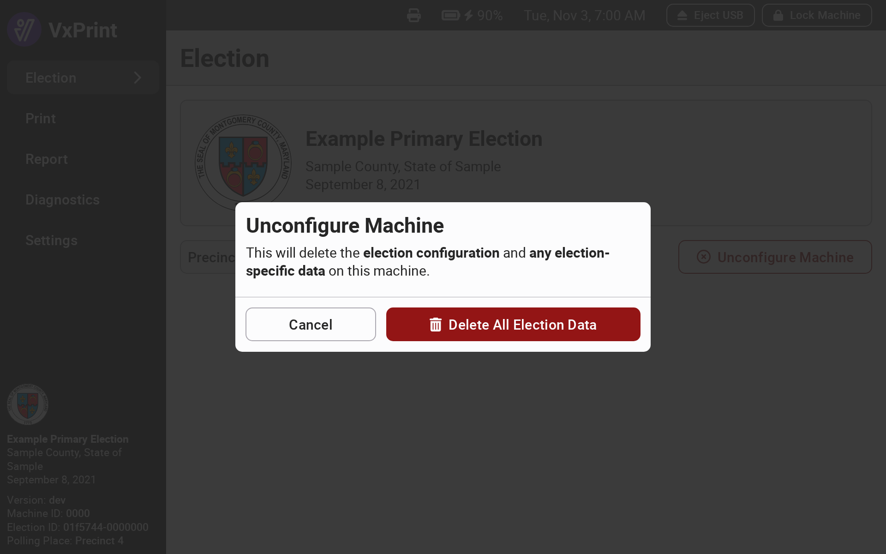
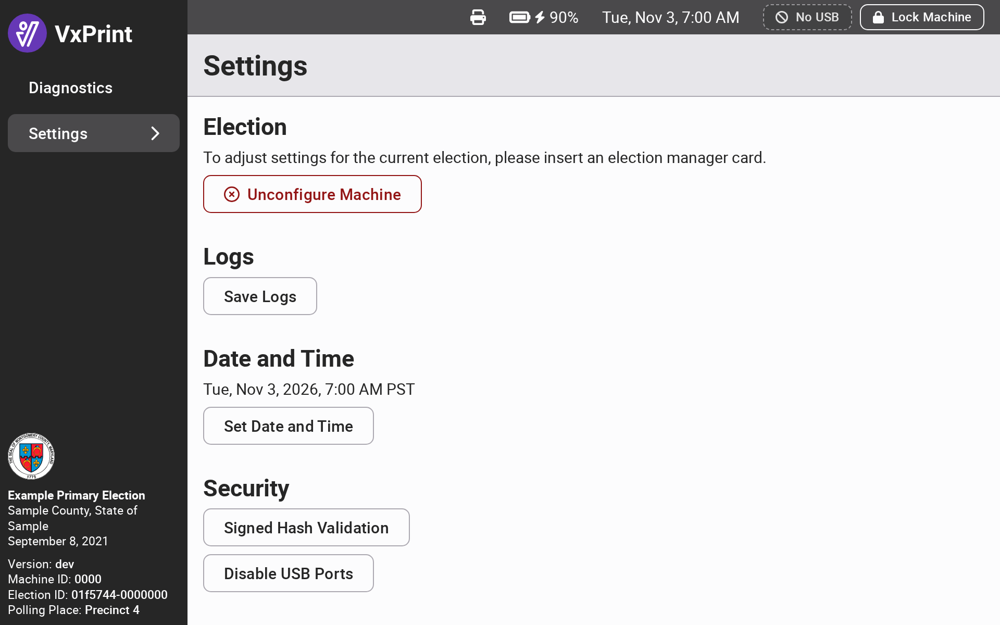

# Configure VxPrint


These steps must be completed by an election manager.


You can configure VxPrint without the printer unpacked and set up.

To configure VxPrint, you must do two things in VxAdmin:

* [ ] Save the election package to a USB drive (see [Save the Election Package](../vxadmin-system-setup/save-election-package.md "mention"))
* [ ] Create an election manager card (see [Smart Cards and User Roles](../vxadmin-system-setup/programming-cards.md "mention"))

## Insert Smart Cards

The smart card reader is located on the side of the laptop to the left of the trackpad. Insert a smart card with the chip facing up.

<figure><figcaption></figcaption></figure>

The picture above shows someone inserting a system administrator card into the laptop. To configure VxPrint, you need to insert an election manager card.

## Load the Election Package

An unconfigured machine prompts you to insert an election manager card to log in and then insert a USB drive with the election package saved from VxAdmin.

* [ ] Insert an election manager card
* [ ] Insert a USB drive with the election package saved from VxAdmin

After the USB drive is inserted, VxPrint automatically begins loading all ballot styles for the election. After the election package is done loading, the election information appears.

<figure><figcaption></figcaption></figure> <figure><figcaption></figcaption></figure> <figure><figcaption></figcaption></figure>

## Select a Polling Place

If the election has more than one polling place, an election manager must select one before VxPrint can print ballots. Until a polling place is selected, VxPrint prompts you to insert an election manager card to select a polling place. From the `Election` screen, use the `Select a polling place...` dropdown to choose the polling place for the device.

The selected polling place limits which ballot styles poll workers can print. Election managers can always print any ballot style.

<figure><figcaption></figcaption></figure>


If your election package defines only one polling place, it is selected automatically and the `Select a polling place...` dropdown isn't visible.


## Set the Ballot Mode

By default, VxPrint is in official ballot mode and all ballots printed are official ballots. If you intend to use VxPrint for testing with the rest of the voting system, navigate to the `Settings` page and use the toggle button to switch to `Test Ballot Mode`. In test ballot mode, all ballots printed are test ballots and a "Test Ballot Mode" banner displays in the top bar at all times.

<figure><figcaption></figcaption></figure> <figure><figcaption></figcaption></figure>

Switching ballot modes clears the ballot printed counts.


Remember to switch VxPrint back to official ballot mode after logic and accuracy testing is complete.


## Remove Configuration and Election Data

To remove the election configuration and all election data from VxPrint:

* [ ] Insert an election manager card
* [ ] Select `Unconfigure Machine`
* [ ] Confirm by selecting `Delete All Election Data`

<figure><figcaption></figcaption></figure> <figure><figcaption></figcaption></figure>

You can now configure VxPrint with a different election package.


The system administrator card can also be used to unconfigure the machine, which may be useful if the election manager card for a previous election is no longer available.


## System Administrator Settings 

The system administrator can always access the `Settings` page, regardless of the election that VxPrint is configured for or whether VxPrint is configured at all. The system administrator has the same `Settings` functionality as the election manager: saving logs, setting the date and time, and verifying the integrity of the software via `Signed Hash Validation`. The system administrator can always unconfigure the election. This is especially useful in the case where VxPrint is configured for a previous election but election manager cards programmed for the previous election are no longer available.

<figure><figcaption></figcaption></figure>
