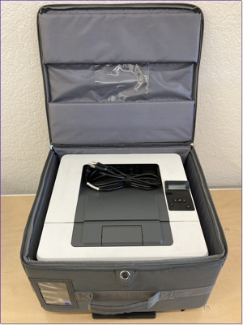
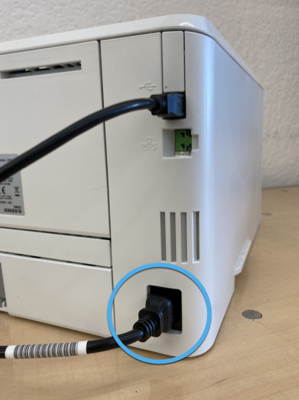
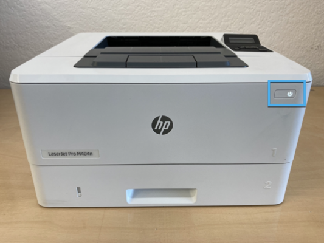
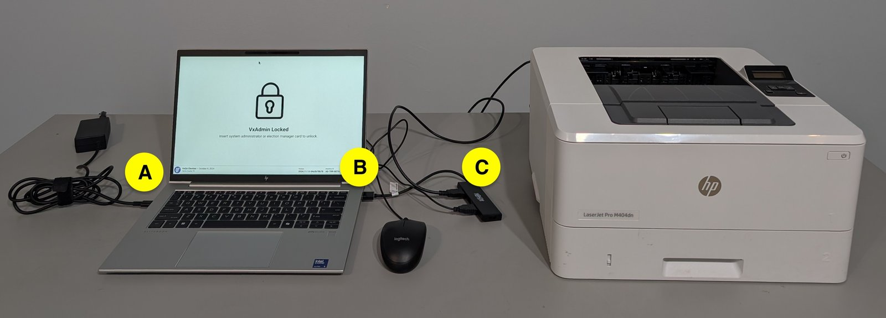

# VxPrint Hardware Setup

## Hardware Overview

VxPrint is a commercial off-the-shelf (COTS) laptop pre-installed with VotingWorks software alongside a COTS laser printer.

## Set Up VxPrint

1. **Unbox and set up the printer:**
   * [ ] Remove the printer and power cord from the case
   * [ ] Plug the power cord into the back of the printer
   * [ ] Plug the power cord into an outlet
   * [ ] Press the power button to turn the printer on
   * [ ] Load paper into the lower paper tray

   
<figure><figcaption></figcaption></figure> <figure><figcaption></figcaption></figure> <figure><figcaption></figcaption></figure>

2. **Set up the VxPrint laptop:**
   * [ ] Remove the laptop from the case
   * [ ] Document seals as necessary
   * [ ] Pull the power cord (A) out and plug into the laptop and an outlet
   * [ ] Pull the USB hub (B) out and plug into the laptop
   * [ ] Pull the printer cord (C) out and plug into the USB hub and the printer
   * [ ] Turn the laptop on

   <figure><figcaption></figcaption></figure>


An optional mouse is included. Plug it into the USB hub to use.



For printer troubleshooting — toner, print quality, paper type, and other issues — see the [HP Printer FAQs](../miscellaneous/hp-printer-faqs.md "mention").


## Pack Up VxPrint

To pack up VxPrint:

* [ ] Place all of the components back into the case as displayed above
* [ ] Secure the case as required by sealing the eyelets

\[screenshot]
