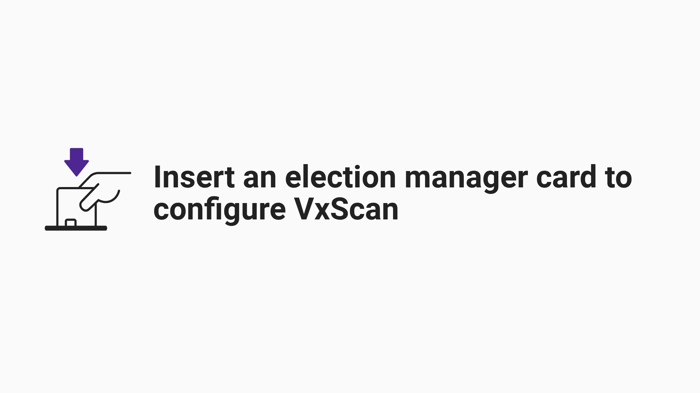
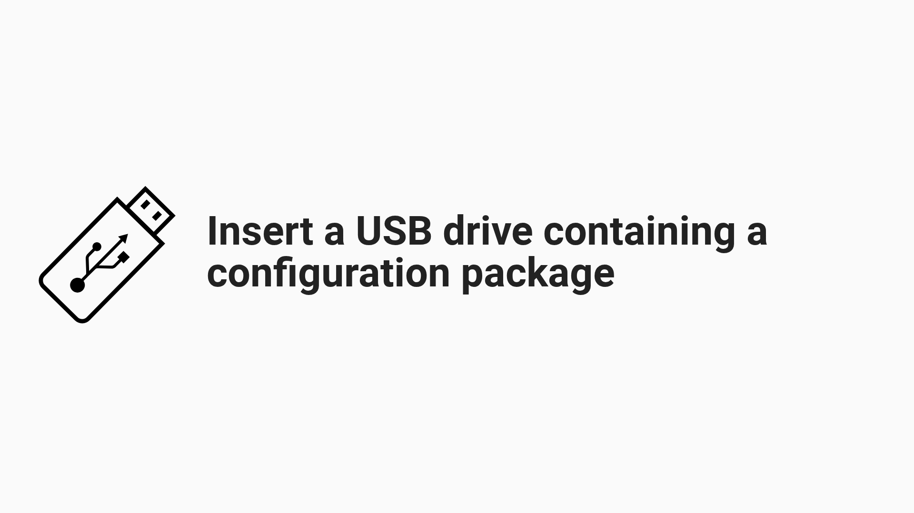
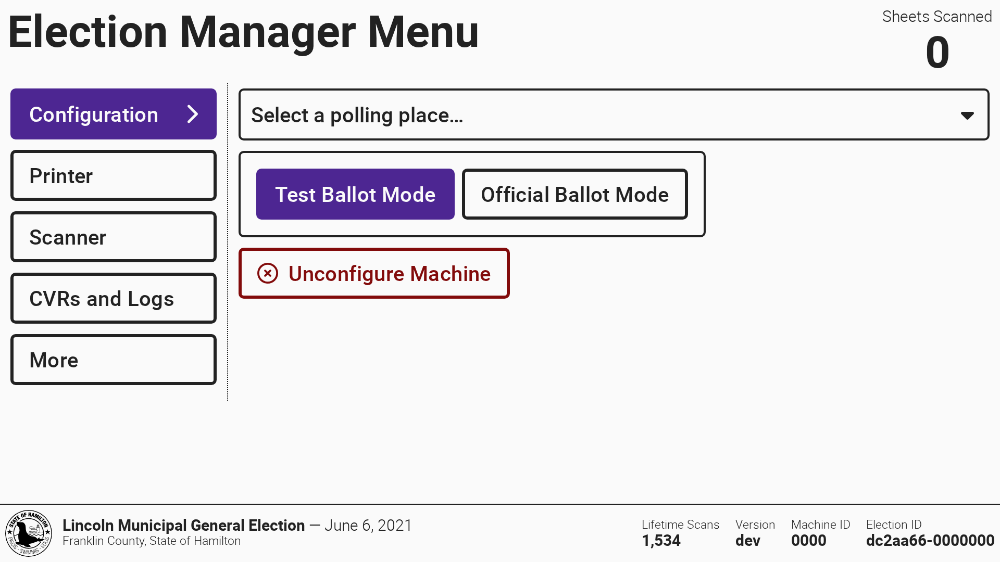
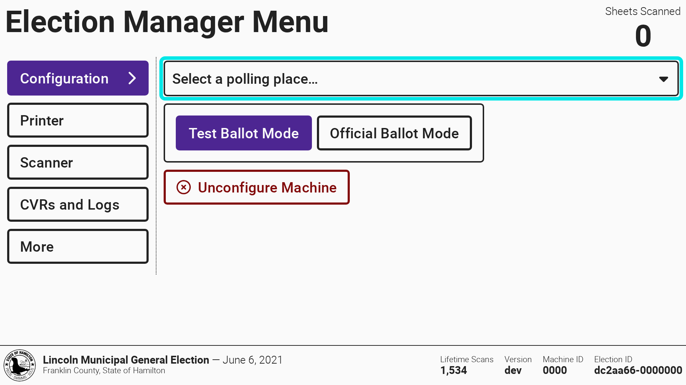
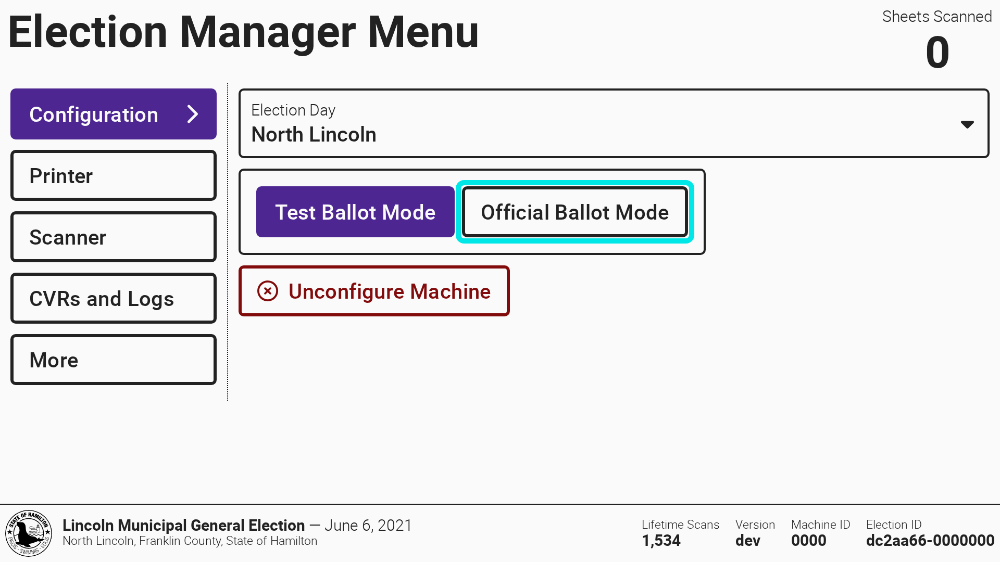
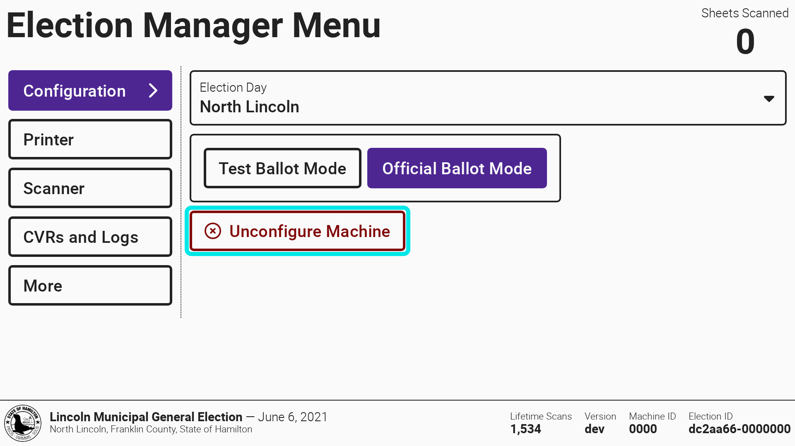
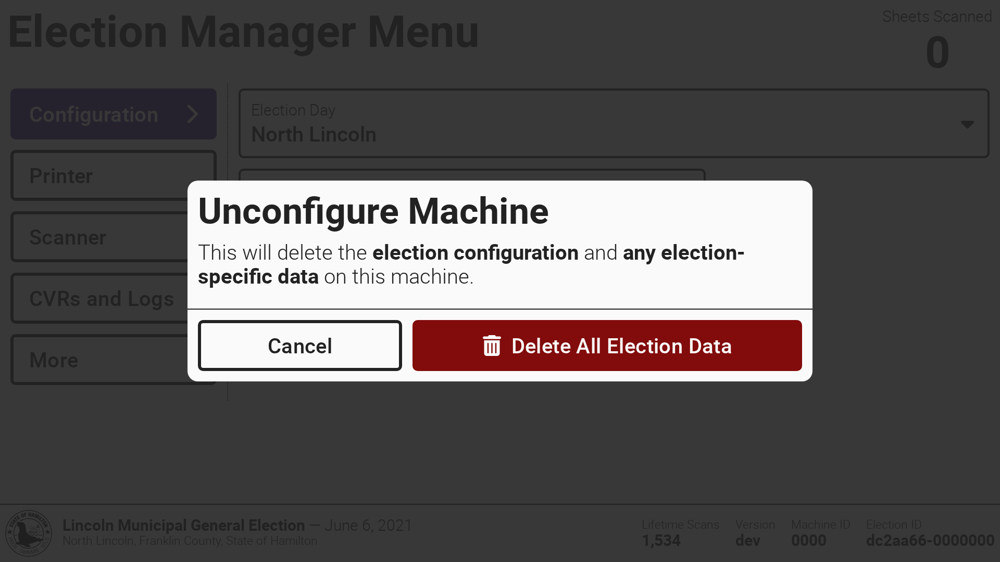
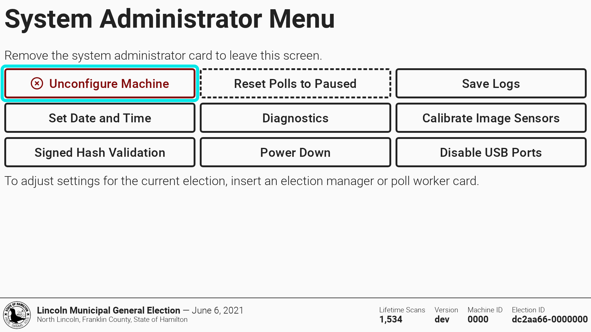

# Configure VxScan


These steps must be completed by an election manager.


Before you configure VxScan, you must set up the machine. Follow the steps in [Set Up VxScan](../election-day-guides/vxscan-setup.md "mention").

To configure VxScan, you must do two things in VxAdmin:

* [ ] Save the configuration package to a USB drive (see [Save the Configuration Package](../vxadmin-system-setup/save-election-package.md "mention"))
* [ ] Create an election manager card (see [Smart Cards and User Roles](../vxadmin-system-setup/programming-cards.md "mention"))

## Load the Configuration Package

An unconfigured machine prompts you to insert an election manager card to log in and then insert a USB drive with the configuration package saved from VxAdmin.

* [ ] Insert an election manager card
* [ ] Insert a USB drive with the configuration package saved from VxAdmin

<figure><figcaption></figcaption></figure> <figure><figcaption></figcaption></figure>


Only one USB drive should be plugged into VxScan at a time. The other USB port is designed as a backup in the event of a failure.


After the USB drive is inserted, VxScan automatically begins loading all ballot styles for the election. After the configuration package is done loading, the election manager menu appears and VxScan is in test ballot mode.

<figure><figcaption></figcaption></figure>

## Select a Polling Place

Use the `Select a polling place...` dropdown to choose a polling place.

<figure><figcaption></figcaption></figure>


If your election package defines only one polling place, there is no need to select one and the `Select a polling place...` dropdown isn't visible.


## Set the Ballot Mode

Use the toggle button to switch between `Test Ballot Mode` and `Official Ballot Mode`. The machine must be in official ballot mode on election day. Review the [L\&A Overview](../logic-and-accuracy-pre-election-testing/l-and-a-overview.md "mention") instructions to understand which mode to use during logic and accuracy (L&A) testing.

<figure><figcaption></figcaption></figure>

## Remove Configuration and Election Data

There are two ways to remove the election configuration and all election data from VxScan.

### Remove as an Election Manager

* [ ] Insert an election manager card
* [ ] Select `Unconfigure Machine`
* [ ] Confirm by selecting `Delete All Election Data`

<figure><figcaption></figcaption></figure> <figure><figcaption></figcaption></figure>

You can now configure VxScan with a different election package.

### Remove as a System Administrator

* [ ] Insert a system administrator card
* [ ] Select `Unconfigure Machine`
* [ ] Confirm by selecting `Delete All Election Data`

<figure><figcaption></figcaption></figure> <figure><figcaption></figcaption></figure>

You can now configure VxScan with a different election package.
